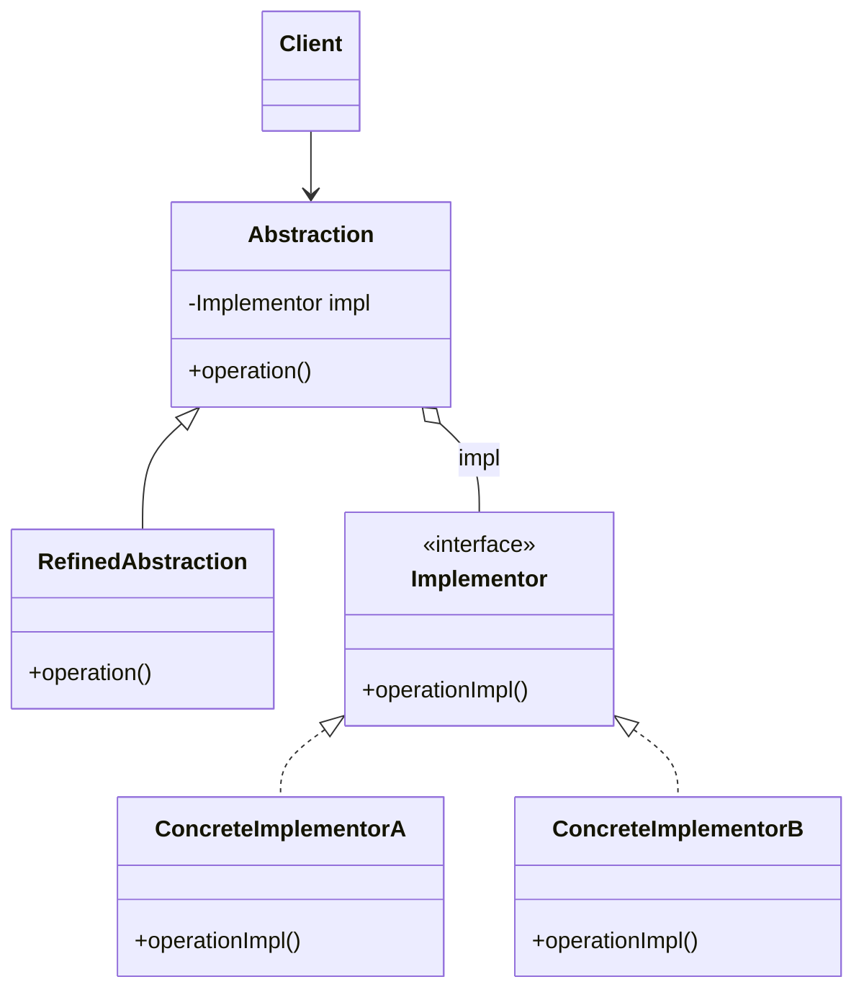

# Bridge

## Descrição

O Bridge desacopla uma abstração da sua implementação para que ambas possam variar de forma independente. Em vez de criar uma hierarquia única que combina todas as variações (por exemplo, `OneTimePixCharge`, `RecurringPixCharge`, `OneTimeBoletoCharge`...), o padrão separa o problema em duas hierarquias: a da **abstração** (o que o cliente usa) e a do **implementador** (como o trabalho de baixo nível é feito).

A abstração mantém uma referência para um objeto implementador e delega a ele as operações primitivas. Novas abstrações refinadas e novas implementações concretas podem ser adicionadas sem que uma afete a outra, e a implementação pode até ser trocada em tempo de execução.

Na prática, o Bridge troca herança por composição: a "ponte" é justamente a referência da abstração para a interface do implementador.

## Problemas que resolve

- Explosão combinatória de subclasses quando duas dimensões de variação (ex.: tipo de cobrança e trilho de liquidação) são modeladas em uma única hierarquia.
- Acoplamento permanente entre a abstração e uma implementação específica definido em tempo de compilação.
- Mudanças na implementação que forçam recompilação ou alteração do código cliente.
- Dificuldade de compartilhar uma mesma implementação entre várias abstrações.

## Quando usar

- Quando uma classe varia em duas (ou mais) dimensões ortogonais que devem evoluir de forma independente.
- Quando é necessário escolher ou trocar a implementação em tempo de execução (ex.: driver, backend de armazenamento, canal de envio).
- Quando se quer esconder detalhes de implementação dependentes de plataforma do código cliente.
- Ao projetar bibliotecas multiplataforma ou drivers (JDBC, renderizadores gráficos, provedores de nuvem).

## Quando evitar

- Quando existe apenas uma implementação e não há perspectiva real de outras; a indireção vira complexidade gratuita.
- Quando as duas dimensões não são de fato independentes e a abstração precisa conhecer detalhes de cada implementação.
- Em código pequeno e estável, onde uma hierarquia simples ou um Strategy pontual resolve.

## Trade-offs

| Ganho | Custo / Risco |
| --- | --- |
| Abstração e implementação evoluem independentemente | Mais classes e interfaces para entender |
| Evita explosão de subclasses (N + M em vez de N x M) | Indireção extra a cada chamada delegada |
| Implementação trocável em tempo de execução | Exige identificar as dimensões corretas logo no design |
| Respeita Open/Closed e Single Responsibility | A interface do implementador pode ficar genérica demais (menor denominador comum) |

- **Acoplamento:** o cliente depende apenas da abstração; implementações ficam isoladas.
- **Testabilidade:** o implementador pode ser substituído por um dublê de teste facilmente.
- **Complexidade:** costuma ser decidido no início do projeto; aplicá-lo depois exige refatoração significativa.
- **Desempenho:** custo de uma chamada indireta, normalmente desprezível.

## Diagrama



`Abstraction` define a interface usada pelo `Client` e mantém uma referência para um `Implementor`; `RefinedAbstraction` estende essa interface. `Implementor` declara as operações primitivas, realizadas por `ConcreteImplementorA` e `ConcreteImplementorB`.

## Exemplo

Um sistema de cobranças tem tipos de cobrança (avulsa, recorrente) e trilhos de liquidação (Pix, boleto, cartão). Com Bridge, cada cobrança delega a liquidação a um trilho, evitando classes como `RecurringPixCharge` e `OneTimeBoletoCharge`.

```typescript
interface SettlementRail {
  settle(reference: string, amountCents: number): void;
}

class PixRail implements SettlementRail {
  settle(reference: string, amountCents: number) { console.log(`Pix settled ${reference}: ${amountCents}`); }
}

class BoletoRail implements SettlementRail {
  settle(reference: string, amountCents: number) { console.log(`Boleto settled ${reference}: ${amountCents}`); }
}

class CardRail implements SettlementRail {
  settle(reference: string, amountCents: number) { console.log(`Card settled ${reference}: ${amountCents}`); }
}

abstract class Charge {
  constructor(protected rail: SettlementRail) {}
  abstract collect(reference: string, amountCents: number): void;
}

class OneTimeCharge extends Charge {
  collect(reference: string, amountCents: number) { this.rail.settle(reference, amountCents); }
}

class RecurringCharge extends Charge {
  constructor(rail: SettlementRail, private readonly cycles: number) { super(rail); }

  collect(reference: string, amountCents: number) {
    for (let n = 1; n <= this.cycles; n++) {
      this.rail.settle(`${reference}-${n}`, amountCents);
    }
  }
}

new OneTimeCharge(new PixRail()).collect("inv-12", 15_000);
new RecurringCharge(new CardRail(), 3).collect("sub-77", 4_990);
```

## Padrões relacionados

- [Adapter](/coding/gof/structural/adapter) — também envolve indireção entre interfaces, mas o Adapter é aplicado depois para compatibilizar classes existentes; o Bridge é planejado de antemão.
- [Abstract Factory](/coding/gof/creational/abstract-factory) — pode criar e configurar o par abstração/implementador adequado, escondendo a escolha da implementação concreta.
- [Strategy](/coding/gof/behavioral/strategy) — estrutura semelhante (composição + delegação), mas o Strategy foca em trocar algoritmos, enquanto o Bridge separa duas hierarquias estruturais.
- [State](/coding/gof/behavioral/state) — também delega comportamento a um objeto composto, porém a troca é dirigida pelo estado interno.
- [Builder](/coding/gof/creational/builder) — pode ser combinado com Bridge: o diretor atua como abstração e os builders como implementações.

## Referência

- [Design Patterns Cheat Sheet](https://iretha.github.io/design-patterns/cheat-sheet)
- [Bridge no Refactoring.Guru](https://refactoring.guru/design-patterns/bridge)
