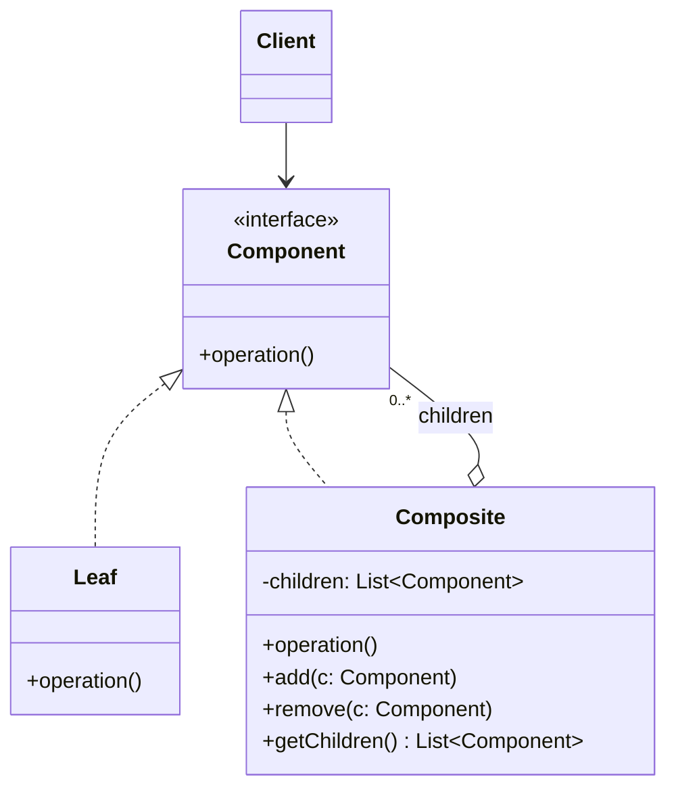

# Composite

## Descrição

O Composite compõe objetos em estruturas de árvore para representar hierarquias parte-todo. Ele permite que o cliente trate objetos individuais (folhas) e composições de objetos (nós com filhos) de maneira uniforme, por meio de uma interface comum.

A interface `Component` declara as operações compartilhadas. As folhas (`Leaf`) implementam o comportamento diretamente, enquanto os compostos (`Composite`) guardam uma coleção de filhos do tipo `Component` e delegam a operação a cada um deles, geralmente agregando os resultados. Como o composto também é um `Component`, a estrutura pode ser aninhada recursivamente em qualquer profundidade.

Com isso, o código cliente não precisa distinguir se está lidando com um elemento simples ou com um grupo: basta chamar a operação na raiz e a recursão percorre a árvore inteira.

## Problemas que resolve

- Código cliente cheio de verificações de tipo (`if` / `instanceof`) para diferenciar elementos simples de agrupamentos
- Necessidade de representar hierarquias recursivas (sistemas de arquivos, menus, organogramas, árvores de UI, expressões)
- Dificuldade de aplicar uma operação (calcular total, renderizar, validar) a uma estrutura inteira de forma recursiva
- Acoplamento do cliente à estrutura interna de agrupamentos de objetos

## Quando usar

- Quando o domínio tem uma estrutura naturalmente em árvore, com relação parte-todo
- Quando o cliente deve ignorar a diferença entre objetos individuais e composições
- Quando novas espécies de folhas ou compostos podem surgir sem alterar o código cliente

## Quando evitar

- Quando a estrutura é plana ou tem um único nível; uma simples lista basta
- Quando folhas e compostos têm comportamentos muito diferentes, tornando a interface comum artificial ou cheia de operações sem sentido para um dos lados
- Quando é necessário restringir rigidamente quais tipos de filhos um composto aceita (o sistema de tipos deixa de ajudar)

## Trade-offs

| Ganho | Custo / Risco |
| --- | --- |
| Cliente trata folhas e compostos de forma uniforme | Interface comum pode ficar genérica demais |
| Facilita adicionar novos tipos de componentes (Open/Closed) | Difícil restringir os tipos de filhos de um composto |
| Operações recursivas simples e elegantes | Operações de gerenciamento de filhos (`add`/`remove`) na folha violam segurança de tipos ou exigem verificações |
| Estruturas aninhadas de profundidade arbitrária | Árvores grandes podem ter custo de desempenho em travessias repetidas |

- **Transparência vs. segurança:** declarar `add`/`remove` em `Component` dá transparência ao cliente, mas obriga a folha a lançar erro ou ignorar a chamada; declará-los só em `Composite` é mais seguro, porém exige que o cliente conheça o tipo concreto.
- **Referência ao pai:** manter um ponteiro para o pai facilita navegação e remoção, mas adiciona complexidade de consistência.
- **Cache:** compostos podem guardar resultados agregados para evitar recálculos, desde que invalidem o cache quando filhos mudam.
- **Testabilidade:** cada folha pode ser testada isoladamente; compostos podem ser testados com folhas falsas.

## Diagrama



O `Client` depende apenas de `Component`. `Leaf` implementa a operação diretamente, e `Composite` agrega vários `Component` filhos, delegando a operação a cada um deles de forma recursiva.

## Exemplo

Em um sistema de arquivos, o tamanho de uma pasta é a soma dos tamanhos de seus arquivos e subpastas. O cliente calcula o tamanho de qualquer nó sem saber se é arquivo ou pasta.

```typescript
interface FileSystemNode {
  getName(): string;
  getSize(): number;
}

class File implements FileSystemNode {
  constructor(private name: string, private size: number) {}
  getName() { return this.name; }
  getSize() { return this.size; }
}

class Folder implements FileSystemNode {
  private children: FileSystemNode[] = [];
  constructor(private name: string) {}
  add(node: FileSystemNode) { this.children.push(node); return this; }
  remove(node: FileSystemNode) { this.children = this.children.filter(c => c !== node); }
  getName() { return this.name; }
  getSize() { return this.children.reduce((total, c) => total + c.getSize(), 0); }
}

const src = new Folder("src").add(new File("app.ts", 120)).add(new File("util.ts", 40));
const root = new Folder("project").add(src).add(new File("README.md", 10));

console.log(root.getSize()); // 170
```

## Padrões relacionados

- [Decorator](/coding/gof/structural/decorator) — tem estrutura recursiva semelhante, mas um decorador possui um único filho e adiciona responsabilidades, enquanto o Composite agrega vários filhos
- [Iterator](/coding/gof/behavioral/iterator) — usado para percorrer a árvore de componentes sem expor sua estrutura interna
- [Visitor](/coding/gof/behavioral/visitor) — permite aplicar novas operações sobre toda a árvore sem alterar as classes de `Leaf` e `Composite`
- [Chain of Responsibility](/coding/gof/behavioral/chain-of-responsibility) — costuma usar a referência ao pai do componente como sucessor na cadeia
- [Flyweight](/coding/gof/structural/flyweight) — folhas podem ser compartilhadas como flyweights para economizar memória em árvores grandes
- [Interpreter](/coding/gof/behavioral/interpreter) — a árvore sintática abstrata do Interpreter é uma aplicação do Composite
- [Builder](/coding/gof/creational/builder) — pode ser usado para construir árvores Composite complexas passo a passo
- [Command](/coding/gof/behavioral/command) — comandos de macro são compostos de outros comandos

## Referência

- [Design Patterns Cheat Sheet](https://iretha.github.io/design-patterns/cheat-sheet)
- [Composite no Refactoring.Guru](https://refactoring.guru/design-patterns/composite)
