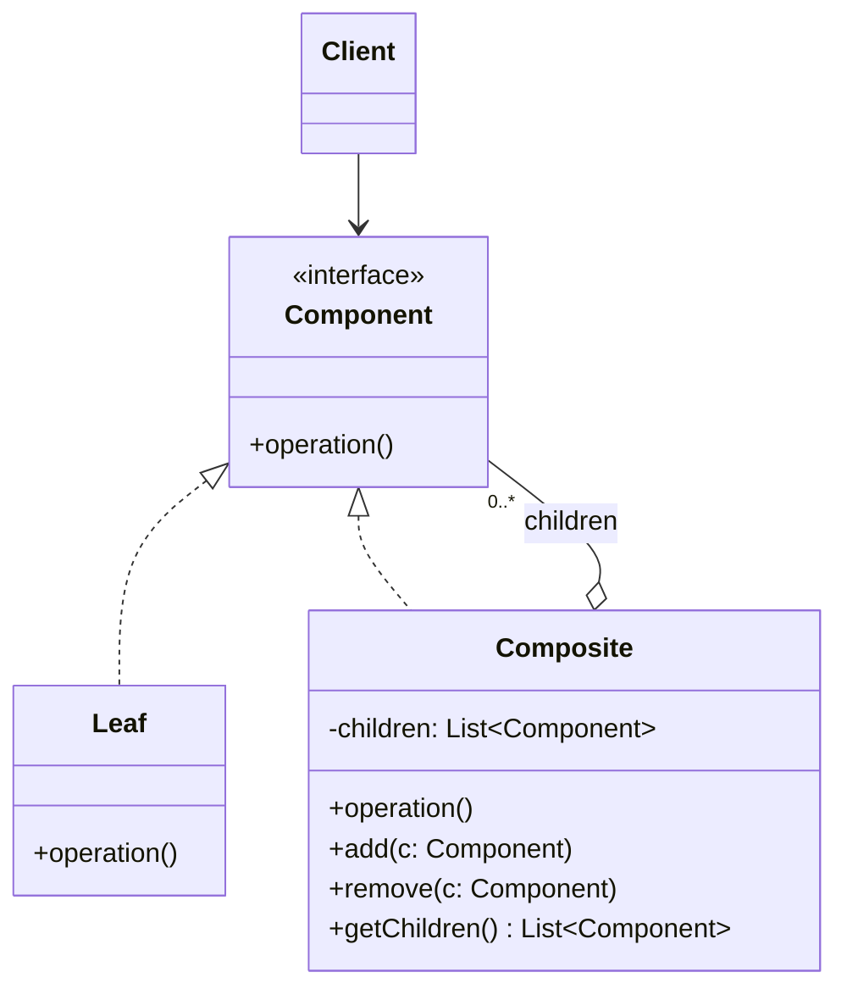

# Composite

## Descrição

O Composite compõe objetos em estruturas de árvore para representar hierarquias parte-todo. Ele permite que o cliente trate objetos individuais (folhas) e composições de objetos (nós com filhos) de maneira uniforme, por meio de uma interface comum.

A interface `Component` declara as operações compartilhadas. As folhas (`Leaf`) implementam o comportamento diretamente, enquanto os compostos (`Composite`) guardam uma coleção de filhos do tipo `Component` e delegam a operação a cada um deles, geralmente agregando os resultados. Como o composto também é um `Component`, a estrutura pode ser aninhada recursivamente em qualquer profundidade.

Com isso, o código cliente não precisa distinguir se está lidando com um elemento simples ou com um grupo: basta chamar a operação na raiz e a recursão percorre a árvore inteira.

## Problemas que resolve

- Código cliente cheio de verificações de tipo (`if` / `instanceof`) para diferenciar elementos simples de agrupamentos
- Necessidade de representar hierarquias recursivas (sistemas de arquivos, menus, organogramas, árvores de UI, expressões)
- Dificuldade de aplicar uma operação (calcular total, renderizar, validar) a uma estrutura inteira de forma recursiva
- Acoplamento do cliente à estrutura interna de agrupamentos de objetos

## Quando usar

- Quando o domínio tem uma estrutura naturalmente em árvore, com relação parte-todo
- Quando o cliente deve ignorar a diferença entre objetos individuais e composições
- Quando novas espécies de folhas ou compostos podem surgir sem alterar o código cliente

## Quando evitar

- Quando a estrutura é plana ou tem um único nível; uma simples lista basta
- Quando folhas e compostos têm comportamentos muito diferentes, tornando a interface comum artificial ou cheia de operações sem sentido para um dos lados
- Quando é necessário restringir rigidamente quais tipos de filhos um composto aceita (o sistema de tipos deixa de ajudar)

## Trade-offs

| Ganho | Custo / Risco |
| --- | --- |
| Cliente trata folhas e compostos de forma uniforme | Interface comum pode ficar genérica demais |
| Facilita adicionar novos tipos de componentes (Open/Closed) | Difícil restringir os tipos de filhos de um composto |
| Operações recursivas simples e elegantes | Operações de gerenciamento de filhos (`add`/`remove`) na folha violam segurança de tipos ou exigem verificações |
| Estruturas aninhadas de profundidade arbitrária | Árvores grandes podem ter custo de desempenho em travessias repetidas |

- **Transparência vs. segurança:** declarar `add`/`remove` em `Component` dá transparência ao cliente, mas obriga a folha a lançar erro ou ignorar a chamada; declará-los só em `Composite` é mais seguro, porém exige que o cliente conheça o tipo concreto.
- **Referência ao pai:** manter um ponteiro para o pai facilita navegação e remoção, mas adiciona complexidade de consistência.
- **Cache:** compostos podem guardar resultados agregados para evitar recálculos, desde que invalidem o cache quando filhos mudam.
- **Testabilidade:** cada folha pode ser testada isoladamente; compostos podem ser testados com folhas falsas.

## Diagrama



O `Client` depende apenas de `Component`. `Leaf` implementa a operação diretamente, e `Composite` agrega vários `Component` filhos, delegando a operação a cada um deles de forma recursiva.

## Exemplo

Uma carteira de investimentos contém ativos e subcarteiras, como "Reserva" e "Aposentadoria". O valor atual de uma carteira é a soma dos valores de seus itens, e o cliente pede o valor de qualquer nó sem saber se é um ativo ou uma carteira. Valores ilustrativos.

<Tabs groupId="lang" queryString>
<TabItem value="java" label="Java">

```java
record Money(long cents) {
    Money plus(Money other) { return new Money(cents + other.cents); }
}

interface Holding {
    String getName();
    Money currentValue();
}

record Asset(String name, Money value) implements Holding {
    public String getName() { return name; }
    public Money currentValue() { return value; }
}

class Portfolio implements Holding {
    private final String name;
    private final List<Holding> children = new ArrayList<>();

    Portfolio(String name) { this.name = name; }

    Portfolio add(Holding holding) { children.add(holding); return this; }
    void remove(Holding holding) { children.remove(holding); }

    public String getName() { return name; }
    public Money currentValue() {
        return children.stream().map(Holding::currentValue).reduce(new Money(0), Money::plus);
    }
}

Portfolio reserve = new Portfolio("Reserva").add(new Asset("CDB Liquidez Diária", new Money(2_000_000)));
Portfolio retirement = new Portfolio("Aposentadoria")
    .add(new Asset("CDB 2029", new Money(1_500_000)))
    .add(new Asset("Fundo Multimercado", new Money(800_000)));
Portfolio portfolio = new Portfolio("Carteira").add(reserve).add(retirement);

System.out.println(portfolio.currentValue().cents()); // 4300000 (R$ 43.000,00)
```

</TabItem>
<TabItem value="python" label="Python">

```python
from __future__ import annotations

from dataclasses import dataclass
from typing import Protocol

@dataclass(frozen=True)
class Money:
    cents: int

    def __add__(self, other: Money) -> Money:
        return Money(self.cents + other.cents)

class Holding(Protocol):
    name: str

    def current_value(self) -> Money: ...

@dataclass(frozen=True)
class Asset:
    name: str
    value: Money

    def current_value(self) -> Money:
        return self.value

class Portfolio:
    def __init__(self, name: str) -> None:
        self.name = name
        self._children: list[Holding] = []

    def add(self, holding: Holding) -> Portfolio:
        self._children.append(holding)
        return self

    def remove(self, holding: Holding) -> None:
        self._children.remove(holding)

    def current_value(self) -> Money:
        return sum((child.current_value() for child in self._children), Money(0))

reserve = Portfolio("Reserva").add(Asset("CDB Liquidez Diária", Money(2_000_000)))
retirement = (
    Portfolio("Aposentadoria")
    .add(Asset("CDB 2029", Money(1_500_000)))
    .add(Asset("Fundo Multimercado", Money(800_000)))
)
portfolio = Portfolio("Carteira").add(reserve).add(retirement)

print(portfolio.current_value().cents)  # 4300000 (R$ 43.000,00)
```

</TabItem>
<TabItem value="go" label="Go">

```go
type Money struct{ Cents int64 }

func (m Money) Plus(other Money) Money { return Money{m.Cents + other.Cents} }

type Holding interface {
	Name() string
	CurrentValue() Money
}

type Asset struct {
	name  string
	value Money
}

func (a Asset) Name() string        { return a.name }
func (a Asset) CurrentValue() Money { return a.value }

type Portfolio struct {
	name     string
	children []Holding
}

func NewPortfolio(name string) *Portfolio { return &Portfolio{name: name} }

func (p *Portfolio) Add(holding Holding) *Portfolio {
	p.children = append(p.children, holding)
	return p
}

func (p *Portfolio) Remove(holding Holding) {
	p.children = slices.DeleteFunc(p.children, func(c Holding) bool { return c == holding })
}

func (p *Portfolio) Name() string { return p.name }

func (p *Portfolio) CurrentValue() Money {
	total := Money{}
	for _, child := range p.children {
		total = total.Plus(child.CurrentValue())
	}
	return total
}

func main() {
	reserve := NewPortfolio("Reserva").Add(Asset{"CDB Liquidez Diária", Money{2_000_000}})
	retirement := NewPortfolio("Aposentadoria").
		Add(Asset{"CDB 2029", Money{1_500_000}}).
		Add(Asset{"Fundo Multimercado", Money{800_000}})
	portfolio := NewPortfolio("Carteira").Add(reserve).Add(retirement)

	fmt.Println(portfolio.CurrentValue().Cents) // 4300000 (R$ 43.000,00)
}
```

</TabItem>
<TabItem value="typescript" label="TypeScript">

```typescript
class Money {
  constructor(readonly cents: number) {}
  plus(other: Money): Money { return new Money(this.cents + other.cents); }
}

interface Holding {
  getName(): string;
  currentValue(): Money;
}

class Asset implements Holding {
  constructor(private name: string, private value: Money) {}
  getName() { return this.name; }
  currentValue() { return this.value; }
}

class Portfolio implements Holding {
  private children: Holding[] = [];
  constructor(private name: string) {}
  add(holding: Holding) { this.children.push(holding); return this; }
  remove(holding: Holding) { this.children = this.children.filter(c => c !== holding); }
  getName() { return this.name; }
  currentValue() {
    return this.children.reduce((total, c) => total.plus(c.currentValue()), new Money(0));
  }
}

const reserve = new Portfolio("Reserva").add(new Asset("CDB Liquidez Diária", new Money(2_000_000)));
const retirement = new Portfolio("Aposentadoria")
  .add(new Asset("CDB 2029", new Money(1_500_000)))
  .add(new Asset("Fundo Multimercado", new Money(800_000)));
const portfolio = new Portfolio("Carteira").add(reserve).add(retirement);

console.log(portfolio.currentValue().cents); // 4300000 (R$ 43.000,00)
```

</TabItem>
</Tabs>

## Padrões relacionados

- [Decorator](/coding/gof/structural/decorator) — tem estrutura recursiva semelhante, mas um decorador possui um único filho e adiciona responsabilidades, enquanto o Composite agrega vários filhos
- [Iterator](/coding/gof/behavioral/iterator) — usado para percorrer a árvore de componentes sem expor sua estrutura interna
- [Visitor](/coding/gof/behavioral/visitor) — permite aplicar novas operações sobre toda a árvore sem alterar as classes de `Leaf` e `Composite` (a mesma carteira de investimentos serve de exemplo ali, com operações como imposto e informe de rendimentos)
- [Chain of Responsibility](/coding/gof/behavioral/chain-of-responsibility) — costuma usar a referência ao pai do componente como sucessor na cadeia
- [Flyweight](/coding/gof/structural/flyweight) — folhas podem ser compartilhadas como flyweights para economizar memória em árvores grandes
- [Interpreter](/coding/gof/behavioral/interpreter) — a árvore sintática abstrata do Interpreter é uma aplicação do Composite
- [Builder](/coding/gof/creational/builder) — pode ser usado para construir árvores Composite complexas passo a passo
- [Command](/coding/gof/behavioral/command) — comandos de macro são compostos de outros comandos

## Referência

- [Design Patterns Cheat Sheet](https://iretha.github.io/design-patterns/cheat-sheet)
- [Composite no Refactoring.Guru](https://refactoring.guru/design-patterns/composite)
