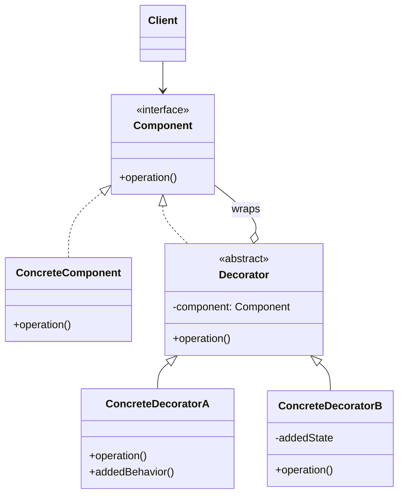

# Decorator

## Descrição

O Decorator permite adicionar responsabilidades a um objeto de forma dinâmica, em tempo de execução, sem alterar sua classe e sem recorrer à herança. Ele oferece uma alternativa flexível à criação de subclasses para estender funcionalidades.

A ideia é "embrulhar" o objeto original em outro objeto (o decorador) que implementa a mesma interface. O decorador mantém uma referência ao componente embrulhado, delega a ele as chamadas e acrescenta comportamento antes ou depois dessa delegação. Como o decorador tem a mesma interface do componente, o cliente não percebe a diferença.

Decoradores podem ser empilhados: cada camada adiciona um comportamento, e a ordem de composição determina o resultado final. Isso permite combinar funcionalidades livremente, em vez de criar uma subclasse para cada combinação possível.

## Problemas que resolve

- Explosão de subclasses para representar todas as combinações de funcionalidades opcionais (ex.: `CompressedEncryptedBufferedStream`).
- Necessidade de adicionar ou remover comportamento de objetos individuais em tempo de execução, sem afetar outras instâncias da mesma classe.
- Estender classes que não podem ser modificadas ou herdadas (ex.: classes `final`/`sealed` ou de bibliotecas de terceiros).
- Separar preocupações transversais (log, cache, métricas, retry) da lógica principal.

## Quando usar

- Quando é preciso adicionar responsabilidades a objetos de forma transparente e dinâmica.
- Quando as extensões são opcionais e combináveis entre si.
- Quando a herança é impraticável, seja por gerar muitas subclasses, seja por a classe não permitir extensão.
- Para aplicar comportamentos transversais (logging, cache, autorização, compressão) mantendo o Single Responsibility Principle.

## Quando evitar

- Quando o cliente depende da identidade ou do tipo concreto do objeto (o decorador é um objeto diferente do componente embrulhado).
- Quando a interface do componente é muito extensa, obrigando cada decorador a delegar dezenas de métodos.
- Quando há apenas uma extensão fixa e estável, em que uma subclasse simples ou uma alteração direta é mais clara.
- Quando a ordem dos decoradores importa muito e é difícil de controlar, gerando comportamentos inesperados.

## Trade-offs

| Ganho | Custo / Risco |
| --- | --- |
| Estende comportamento sem modificar a classe original (Open/Closed) | Muitos objetos pequenos e parecidos, dificultando a leitura |
| Combina funcionalidades em tempo de execução | A ordem de empilhamento afeta o resultado e pode gerar bugs sutis |
| Evita explosão de subclasses | Comparações de identidade e checagens de tipo deixam de funcionar |
| Cada decorador tem uma única responsabilidade | Depuração mais difícil por causa das várias camadas de delegação |

- **Acoplamento:** baixo; decoradores dependem apenas da interface do componente.
- **Testabilidade:** alta; cada decorador pode ser testado isoladamente com um componente falso.
- **Complexidade:** a montagem da cadeia costuma ser delegada a uma factory ou a um container de injeção de dependência.
- **Desempenho:** cada camada acrescenta uma chamada indireta, geralmente com custo desprezível.

## Diagrama



`Component` define a interface comum; `ConcreteComponent` é o objeto base. `Decorator` implementa a mesma interface e guarda uma referência a um `Component`, delegando a ele as chamadas; `ConcreteDecoratorA` e `ConcreteDecoratorB` acrescentam comportamento antes ou depois dessa delegação. O `Client` trabalha apenas com `Component`.

## Exemplo

O serviço de transferência básico só movimenta o dinheiro. Antifraude, limite noturno e trilha de auditoria são camadas empilhadas conforme o tipo de conta, em vez de uma subclasse para cada combinação. Os limites são ilustrativos.

```typescript
interface TransferRequest {
  fromAccountId: string;
  toKey: string;
  amountCents: number;
  at: Date;
}

interface TransferService {
  transfer(request: TransferRequest): void;
}

class BasicTransferService implements TransferService {
  transfer(request: TransferRequest): void {
    console.log(`Transferindo ${request.amountCents} -> ${request.toKey}`);
  }
}

abstract class TransferDecorator implements TransferService {
  constructor(protected wrapped: TransferService) {}
  transfer(request: TransferRequest): void {
    this.wrapped.transfer(request);
  }
}

class FraudCheckDecorator extends TransferDecorator {
  transfer(request: TransferRequest): void {
    if (request.amountCents > 5_000_000) throw new Error("Bloqueado pelo antifraude");
    super.transfer(request);
  }
}

class NightLimitDecorator extends TransferDecorator {
  transfer(request: TransferRequest): void {
    const hour = request.at.getHours();
    const isNight = hour >= 20 || hour < 6;
    if (isNight && request.amountCents > 100_000) throw new Error("Limite noturno excedido");
    super.transfer(request);
  }
}

class AuditDecorator extends TransferDecorator {
  transfer(request: TransferRequest): void {
    console.log(`Audit: ${request.fromAccountId} transfere ${request.amountCents}`);
    super.transfer(request);
  }
}

const service: TransferService = new AuditDecorator(
  new NightLimitDecorator(new FraudCheckDecorator(new BasicTransferService())),
);
service.transfer({
  fromAccountId: "acc-1",
  toKey: "ana@example.com",
  amountCents: 50_000,
  at: new Date("2026-03-10T23:30:00"),
}); // auditoria, limite noturno e antifraude aprovam; R$ 500,00 transferidos
```

## Padrões relacionados

- [Adapter](/coding/gof/structural/adapter) — o Adapter altera a interface de um objeto; o Decorator mantém a interface e acrescenta responsabilidades.
- [Composite](/coding/gof/structural/composite) — estrutura semelhante (composição recursiva), mas o Decorator tem um único filho e foca em adicionar comportamento, não em agregar resultados.
- [Proxy](/coding/gof/structural/proxy) — mesma estrutura de embrulho, mas o Proxy controla o acesso ao objeto e normalmente gerencia seu ciclo de vida, enquanto o Decorator é composto pelo cliente para estender comportamento.
- [Strategy](/coding/gof/behavioral/strategy) — o Decorator muda a "casca" do objeto; o Strategy muda suas "entranhas", trocando o algoritmo interno.
- [Chain of Responsibility](/coding/gof/behavioral/chain-of-responsibility) — também encadeia objetos, mas um elo pode interromper o fluxo, enquanto decoradores normalmente sempre delegam.

## Referência

- [Design Patterns Cheat Sheet](https://iretha.github.io/design-patterns/cheat-sheet)
- [Decorator no Refactoring.Guru](https://refactoring.guru/design-patterns/decorator)
