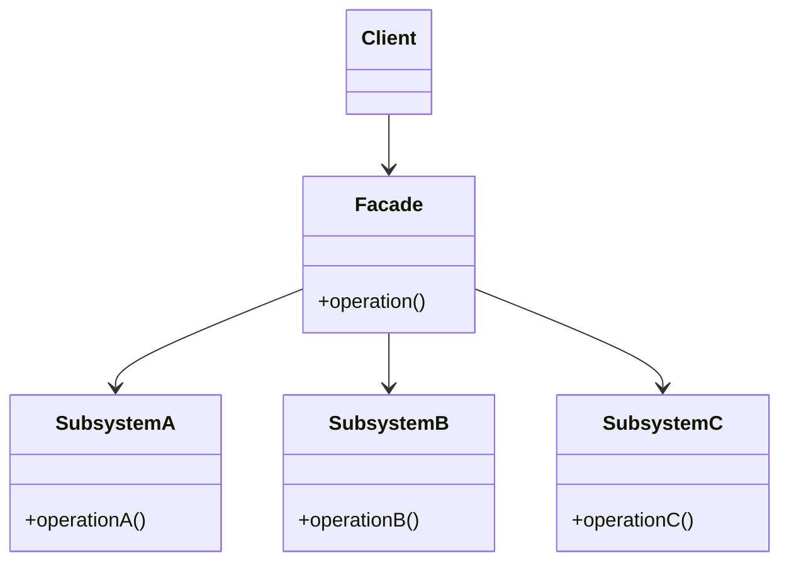

# Facade

## Descrição

O Facade oferece uma interface única e simplificada para um conjunto de interfaces de um subsistema. Em vez de o cliente conhecer e coordenar várias classes internas, ele conversa com um único objeto de fachada que expõe operações de alto nível.

A fachada sabe quais classes do subsistema são responsáveis por cada pedido e delega o trabalho a elas, na ordem correta. As classes do subsistema continuam funcionando de forma independente e não conhecem a fachada; clientes avançados ainda podem acessá-las diretamente quando precisarem de mais controle.

O resultado é uma camada que reduz o acoplamento entre clientes e detalhes de implementação, facilitando o uso, a manutenção e a evolução do subsistema.

## Problemas que resolve

- Clientes precisam orquestrar muitas classes de baixo nível (bibliotecas, frameworks, APIs legadas) para executar uma tarefa simples.
- Mudanças internas em um subsistema se propagam para todo o código que o utiliza.
- Dependências complexas entre camadas dificultam entender o ponto de entrada de um módulo.
- Código de integração repetido em vários lugares para realizar a mesma sequência de chamadas.

## Quando usar

- Quando se quer fornecer uma interface simples para um subsistema complexo.
- Para estruturar um sistema em camadas, definindo um ponto de entrada para cada uma.
- Para isolar o código cliente de bibliotecas de terceiros ou sistemas legados, facilitando substituí-los.
- Quando há muitas dependências entre clientes e classes de implementação e se deseja desacoplá-los.

## Quando evitar

- Quando o subsistema já é simples; a fachada só adicionaria uma camada desnecessária.
- Quando os clientes precisam de todo o poder e flexibilidade do subsistema e a fachada acabaria replicando toda a sua API.
- Quando a fachada tende a virar um "god object", acumulando responsabilidades não relacionadas.

## Trade-offs

| Ganho | Custo / Risco |
| --- | --- |
| Interface simples e fácil de usar | Pode esconder funcionalidades úteis ou limitar casos avançados |
| Menor acoplamento entre clientes e subsistema | Mais uma camada de indireção para manter |
| Mudanças internas ficam isoladas atrás da fachada | Risco de a fachada crescer demais e virar um "god object" |
| Ponto de entrada claro para camadas e módulos | Pode mascarar problemas de design no subsistema em vez de resolvê-los |

- **Acoplamento:** o cliente depende apenas da fachada, mas a fachada fica acoplada a várias classes do subsistema.
- **Testabilidade:** clientes ficam fáceis de testar com um dublê da fachada; a própria fachada exige testes de integração ou mocks dos componentes.
- **Complexidade:** baixa; o padrão não exige herança nem interfaces especiais.
- **Desempenho:** impacto desprezível, apenas uma chamada a mais de delegação.

## Diagrama



O `Client` interage apenas com a `Facade`, que delega as chamadas para `SubsystemA`, `SubsystemB` e `SubsystemC` na ordem adequada. As classes do subsistema não conhecem a fachada.

## Exemplo

Enviar um Pix exige resolver a chave no DICT, passar pelo antifraude, debitar o ledger e enviar a mensagem ao SPI. Em vez de cada controlador coordenar esses quatro serviços, um `PixTransferFacade` expõe uma única operação `send`.

<Tabs groupId="lang" queryString>
<TabItem value="java" label="Java">

```java
record PixDestination(String ispb, String account) {}

class DictClient {
    PixDestination resolve(String pixKey) { return new PixDestination("00000000", "12345-6"); }
}

class FraudService {
    boolean approve(String accountId, long amountCents) { return true; }
}

class LedgerService {
    String debit(String accountId, long amountCents) { return "entry-123"; }
}

class SpiClient {
    String submit(PixDestination destination, long amountCents, String entryId) {
        return "E00000000202603101030abcdef12345"; // endToEndId
    }
}

class PixTransferFacade {
    private final DictClient dict = new DictClient();
    private final FraudService fraud = new FraudService();
    private final LedgerService ledger = new LedgerService();
    private final SpiClient spi = new SpiClient();

    String send(String accountId, String pixKey, long amountCents) {
        PixDestination destination = dict.resolve(pixKey);
        if (!fraud.approve(accountId, amountCents)) {
            throw new IllegalStateException("Transferência recusada pelo antifraude");
        }
        String entryId = ledger.debit(accountId, amountCents);
        return spi.submit(destination, amountCents, entryId);
    }
}

// Cliente
String endToEndId = new PixTransferFacade().send("acc-1", "ana@example.com", 19_990);
```

</TabItem>
<TabItem value="python" label="Python">

```python
from dataclasses import dataclass

@dataclass(frozen=True)
class PixDestination:
    ispb: str
    account: str

class DictClient:
    def resolve(self, pix_key: str) -> PixDestination:
        return PixDestination("00000000", "12345-6")

class FraudService:
    def approve(self, account_id: str, amount_cents: int) -> bool:
        return True

class LedgerService:
    def debit(self, account_id: str, amount_cents: int) -> str:
        return "entry-123"

class SpiClient:
    def submit(self, destination: PixDestination, amount_cents: int, entry_id: str) -> str:
        return "E00000000202603101030abcdef12345"  # endToEndId

class PixTransferFacade:
    def __init__(self) -> None:
        self._dict = DictClient()
        self._fraud = FraudService()
        self._ledger = LedgerService()
        self._spi = SpiClient()

    def send(self, account_id: str, pix_key: str, amount_cents: int) -> str:
        destination = self._dict.resolve(pix_key)
        if not self._fraud.approve(account_id, amount_cents):
            raise PermissionError("Transferência recusada pelo antifraude")
        entry_id = self._ledger.debit(account_id, amount_cents)
        return self._spi.submit(destination, amount_cents, entry_id)

# Cliente
end_to_end_id = PixTransferFacade().send("acc-1", "ana@example.com", 19_990)
```

</TabItem>
<TabItem value="go" label="Go">

```go
type PixDestination struct{ ISPB, Account string }

type DictClient struct{}

func (DictClient) Resolve(pixKey string) PixDestination {
	return PixDestination{ISPB: "00000000", Account: "12345-6"}
}

type FraudService struct{}

func (FraudService) Approve(accountID string, amountCents int64) bool { return true }

type LedgerService struct{}

func (LedgerService) Debit(accountID string, amountCents int64) string { return "entry-123" }

type SpiClient struct{}

func (SpiClient) Submit(destination PixDestination, amountCents int64, entryID string) string {
	return "E00000000202603101030abcdef12345" // endToEndId
}

type PixTransferFacade struct {
	dict   DictClient
	fraud  FraudService
	ledger LedgerService
	spi    SpiClient
}

func (f PixTransferFacade) Send(accountID, pixKey string, amountCents int64) (string, error) {
	destination := f.dict.Resolve(pixKey)
	if !f.fraud.Approve(accountID, amountCents) {
		return "", errors.New("transferência recusada pelo antifraude")
	}
	entryID := f.ledger.Debit(accountID, amountCents)
	return f.spi.Submit(destination, amountCents, entryID), nil
}

func main() {
	// Cliente
	endToEndID, err := PixTransferFacade{}.Send("acc-1", "ana@example.com", 19_990)
}
```

</TabItem>
<TabItem value="typescript" label="TypeScript">

```typescript
interface PixDestination { ispb: string; account: string; }

class DictClient {
  resolve(pixKey: string): PixDestination { return { ispb: "00000000", account: "12345-6" }; }
}

class FraudService {
  approve(accountId: string, amountCents: number): boolean { return true; }
}

class LedgerService {
  debit(accountId: string, amountCents: number): string { return "entry-123"; }
}

class SpiClient {
  submit(destination: PixDestination, amountCents: number, entryId: string): string {
    return "E00000000202603101030abcdef12345"; // endToEndId
  }
}

class PixTransferFacade {
  constructor(
    private dict = new DictClient(),
    private fraud = new FraudService(),
    private ledger = new LedgerService(),
    private spi = new SpiClient(),
  ) {}

  send(accountId: string, pixKey: string, amountCents: number): string {
    const destination = this.dict.resolve(pixKey);
    if (!this.fraud.approve(accountId, amountCents)) {
      throw new Error("Transferência recusada pelo antifraude");
    }
    const entryId = this.ledger.debit(accountId, amountCents);
    return this.spi.submit(destination, amountCents, entryId);
  }
}

// Cliente
const endToEndId = new PixTransferFacade().send("acc-1", "ana@example.com", 19_990);
```

</TabItem>
</Tabs>

## Padrões relacionados

- [Adapter](/coding/gof/structural/adapter) — o Adapter converte uma interface existente para outra esperada; o Facade cria uma interface nova e mais simples para um conjunto de classes.
- [Mediator](/coding/gof/behavioral/mediator) — ambos centralizam a comunicação, mas o Mediator coordena colegas que o conhecem, enquanto o Facade é transparente para o subsistema.
- [Abstract Factory](/coding/gof/creational/abstract-factory) — pode ser usado junto com o Facade para criar os objetos do subsistema de forma independente de plataforma.
- [Singleton](/coding/gof/creational/singleton) — frequentemente basta uma única instância da fachada.
- [Proxy](/coding/gof/structural/proxy) — também se interpõe entre cliente e objeto real, mas mantém a mesma interface em vez de simplificá-la.

## Referência

- [Design Patterns Cheat Sheet](https://iretha.github.io/design-patterns/cheat-sheet)
- [Facade no Refactoring.Guru](https://refactoring.guru/design-patterns/facade)
