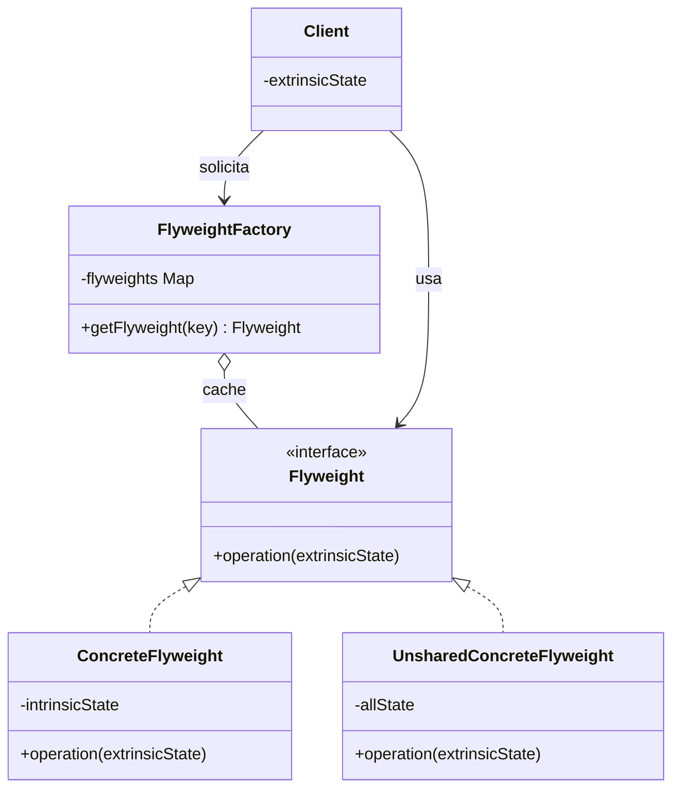

# Flyweight

## Descrição

O Flyweight reduz o consumo de memória quando uma aplicação precisa manter um número muito grande de objetos parecidos. A ideia é compartilhar, entre muitos contextos, as partes do estado que se repetem, em vez de duplicá-las em cada instância.

Para isso, o estado do objeto é dividido em duas partes: o **estado intrínseco**, imutável e independente do contexto, que fica armazenado no flyweight e pode ser compartilhado; e o **estado extrínseco**, que varia conforme o uso e é mantido pelo cliente (ou por um objeto de contexto) e passado como parâmetro às operações do flyweight.

Uma `FlyweightFactory` controla a criação e o reaproveitamento das instâncias: ao receber uma chave, devolve o flyweight já existente no cache ou cria um novo. Assim, milhares de objetos lógicos podem ser representados por poucas instâncias físicas.

## Problemas que resolve

- Consumo excessivo de memória causado por milhares ou milhões de objetos que carregam dados idênticos (fontes, texturas, ícones, metadados)
- Custo de criação repetida de objetos pesados cujo conteúdo é sempre o mesmo
- Dificuldade de escalar estruturas de granularidade fina (caracteres de um editor, partículas, árvores de um mapa, células de planilha)

## Quando usar

- A aplicação cria uma quantidade muito grande de objetos semelhantes e a memória é um gargalo real
- Grande parte do estado dos objetos pode ser extraída e tornada extrínseca
- Muitos grupos de objetos podem ser substituídos por poucos objetos compartilhados depois que o estado extrínseco é removido
- A aplicação não depende da identidade dos objetos (comparações por referência não são relevantes)

## Quando evitar

- O número de objetos é pequeno ou a memória não é uma restrição; o ganho não compensa a complexidade
- O estado dos objetos é majoritariamente único, sobrando pouco a compartilhar
- O estado intrínseco precisa ser mutável, o que tornaria o compartilhamento perigoso
- Calcular ou transportar o estado extrínseco custa mais (CPU, legibilidade) do que a memória economizada

## Trade-offs

| Ganho | Custo / Risco |
| --- | --- |
| Redução drástica do uso de memória | Código mais complexo, com estado dividido entre flyweight e contexto |
| Menos alocações e menor pressão sobre o garbage collector | Custo de CPU para buscar no cache e recalcular/passar o estado extrínseco |
| Ponto central de criação e reaproveitamento via factory | A factory e seu cache precisam ser thread-safe em ambientes concorrentes |
| Objetos compartilhados imutáveis são seguros entre threads | Perda de identidade: o mesmo objeto representa vários elementos lógicos |

- **Acoplamento:** clientes passam a depender da factory e precisam conhecer o estado extrínseco.
- **Testabilidade:** flyweights imutáveis são fáceis de testar; o cache compartilhado pode exigir isolamento entre testes.
- **Desempenho:** é uma otimização; meça antes de aplicar e cuide do crescimento ilimitado do cache.

## Diagrama



O `Client` obtém flyweights pela `FlyweightFactory`, que mantém um cache de `ConcreteFlyweight` compartilhados (com estado intrínseco). O cliente guarda o estado extrínseco e o repassa em cada chamada a `operation`; `UnsharedConcreteFlyweight` representa implementações que não precisam ser compartilhadas.

## Exemplo

A conciliação de cartões mantém milhões de lançamentos em memória. Nome, MCC e logotipo do estabelecimento (pesados) são compartilhados entre os lançamentos do mesmo estabelecimento; apenas valor, data e portador ficam em cada lançamento.

```java
record MerchantInfo(String name, String mcc, byte[] logo) { // flyweight (intrínseco)
    String label() {
        return name + " (MCC " + mcc + ")";
    }
}

class MerchantInfoFactory {
    private static final Map<String, MerchantInfo> cache = new ConcurrentHashMap<>();

    static MerchantInfo get(String name, String mcc, byte[] logo) {
        return cache.computeIfAbsent(name + ":" + mcc,
                k -> new MerchantInfo(name, mcc, logo));
    }
}

record CardEntry(long amountCents, LocalDate date, String holder, MerchantInfo merchant) { // contexto, extrínseco
    String describe() { return holder + " - " + merchant.label() + ": " + amountCents; }
}

class ReconciliationBatch {
    private final List<CardEntry> entries = new ArrayList<>();

    void add(long amountCents, LocalDate date, String holder,
             String merchantName, String mcc, byte[] logo) {
        entries.add(new CardEntry(amountCents, date, holder,
                MerchantInfoFactory.get(merchantName, mcc, logo)));
    }

    long totalCents() { return entries.stream().mapToLong(CardEntry::amountCents).sum(); }
}
```

## Padrões relacionados

- [Composite](/coding/gof/structural/composite) — folhas de uma árvore Composite costumam ser implementadas como flyweights compartilhados
- [Factory Method](/coding/gof/creational/factory-method) — a `FlyweightFactory` encapsula a criação e o reaproveitamento das instâncias
- [Singleton](/coding/gof/creational/singleton) — a factory de flyweights frequentemente é única; ambos controlam o número de instâncias
- [Object Pool](/coding/gof/creational/object-pool) — também reaproveita objetos, mas por empréstimo exclusivo, enquanto o Flyweight compartilha instâncias imutáveis simultaneamente
- [State](/coding/gof/behavioral/state) e [Strategy](/coding/gof/behavioral/strategy) — objetos de estado ou estratégia sem dados próprios podem ser compartilhados como flyweights
- [Proxy](/coding/gof/structural/proxy) — ambos interpõem um objeto para controlar recursos; o Proxy controla o acesso, o Flyweight controla a quantidade de instâncias

## Referência

- [Design Patterns Cheat Sheet](https://iretha.github.io/design-patterns/cheat-sheet)
- [Flyweight no Refactoring.Guru](https://refactoring.guru/design-patterns/flyweight)
