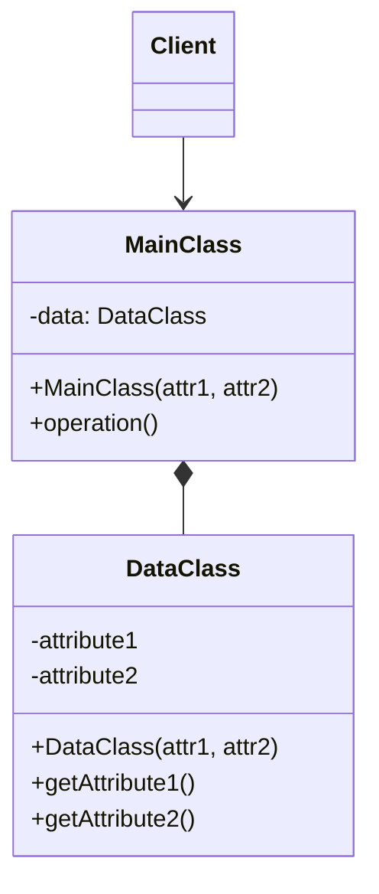

# Private Class Data

## Descrição

O Private Class Data restringe o acesso e a modificação dos atributos de uma classe ao separá-los em um objeto de dados próprio (a classe `Data`). A classe principal deixa de expor ou manipular diretamente seus campos e passa a guardar uma referência a esse objeto, que só oferece leitura, ou leitura e alterações controladas.

Normalmente os dados são passados no construtor da classe de dados e ficam imutáveis depois disso. Assim, nem os próprios métodos da classe principal conseguem alterar por engano valores que deveriam ser fixados uma única vez, como na inicialização. O padrão reduz a superfície de escrita do estado e deixa claro quais atributos são estáveis e quais variam.

Não é um dos 23 padrões do livro do Gang of Four. Ele aparece em catálogos complementares como uma técnica de encapsulamento, e em várias linguagens modernas se resume ao uso de campos `final`/`readonly`, records ou value objects.

## Problemas que resolve

- Atributos que deveriam ser definidos só na construção acabam sendo alterados por métodos da própria classe.
- Classes com muitos campos mutáveis, nas quais é difícil saber quem altera o quê e quando.
- Exposição desnecessária do estado interno por getters e setters genéricos.
- Dificuldade de manter invariantes quando qualquer método pode reatribuir campos.

## Quando usar

- Quando um conjunto de atributos deve ser imutável depois da inicialização.
- Quando se quer separar dados (estado) de comportamento, deixando explícito o que é somente leitura.
- Quando a linguagem não oferece bons recursos nativos de imutabilidade (`final`, `readonly`, `const`).
- Quando o objeto é compartilhado entre threads e precisa de estado seguro para leitura concorrente.

## Quando evitar

- Quando a linguagem já oferece imutabilidade simples (records, `readonly`, `data class`, `frozen dataclass`) que resolve o problema sem uma classe extra.
- Em classes pequenas, com poucos campos, nas quais a indireção só acrescenta código.
- Quando os dados precisam mudar com frequência; a imutabilidade obrigaria a recriar objetos o tempo todo.

## Trade-offs

| Ganho | Custo / Risco |
| --- | --- |
| Encapsulamento mais forte e menos escrita acidental do estado | Mais uma classe e uma indireção no acesso aos dados |
| Invariantes garantidas desde a construção | Alterar um valor exige criar um novo objeto de dados |
| Estado imutável, seguro para compartilhar entre threads | Pode duplicar o que a linguagem já oferece nativamente |
| Separação clara entre dados e comportamento | Risco de virar um "saco de getters" sem significado de domínio |

- **Acoplamento:** a classe principal depende só da interface de leitura da classe de dados.
- **Testabilidade:** objetos de dados imutáveis são fáceis de criar e comparar nos testes.
- **Desempenho:** recriar objetos de dados a cada alteração pode gerar alocações extras em caminhos críticos.

## Diagrama



O `Client` usa a `MainClass`, que compõe internamente uma `DataClass`. A `DataClass` recebe os valores no construtor e expõe apenas métodos de leitura, de modo que a `MainClass` usa os dados sem poder reatribuí-los.

## Exemplo

Um `Card` recebe o token do número, a validade e o nome do portador na emissão, e esses valores não podem mudar depois. Os dados ficam em `CardData`, que só permite leitura, e métodos como `isExpired()` apenas leem.

<Tabs groupId="lang" queryString>
<TabItem value="java" label="Java">

```java
public final class CardData {
    private final String numberToken;
    private final YearMonth expiry;
    private final String holderName;

    public CardData(String numberToken, YearMonth expiry, String holderName) {
        this.numberToken = numberToken;
        this.expiry = expiry;
        this.holderName = holderName;
    }

    public String getNumberToken() { return numberToken; }
    public YearMonth getExpiry() { return expiry; }
    public String getHolderName() { return holderName; }
}

public class Card {
    private final CardData data;

    public Card(String numberToken, YearMonth expiry, String holderName) {
        this.data = new CardData(numberToken, expiry, holderName);
    }

    public boolean isExpired(LocalDate today) {
        return YearMonth.from(today).isAfter(data.getExpiry());
    }

    public String describe() {
        return data.getHolderName() + " (" + data.getNumberToken() + ")";
    }
}
```

</TabItem>
<TabItem value="python" label="Python">

```python
from dataclasses import dataclass
from datetime import date

@dataclass(frozen=True)  # frozen: os campos não podem ser reatribuídos depois da criação
class CardData:
    number_token: str
    expiry_year: int
    expiry_month: int
    holder_name: str

class Card:
    def __init__(self, number_token: str, expiry_year: int, expiry_month: int, holder_name: str) -> None:
        self._data = CardData(number_token, expiry_year, expiry_month, holder_name)

    def is_expired(self, today: date) -> bool:
        return (today.year, today.month) > (self._data.expiry_year, self._data.expiry_month)

    def describe(self) -> str:
        return f"{self._data.holder_name} ({self._data.number_token})"
```

</TabItem>
<TabItem value="go" label="Go">

```go
// Em Go a visibilidade é por pacote: CardData vive em um pacote próprio, com campos
// não exportados, e Card (em outro pacote) só consegue ler pelos métodos.
type CardData struct {
	numberToken string
	expiryYear  int
	expiryMonth time.Month
	holderName  string
}

func NewCardData(numberToken string, expiryYear int, expiryMonth time.Month, holderName string) CardData {
	return CardData{numberToken, expiryYear, expiryMonth, holderName}
}

func (d CardData) NumberToken() string       { return d.numberToken }
func (d CardData) Expiry() (int, time.Month) { return d.expiryYear, d.expiryMonth }
func (d CardData) HolderName() string        { return d.holderName }

type Card struct {
	data CardData
}

func NewCard(numberToken string, expiryYear int, expiryMonth time.Month, holderName string) *Card {
	return &Card{data: NewCardData(numberToken, expiryYear, expiryMonth, holderName)}
}

func (c *Card) IsExpired(today time.Time) bool {
	year, month := c.data.Expiry()
	return today.Year() > year || (today.Year() == year && today.Month() > month)
}

func (c *Card) Describe() string {
	return fmt.Sprintf("%s (%s)", c.data.HolderName(), c.data.NumberToken())
}
```

</TabItem>
</Tabs>

## Padrões relacionados

- [Proxy](/coding/gof/structural/proxy) — também controla o acesso a um objeto, mas por meio de um substituto, e não pela separação do estado.
- [Facade](/coding/gof/structural/facade) — ambos reduzem o que é exposto aos clientes; a Facade simplifica um subsistema, o Private Class Data protege os atributos.
- [Builder](/coding/gof/creational/builder) — costuma montar objetos de dados imutáveis quando há muitos parâmetros de inicialização.
- [Telescoping Constructor](/coding/gof/creational/telescoping-constructor) — problema que aparece quando a classe de dados recebe muitos atributos no construtor.
- [Memento](/coding/gof/behavioral/memento) — também guarda o estado em um objeto separado e opaco, mas para salvá-lo e restaurá-lo depois.
- [Flyweight](/coding/gof/structural/flyweight) — o estado intrínseco compartilhado precisa ser imutável, que é justamente o que o Private Class Data garante.

## Referência

- [Design Patterns Cheat Sheet](https://iretha.github.io/design-patterns/cheat-sheet)
- [Private Class Data no SourceMaking](https://sourcemaking.com/design_patterns/private_class_data)
