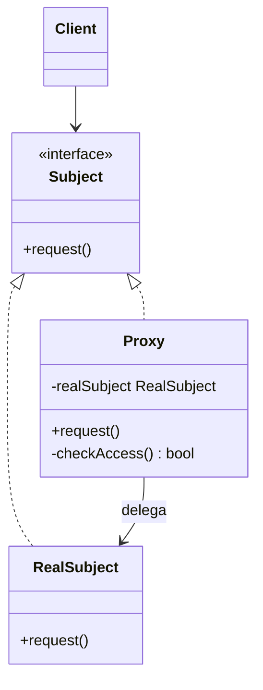

# Proxy

## Descrição

O Proxy fornece um substituto (ou representante) para outro objeto, controlando o acesso a ele. O proxy implementa a mesma interface do objeto real (o `RealSubject`), de modo que o cliente não percebe se está falando com o objeto verdadeiro ou com o intermediário.

Ao receber uma chamada, o proxy pode executar lógica adicional antes ou depois de delegar ao objeto real: criar o objeto apenas quando necessário (virtual proxy), verificar permissões (protection proxy), encaminhar a chamada para outro processo ou máquina (remote proxy), armazenar resultados em cache (caching proxy) ou registrar uso e contar referências (smart reference).

A diferença em relação a outros wrappers está na intenção: o Proxy não acrescenta funcionalidades de negócio nem muda a interface, ele controla *quando*, *como* e *se* o acesso ao objeto real acontece.

## Problemas que resolve

- Objetos caros de criar (imagens grandes, conexões, documentos) sendo instanciados mesmo quando nunca são usados.
- Necessidade de aplicar controle de acesso a um objeto sem modificar sua classe.
- Chamadas a objetos remotos que exigem serialização, rede e tratamento de falhas, poluindo o código cliente.
- Repetição de operações custosas que poderiam ser cacheadas de forma transparente.
- Falta de um ponto central para logging, métricas ou contagem de referências de um recurso.

## Quando usar

- Quando é preciso adiar a criação ou o carregamento de um objeto pesado até o primeiro uso (lazy initialization).
- Quando o acesso a um objeto deve ser restrito conforme o perfil ou as permissões do cliente.
- Quando um objeto vive em outro espaço de endereçamento (outro processo, serviço ou servidor) e o cliente deve usá-lo como se fosse local.
- Quando se deseja adicionar cache, auditoria ou rate limiting de forma transparente ao cliente.
- Quando o objeto real vem de uma biblioteca de terceiros e não pode ser alterado.

## Quando evitar

- Quando o objeto real é barato e não há necessidade de controle de acesso: o proxy só acrescenta indireção.
- Quando a latência extra introduzida pela camada intermediária é crítica.
- Quando o objetivo é acrescentar comportamento empilhável e combinável; nesse caso o Decorator é mais adequado.
- Quando a transparência esconde custos importantes (por exemplo, chamadas de rede que parecem locais) e isso leva a uso ingênuo e ineficiente.

## Trade-offs

| Ganho | Custo / Risco |
| --- | --- |
| Controle do ciclo de vida e do acesso ao objeto real sem que o cliente saiba | Camada extra de indireção e mais classes para manter |
| Lazy loading reduz uso de memória e tempo de inicialização | O primeiro acesso pode ter latência inesperada |
| Respeita o princípio aberto/fechado: novas políticas sem alterar o `RealSubject` | A interface do proxy precisa acompanhar toda mudança na interface do `Subject` |
| Cache e remote proxy simplificam o código cliente | Transparência pode ocultar falhas de rede, dados obsoletos e custos reais |

- **Acoplamento:** o cliente depende apenas da interface `Subject`, o que facilita trocar o objeto real pelo proxy via injeção de dependência.
- **Testabilidade:** proxies podem ser testados isoladamente com um `RealSubject` falso; mocks de frameworks costumam ser proxies dinâmicos.
- **Concorrência:** proxies com lazy initialization ou cache precisam de cuidado com acesso concorrente.
- **Ferramentas:** muitas linguagens oferecem proxies dinâmicos (Java `java.lang.reflect.Proxy`, JavaScript `Proxy`, AOP em frameworks), reduzindo código repetitivo.

## Diagrama



O `Client` trabalha apenas com a interface `Subject`. Tanto `RealSubject` quanto `Proxy` a implementam; o `Proxy` mantém uma referência ao `RealSubject` e decide quando e se deve delegar a chamada, aplicando controle de acesso, lazy loading ou cache.

## Exemplo

A consulta ao bureau de crédito é lenta e cobrada por chamada. O `CachingCreditBureauProxy` só consulta o bureau quando a análise realmente pede o score e guarda o resultado para as chamadas seguintes.

<Tabs groupId="lang" queryString>
<TabItem value="java" label="Java">

```java
interface CreditBureau {
    int score(String cpf);
}

class RemoteCreditBureau implements CreditBureau {
    public int score(String cpf) {
        System.out.println("Consultando o bureau para " + cpf + "..."); // operação lenta e cobrada por chamada
        return 720;
    }
}

class CachingCreditBureauProxy implements CreditBureau {
    private CreditBureau real;
    private final Map<String, Integer> cache = new HashMap<>();

    public int score(String cpf) {
        if (!cache.containsKey(cpf)) {
            if (real == null) real = new RemoteCreditBureau(); // criado só na primeira consulta
            cache.put(cpf, real.score(cpf)); // consulta sob demanda
        }
        return cache.get(cpf);
    }
}

CreditBureau bureau = new CachingCreditBureauProxy();
bureau.score("123.456.789-09"); // consulta o bureau
bureau.score("123.456.789-09"); // responde do cache, sem nova cobrança
```

</TabItem>
<TabItem value="python" label="Python">

```python
from typing import Optional, Protocol

class CreditBureau(Protocol):
    def score(self, cpf: str) -> int: ...

class RemoteCreditBureau:
    def score(self, cpf: str) -> int:
        print(f"Consultando o bureau para {cpf}...")  # operação lenta e cobrada por chamada
        return 720

class CachingCreditBureauProxy:
    def __init__(self) -> None:
        self._real: Optional[CreditBureau] = None
        self._cache: dict[str, int] = {}

    def score(self, cpf: str) -> int:
        if cpf not in self._cache:
            if self._real is None:
                self._real = RemoteCreditBureau()  # criado só na primeira consulta
            self._cache[cpf] = self._real.score(cpf)  # consulta sob demanda
        return self._cache[cpf]

bureau: CreditBureau = CachingCreditBureauProxy()
bureau.score("123.456.789-09")  # consulta o bureau
bureau.score("123.456.789-09")  # responde do cache, sem nova cobrança
```

</TabItem>
<TabItem value="go" label="Go">

```go
type CreditBureau interface {
	Score(cpf string) int
}

type RemoteCreditBureau struct{}

func (RemoteCreditBureau) Score(cpf string) int {
	fmt.Printf("Consultando o bureau para %s...\n", cpf) // operação lenta e cobrada por chamada
	return 720
}

type CachingCreditBureauProxy struct {
	real  CreditBureau
	cache map[string]int
}

func (p *CachingCreditBureauProxy) Score(cpf string) int {
	if _, ok := p.cache[cpf]; !ok {
		if p.real == nil {
			p.real = RemoteCreditBureau{} // criado só na primeira consulta
		}
		p.cache[cpf] = p.real.Score(cpf) // consulta sob demanda
	}
	return p.cache[cpf]
}

func main() {
	var bureau CreditBureau = &CachingCreditBureauProxy{cache: map[string]int{}}
	bureau.Score("123.456.789-09") // consulta o bureau
	bureau.Score("123.456.789-09") // responde do cache, sem nova cobrança
}
```

</TabItem>
<TabItem value="typescript" label="TypeScript">

```typescript
type Cpf = string;

interface CreditBureau {
  score(cpf: Cpf): number;
}

class RemoteCreditBureau implements CreditBureau {
  score(cpf: Cpf): number {
    console.log(`Consultando o bureau para ${cpf}...`); // operação lenta e cobrada por chamada
    return 720;
  }
}

class CachingCreditBureauProxy implements CreditBureau {
  private real?: CreditBureau;
  private cache = new Map<Cpf, number>();

  score(cpf: Cpf): number {
    if (!this.cache.has(cpf)) {
      this.real ??= new RemoteCreditBureau(); // criado só na primeira consulta
      this.cache.set(cpf, this.real.score(cpf)); // consulta sob demanda
    }
    return this.cache.get(cpf)!;
  }
}

const bureau: CreditBureau = new CachingCreditBureauProxy();
bureau.score("123.456.789-09"); // consulta o bureau
bureau.score("123.456.789-09"); // responde do cache, sem nova cobrança
```

</TabItem>
</Tabs>

## Padrões relacionados

- [Adapter](/coding/gof/structural/adapter) — também envolve outro objeto, mas fornece uma interface diferente; o Proxy mantém a mesma interface.
- [Decorator](/coding/gof/structural/decorator) — estrutura quase idêntica, porém o Decorator acrescenta responsabilidades e é empilhável, enquanto o Proxy controla o acesso e geralmente gerencia o ciclo de vida do objeto real.
- [Facade](/coding/gof/structural/facade) — também é um intermediário, mas simplifica um subsistema inteiro em vez de representar um único objeto.
- [Flyweight](/coding/gof/structural/flyweight) — proxies podem ser usados para compartilhar e referenciar objetos flyweight de forma transparente.
- [Singleton](/coding/gof/creational/singleton) — o proxy costuma ser o ponto de acesso controlado a um recurso único e caro.

## Referência

- [Design Patterns Cheat Sheet](https://iretha.github.io/design-patterns/cheat-sheet)
- [Proxy no Refactoring.Guru](https://refactoring.guru/design-patterns/proxy)
