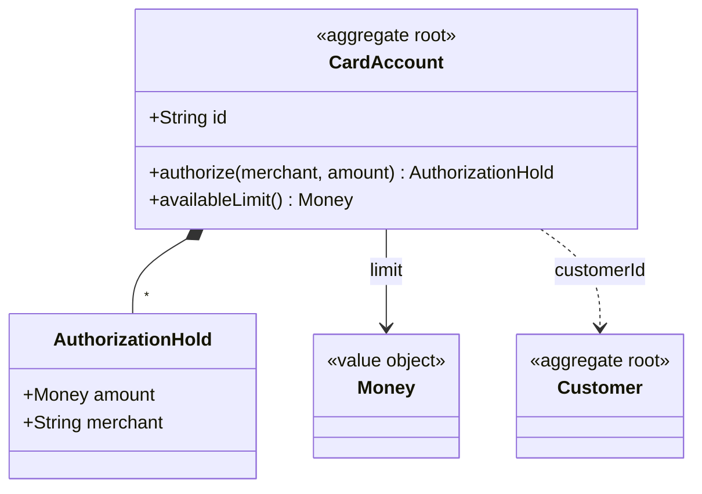

# Aggregate

## Descrição

Um Aggregate é um grupo de entidades e Value Objects tratado como uma unidade para fins de mudança de dados. Uma entidade é a raiz (Aggregate Root), a única com identidade global e a única referenciada por objetos de fora; os demais membros têm identidade local ao agregado.

A raiz garante as invariantes de todo o grupo. Objetos externos só mantêm referências para a raiz e só a modificam por meio de seus métodos. A fronteira define o escopo da transação: uma transação altera um único agregado, e a consistência entre agregados é eventual.

Referências entre agregados devem ser feitas por identidade, e não por referência direta ao objeto, o que mantém os agregados pequenos e desacoplados.

## Problemas que resolve

- Grafos de objetos emaranhados, sem fronteira clara de consistência.
- Invariantes violadas por modificações feitas direto em objetos internos.
- Transações grandes que bloqueiam muitos dados e geram contenção.
- Dificuldade de decidir o escopo de carga e de persistência.

## Quando usar

- Quando há invariantes que precisam valer de forma consistente entre vários objetos.
- Quando é preciso definir a unidade de transação e de persistência.
- Quando se quer limitar o acoplamento entre partes do modelo.

## Quando evitar

- Quando os agregados ficam grandes demais, causando contenção e custo de carga.
- Quando a fronteira é imposta por conveniência técnica, sem invariantes reais.

## Trade-offs

| Ganho | Custo / Risco |
| --- | --- |
| Invariantes garantidas dentro da fronteira | Agregados grandes causam contenção e lentidão |
| Unidade clara de transação e persistência | Consistência entre agregados é eventual |
| Acoplamento reduzido por referência via identidade | Consultas entre agregados exigem mais trabalho |

- **Tamanho:** prefira agregados pequenos, projetados em torno de invariantes reais.
- **Eventos:** mudanças que afetam outros agregados costumam ser propagadas por Domain Events.
- **Acesso:** o Repository trabalha por raiz de agregado.

## Diagrama



`CardAccount` é a raiz e controla `AuthorizationHold` e o limite (`Money`). A referência a `Customer`, outro agregado, é feita apenas por identidade.

## Exemplo

A conta de cartão protege a invariante de limite: a soma das pré-autorizações nunca passa do limite disponível, e ninguém altera `AuthorizationHold` diretamente.

```typescript
class CardAccount {
  private holds: AuthorizationHold[] = [];
  constructor(
    readonly id: string,
    readonly customerId: string,
    private limit: Money,
  ) {}

  authorize(merchant: string, amount: Money): AuthorizationHold {
    if (amount.isZeroOrNegative()) throw new Error("Valor inválido");
    if (amount.greaterThan(this.availableLimit())) throw new Error("Limite insuficiente");
    const hold = new AuthorizationHold(merchant, amount);
    this.holds.push(hold);
    return hold;
  }

  availableLimit(): Money {
    const held = this.holds.reduce((sum, h) => sum.plus(h.amount), Money.zero());
    return this.limit.minus(held);
  }
}
```

## Padrões relacionados

- [Entity](/design/ddd/building-blocks/entity) — a raiz do agregado é uma entidade.
- [Value Object](/design/poeaa/base/value-object) — compõe o agregado ao lado de entidades internas.
- [Repository](/design/poeaa/object-relational-metadata-mapping/repository) — persiste e recupera um agregado por vez, pela raiz.
- [Factory](/design/ddd/building-blocks/factory) — cria o agregado inteiro, garantindo invariantes na criação.
- [Domain Event](/architecture/microservices/service-collaboration/domain-event) — propaga mudanças entre agregados com consistência eventual.
- [Domain Model](/design/poeaa/domain-logic/domain-model) — o agregado organiza o modelo de domínio em fronteiras de consistência.

## Referência

- [DDD Reference, Eric Evans (2015)](https://www.domainlanguage.com/ddd/reference/)
- [DDD Aggregate (bliki)](https://martinfowler.com/bliki/DDD_Aggregate.html)
- *Domain-Driven Design: Tackling Complexity in the Heart of Software*, Eric Evans (Addison-Wesley, 2003)
