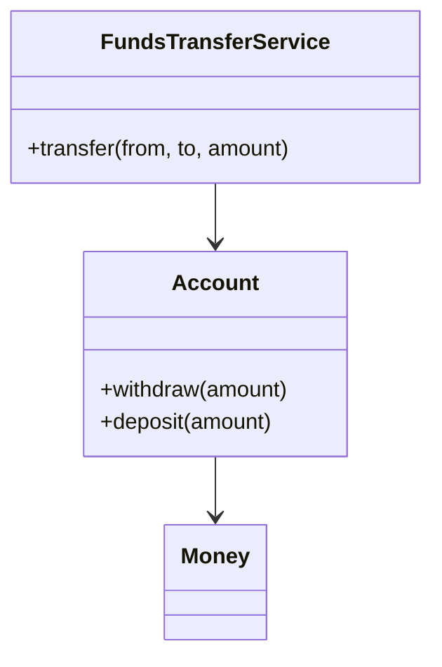

# Domain Service

## Descrição

Um Domain Service (chamado de "Services" no livro de Evans) representa uma operação significativa do domínio que não pertence naturalmente a nenhuma entidade ou Value Object. É uma ação, nomeada com um verbo da linguagem ubíqua, como transferir fundos entre contas.

Evans propõe três características: a operação se refere a um conceito do domínio que não é uma coisa; a interface é definida em termos de elementos do modelo; e o serviço não tem estado. Forçar essa lógica dentro de um objeto distorceria o modelo.

Não confundir com o Service Layer do PoEAA nem com serviços da camada de aplicação: estes orquestram casos de uso e transações, sem conter regra de negócio, enquanto o Domain Service contém lógica do próprio domínio.

## Problemas que resolve

- Operações que envolvem vários objetos e não cabem em nenhum deles.
- Objetos de domínio inchados com responsabilidades que não são suas.
- Lógica de domínio que vaza para a camada de aplicação ou para a interface.

## Quando usar

- Quando a operação é um conceito do domínio, mas não é uma coisa com identidade ou valor.
- Quando a operação envolve múltiplos agregados ou entidades.
- Quando a lógica é stateless e expressa em termos do modelo.

### Quando evitar

- Quando a operação pertence naturalmente a uma entidade ou Value Object.
- Quando o serviço seria só orquestração técnica (isso é camada de aplicação).
- Quando o uso excessivo de serviços leva a um modelo anêmico.

## Trade-offs

| Ganho | Custo / Risco |
| --- | --- |
| Lugar explícito para lógica que não cabe nos objetos | Risco de modelo anêmico se usado em excesso |
| Linguagem ubíqua expressa em verbos do domínio | Fácil confundir com serviço de aplicação |
| Objetos de domínio mais enxutos | Sem estado, depende dos objetos passados como argumento |

- **Estado:** o serviço é stateless; o estado vive nas entidades.
- **Camada:** vive na camada de domínio; a orquestração fica na aplicação.

## Diagrama



`FundsTransferService` coordena duas contas em uma operação que não pertence a nenhuma delas.

## Exemplo

A transferência entre contas envolve duas entidades e uma regra de negócio, por isso vira um serviço de domínio.

```java
public class FundsTransferService {
    public void transfer(Account from, Account to, Money amount) {
        if (from.equals(to)) {
            throw new IllegalArgumentException("Contas iguais");
        }
        from.withdraw(amount);
        to.deposit(amount);
    }
}
```

## Padrões relacionados

- [Entity](/design/ddd/building-blocks/entity) — o serviço opera sobre entidades.
- [Value Object](/design/poeaa/base/value-object) — argumentos e retornos frequentes do serviço.
- [Layered Architecture](/design/ddd/building-blocks/layered-architecture) — distingue serviços de domínio e de aplicação.
- [Service Layer](/design/poeaa/domain-logic/service-layer) — fronteira de aplicação do PoEAA, que não contém regra de negócio.
- [Side-Effect-Free Functions](/design/ddd/supple-design/side-effect-free-functions) — serviços tendem a ser funções sem efeitos colaterais.

## Referência

- [DDD Reference, Eric Evans (2015)](https://www.domainlanguage.com/ddd/reference/)
- *Domain-Driven Design: Tackling Complexity in the Heart of Software*, Eric Evans (Addison-Wesley, 2003)
- [Evans Classification (bliki do Fowler)](https://martinfowler.com/bliki/EvansClassification.html)
