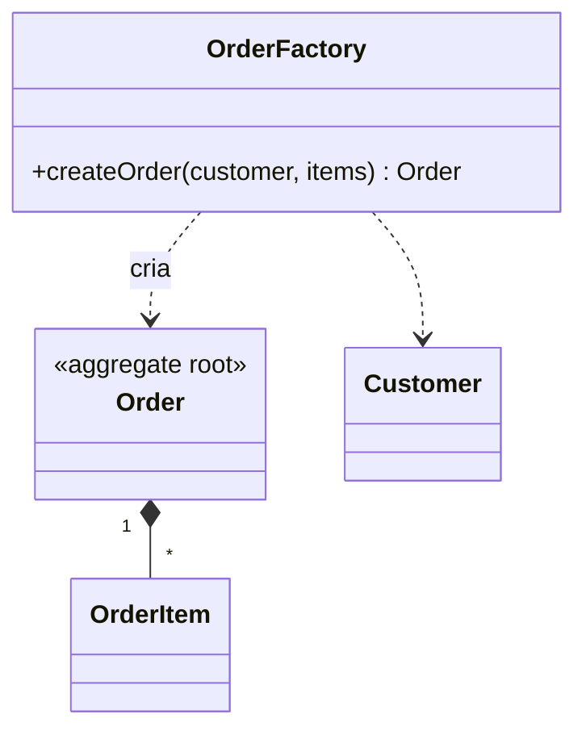

# Factory

## Descrição

No DDD, uma Factory encapsula o conhecimento necessário para criar objetos complexos ou agregados inteiros, mantendo essa responsabilidade fora do modelo principal. Ela garante que o objeto nasça completo e com todas as invariantes satisfeitas.

A criação é atômica: o cliente obtém o agregado inteiro em um estado consistente, ou a criação falha. A Factory pode ser um Factory Method na raiz de um agregado, uma classe própria ou um método estático, dependendo da complexidade. O cliente depende só da interface, sem conhecer o tipo concreto nem os detalhes da montagem.

Não se deve confundir com os padrões Factory Method e Abstract Factory do GoF, que são soluções de design de classes. A Factory do DDD é um conceito de domínio ligado ao ciclo de vida: ela cria e reconstitui objetos, enquanto o Repository os persiste e recupera.

## Problemas que resolve

- Construtores complexos que misturam regras de negócio e montagem.
- Clientes que precisam conhecer a estrutura interna de um agregado para criá-lo.
- Objetos criados em estado inválido ou parcial.
- Reconstituição de objetos a partir de dados persistidos sem passar pelas regras de criação.

## Quando usar

- Quando a criação envolve várias etapas, regras ou objetos relacionados.
- Quando se quer garantir invariantes desde o nascimento do objeto.
- Quando o cliente não deve conhecer a classe concreta.

## Quando evitar

- Quando um construtor simples basta.
- Quando a Factory seria apenas uma camada extra sem lógica de criação.

## Trade-offs

| Ganho | Custo / Risco |
| --- | --- |
| Invariantes garantidas na criação | Mais uma classe para manter |
| Clientes desacoplados dos detalhes de montagem | Risco de duplicar a lógica do construtor |
| Modelo principal mais limpo | Pode esconder complexidade que mereceria simplificação |

- **Atomicidade:** o objeto criado deve ser consistente por inteiro.
- **Reconstituição:** a criação a partir de dados persistidos segue regras diferentes da criação nova.

## Diagrama



`OrderFactory` monta o `Order` com seus itens e garante que o agregado seja válido ao ser entregue.

## Exemplo

A fábrica cria o pedido já validado, impedindo pedidos sem itens ou de clientes bloqueados.

```java
public class OrderFactory {
    public Order createOrder(Customer customer, List<OrderLine> lines) {
        if (customer.isBlocked()) {
            throw new IllegalStateException("Cliente bloqueado");
        }
        if (lines.isEmpty()) {
            throw new IllegalArgumentException("Pedido sem itens");
        }
        Order order = new Order(OrderId.next(), customer.id());
        lines.forEach(l -> order.addItem(l.productId(), l.quantity(), l.price()));
        return order;
    }
}
```

## Padrões relacionados

- [Aggregate](/design/ddd/building-blocks/aggregate) — a fábrica cria o agregado inteiro e suas invariantes.
- [Entity](/design/ddd/building-blocks/entity) — cria entidades com identidade válida.
- [Value Object](/design/poeaa/base/value-object) — também pode ser criado por fábricas.
- [Repository](/design/poeaa/object-relational-metadata-mapping/repository) — recupera objetos já existentes, enquanto a fábrica cria novos.
- [Factory](/coding/gof/creational/factory) — a fábrica simples do acervo GoF, com escopo de design de classes.
- [Factory Method](/coding/gof/creational/factory-method) — padrão GoF que pode ser usado na implementação.
- [Abstract Factory](/coding/gof/creational/abstract-factory) — padrão GoF para famílias de objetos, distinto da Factory do DDD.

## Referência

- [DDD Reference, Eric Evans (2015)](https://www.domainlanguage.com/ddd/reference/)
- *Domain-Driven Design: Tackling Complexity in the Heart of Software*, Eric Evans (Addison-Wesley, 2003)
