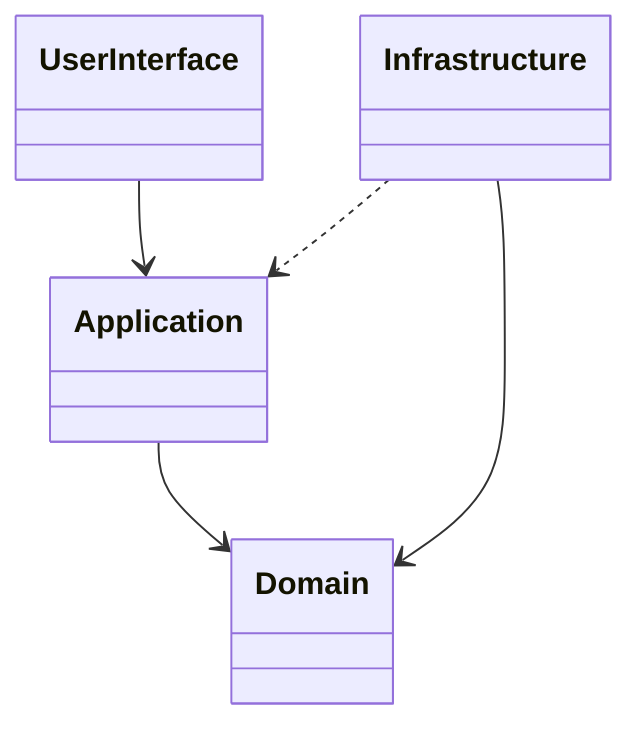

# Layered Architecture

## Descrição

A Layered Architecture divide o sistema em camadas coesas, cada uma com uma responsabilidade bem definida e dependências que apontam em uma única direção. Evans propõe quatro camadas clássicas: interface com o usuário (apresentação), aplicação, domínio e infraestrutura.

A camada de domínio concentra o modelo e as regras de negócio e é o coração do software. A camada de aplicação coordena casos de uso, sem conter regras de negócio, e a infraestrutura fornece suporte técnico, como persistência e mensageria. Camadas superiores dependem das inferiores, e o domínio fica isolado de detalhes de interface e de tecnologia.

O objetivo é que o código do modelo possa ser lido, testado e evoluído sem se misturar a preocupações técnicas, viabilizando o Model-Driven Design.

## Problemas que resolve

- Regras de negócio espalhadas em telas, controladores e consultas SQL.
- Modelo de domínio acoplado a framework, banco de dados e interface.
- Dificuldade de testar regras sem subir infraestrutura.
- Mudanças técnicas que forçam alterações no código do domínio.

## Quando usar

- Em sistemas com domínio rico, onde o modelo precisa ser expresso com clareza.
- Quando a equipe quer isolar a lógica de negócio de preocupações técnicas.
- Quando há várias interfaces (web, API, jobs) sobre o mesmo modelo.

## Quando evitar

- Em aplicações CRUD simples, sem lógica de domínio relevante.
- Quando as camadas viram apenas repasse de chamadas, sem ganho de isolamento.

## Trade-offs

| Ganho | Custo / Risco |
| --- | --- |
| Domínio isolado e testável | Mais código de mapeamento entre camadas |
| Separação clara de responsabilidades | Risco de camadas anêmicas que só repassam chamadas |
| Troca de tecnologia sem afetar o modelo | Exige disciplina para respeitar o sentido das dependências |

- **Dependências:** a inversão de dependência permite que o domínio defina interfaces implementadas pela infraestrutura.
- **Variações:** arquiteturas hexagonal e em cebola seguem a mesma ideia de isolar o domínio.

## Diagrama



A interface chama a aplicação, que orquestra o domínio. A infraestrutura implementa as abstrações definidas pelo domínio e serve às demais camadas.

## Exemplo

Em uma transferência Pix, o `TransferController` (interface) chama o `TransferAppService`, que carrega a conta, delega a regra ao domínio e persiste pelo repositório.

```typescript
// interface
class TransferController {
  constructor(private transfers: TransferAppService) {}

  async post(req: { accountId: string; pixKey: string; amountCents: number }) {
    await this.transfers.execute(req.accountId, req.pixKey, req.amountCents);
  }
}

// application
class TransferAppService {
  constructor(private accounts: AccountRepository) {}

  async execute(accountId: string, pixKey: string, amountCents: number): Promise<void> {
    const account = await this.accounts.findById(accountId);
    account.sendPix(pixKey, Money.ofCents(amountCents)); // regra no domínio
    await this.accounts.save(account);
  }
}

// domain
interface AccountRepository {
  findById(id: string): Promise<Account>;
  save(account: Account): Promise<void>;
}
```

## Padrões relacionados

- [Model-Driven Design](/design/ddd/model-in-practice/model-driven-design) — a camada de domínio isola o modelo para que ele seja refletido no código.
- [Domain Service](/design/ddd/building-blocks/domain-service) — serviços de domínio e de aplicação ocupam camadas distintas.
- [Repository](/design/poeaa/object-relational-metadata-mapping/repository) — interface no domínio, implementação na infraestrutura.
- [Bounded Context](/design/ddd/model-in-practice/bounded-context) — cada contexto pode ter sua própria estrutura de camadas.
- [Service Layer](/design/poeaa/domain-logic/service-layer) — equivale, em linhas gerais, à camada de aplicação.

## Referência

- [DDD Reference, Eric Evans (2015)](https://www.domainlanguage.com/ddd/reference/)
- *Domain-Driven Design: Tackling Complexity in the Heart of Software*, Eric Evans (Addison-Wesley, 2003)
- [Presentation Domain Data Layering (bliki do Fowler)](https://martinfowler.com/bliki/PresentationDomainDataLayering.html)
