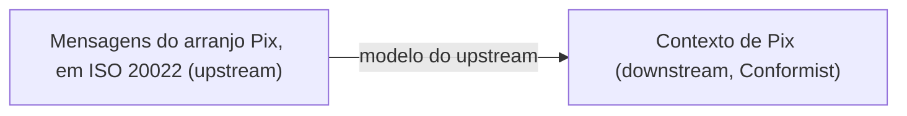

# Conformist

## Descrição

No Conformist, o time downstream decide adotar integralmente o modelo do contexto upstream, sem tradução. O upstream não tem motivação para atender às necessidades do downstream, então, em vez de lutar contra isso, o downstream se conforma.

A decisão elimina a complexidade de traduzir entre modelos e dá ao downstream um vocabulário já pronto, o do upstream. O preço é que o modelo do downstream passa a ser limitado e moldado pelo design do upstream, que pode não ser o ideal para os problemas do downstream.

É parecido com Shared Kernel no resultado, mas a diferença é política: aqui há uma relação unilateral, sem cooperação nem poder de decisão do downstream.

## Problemas que resolve

- Custo e complexidade de manter um tradutor para um modelo upstream razoavelmente bom.
- Integração com sistemas ou produtos de terceiros que não se adaptam ao cliente.
- Divergência de vocabulário entre downstream e upstream, que gera mal-entendidos.

## Quando usar

- O modelo do upstream é adequado, ou ao menos aceitável, para as necessidades do downstream.
- O upstream é grande, externo ou imutável (um produto, um padrão de mercado, uma API de terceiros).
- O custo de uma Anticorruption Layer não compensa o ganho de modelo próprio.

## Quando evitar

- O modelo do upstream é confuso, de baixa qualidade ou incompatível com o domínio do downstream; nesse caso, proteja-se com Anticorruption Layer.
- O contexto downstream faz parte do Core Domain e precisa de um modelo próprio e expressivo.
- Há abertura para negociar com o upstream; prefira Customer/Supplier.

## Trade-offs

| Ganho | Custo / Risco |
| --- | --- |
| Integração simples, sem tradução | Modelo do downstream limitado pelo do upstream |
| Linguagem comum com o upstream | Mudanças do upstream afetam diretamente o downstream |
| Menos código e menos componentes para manter | Perda de liberdade de design no downstream |
| Entrega rápida da integração | O modelo alheio pode contaminar o domínio |

- **Aceitação consciente:** a decisão deve ser tomada e registrada no Context Map, não ocorrer por inércia.
- **Evolução:** se o modelo do upstream começar a atrapalhar, migre para Anticorruption Layer ou Separate Ways.

## Diagrama

O contexto de Pix adota diretamente os conceitos das mensagens do arranjo, sem camada de tradução.

## Exemplo

A fintech se conecta à rede do Pix, cujas mensagens seguem o padrão ISO 20022 e definem conceitos como o `endToEndId`, o pagador, o recebedor e os códigos de motivo de uma devolução. Como o arranjo é definido pelo regulador e não vai mudar para atender a uma instituição, o time de Pix adota esses mesmos termos e estruturas em seu contexto, sem criar tradutor. A decisão economiza semanas de desenvolvimento e é registrada no Context Map. Se um dia o modelo do arranjo começar a atrapalhar regras próprias da fintech, a decisão será revista.

## Padrões relacionados

- [Context Map](/design/ddd/context-mapping/context-map) — registra o relacionamento Conformist.
- [Anticorruption Layer](/architecture/cloud-design-patterns/integration-and-modernization/anti-corruption-layer) — alternativa defensiva quando o modelo upstream não serve.
- [Customer/Supplier Development](/design/ddd/context-mapping/customer-supplier-development) — alternativa quando o upstream aceita negociar.
- [Shared Kernel](/design/ddd/context-mapping/shared-kernel) — compartilhamento por acordo, não por submissão.
- [Separate Ways](/design/ddd/context-mapping/separate-ways) — saída quando a conformidade custa mais do que traz.
- [Published Language](/design/ddd/context-mapping/published-language) — o modelo adotado costuma ser uma linguagem publicada pelo upstream.

## Referência

- [DDD Reference, Eric Evans (2015)](https://www.domainlanguage.com/ddd/reference/)
- *Domain-Driven Design: Tackling Complexity in the Heart of Software*, Eric Evans (Addison-Wesley, 2003), cap. 14
- [DDD Crew: Context Mapping](https://github.com/ddd-crew/context-mapping)
