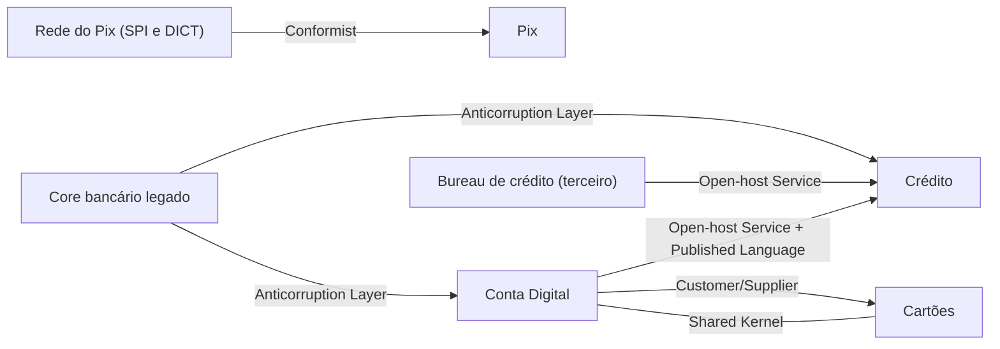

# Context Map

## Descrição

O Context Map é uma visão global dos Bounded Contexts de um projeto e dos relacionamentos reais entre eles. Ele registra quais contextos existem, onde passam as fronteiras, quem depende de quem (upstream e downstream) e que tipo de relação existe em cada ponto de integração, como Shared Kernel, Customer/Supplier ou Anticorruption Layer.

O mapa descreve a situação como ela é hoje, e não como se gostaria que fosse. Pode ser um diagrama, uma tabela ou um texto, desde que seja compartilhado e mantido pelos times. Cada contexto recebe um nome, que passa a fazer parte da linguagem comum da equipe, e cada relação deixa claro onde é necessário traduzir modelos ou coordenar mudanças.

Para Evans, o Context Map é o artefato central da modelagem estratégica: ele expõe as fricções entre times e modelos e guia decisões sobre onde investir em integração, onde isolar e onde aceitar a dependência.

## Problemas que resolve

- Fronteiras entre modelos implícitas, o que faz conceitos com o mesmo nome terem significados diferentes sem que ninguém perceba.
- Times que não sabem de quem dependem nem quem depende deles, descobrindo impactos só em produção.
- Integrações ad hoc, sem uma política clara de tradução ou de coordenação.
- Dificuldade de planejar mudanças que atravessam contextos e de dimensionar o esforço de integração.

## Quando usar

- Sempre que mais de um Bounded Context ou mais de um time participam do mesmo sistema ou ecossistema.
- Em iniciativas de modernização, para decidir onde isolar o legado e onde extrair novos serviços.
- Ao integrar com sistemas externos ou de terceiros, para tornar explícitas as dependências.

## Quando evitar

- Sistemas de contexto único, com um só time e um só modelo, em que o mapa seria cerimônia sem valor.
- Quando o mapa é desenhado como ideal futuro e nunca confrontado com a realidade; ele passa a enganar em vez de informar.

## Trade-offs

| Ganho | Custo / Risco |
| --- | --- |
| Visão compartilhada das fronteiras e dependências | Precisa ser mantido; mapas desatualizados são piores que nenhum |
| Expõe relações de poder e fricções entre times | Pode revelar conflitos organizacionais incômodos |
| Base para decisões de integração e de investimento | Esforço de levantamento inicial e de consenso |
| Vocabulário comum para falar de relações entre contextos | Risco de virar documento burocrático desligado do código |

- **Honestidade:** mapeie o que existe, inclusive relações ruins; a melhoria vem depois.
- **Granularidade:** comece com poucos contextos e refine; uma Big Ball of Mud pode aparecer como um único contexto no mapa.
- **Evolução:** revise o mapa quando times, produtos ou integrações mudarem.

## Diagrama

Cada aresta liga um contexto upstream ao seu downstream e é rotulada com o padrão de relacionamento que de fato vigora entre eles.

## Exemplo

A fintech tem os contextos Conta Digital, Pix, Cartões e Crédito, um core bancário legado e um bureau de crédito de terceiro, além da ligação com a rede do Pix. Ao desenhar o mapa, o time descobre que o contexto de Pix simplesmente adota o modelo de mensagens da rede do Pix (Conformist), que Crédito e Conta Digital precisam de uma camada de tradução para ler os dados antigos do core legado (Anticorruption Layer), que Conta Digital e Cartões compartilham um pequeno núcleo de tipos (Shared Kernel) e que Conta Digital expõe uma API estável para vários consumidores (Open-host Service).

Com isso, o time decide priorizar a reunião quinzenal entre Conta Digital e Cartões (Customer/Supplier) e planejar a retirada gradual do core legado, usando o mapa como referência de onde as traduções são necessárias.

## Padrões relacionados

- [Bounded Context](/design/ddd/model-in-practice/bounded-context) — os nós do mapa; sem fronteiras explícitas não há o que mapear.
- [Shared Kernel](/design/ddd/context-mapping/shared-kernel) — um dos relacionamentos que o mapa registra.
- [Customer/Supplier Development](/design/ddd/context-mapping/customer-supplier-development) — relação upstream/downstream com negociação.
- [Conformist](/design/ddd/context-mapping/conformist) — downstream que adota o modelo do upstream.
- [Anticorruption Layer](/architecture/cloud-design-patterns/integration-and-modernization/anti-corruption-layer) — tradução defensiva no lado downstream.
- [Open-host Service](/design/ddd/context-mapping/open-host-service) — protocolo aberto para muitos consumidores.
- [Published Language](/design/ddd/context-mapping/published-language) — linguagem comum de troca entre contextos.
- [Separate Ways](/design/ddd/context-mapping/separate-ways) — decisão explícita de não integrar.
- [Partnership](/design/ddd/context-mapping/partnership) — times com sucesso interdependente.
- [Big Ball of Mud](/design/ddd/context-mapping/big-ball-of-mud) — região do mapa onde os modelos estão misturados.
- [Decompose by Subdomain](/architecture/microservices/service-boundaries/decompose-by-subdomain) — usa subdomínios do DDD para definir serviços.

## Referência

- [DDD Reference, Eric Evans (2015)](https://www.domainlanguage.com/ddd/reference/)
- *Domain-Driven Design: Tackling Complexity in the Heart of Software*, Eric Evans (Addison-Wesley, 2003), cap. 14
- [DDD Crew: Context Mapping](https://github.com/ddd-crew/context-mapping)
