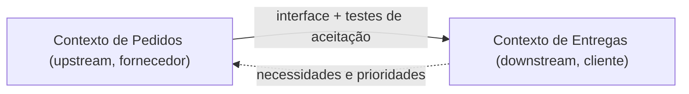

# Customer/Supplier Development

## Descrição

No Customer/Supplier Development, dois contextos têm uma relação upstream/downstream em que o time upstream (fornecedor, supplier) atende às necessidades do time downstream (cliente, customer). O downstream é, de fato, cliente do upstream, e suas necessidades influenciam o planejamento do fornecedor.

Para isso funcionar, os times estabelecem um relacionamento formal: o downstream participa do planejamento do upstream, as necessidades entram como histórias no backlog, e ambos definem em conjunto testes de aceitação automatizados que validam a interface. Esses testes passam a fazer parte do conjunto de testes do upstream, que pode mudar seu código sabendo que não quebra o cliente.

Sem esse acordo, o downstream fica à mercê das prioridades do upstream.

## Problemas que resolve

- Time downstream bloqueado por uma dependência cujo dono tem outras prioridades.
- Mudanças do upstream que quebram o downstream sem aviso.
- Falta de canal formal para o downstream pedir mudanças de interface e de modelo.
- Receio do upstream de alterar o próprio código por não saber quem depende dele.

## Quando usar

- Existe relação upstream/downstream clara entre dois times que pertencem à mesma organização ou a organizações cooperativas.
- O upstream tem interesse e autoridade para priorizar necessidades do downstream.
- É possível manter testes de aceitação compartilhados entre os dois lados.

## Quando evitar

- Quando o upstream não tem incentivo ou poder de atender o downstream, como fornecedores externos ou produtos de prateleira; prefira Conformist ou Anticorruption Layer.
- Quando os times já são tão próximos que uma Partnership seria mais adequada.
- Quando não há disciplina para manter os testes de aceitação; sem eles o acordo vira só promessa.

## Trade-offs

| Ganho | Custo / Risco |
| --- | --- |
| Downstream tem voz no planejamento do upstream | O upstream precisa dedicar capacidade às demandas do downstream |
| Testes de aceitação protegem a interface | Esforço de manter e evoluir os testes compartilhados |
| Menos surpresas por quebra de contrato | Depende de relações saudáveis e de apoio gerencial |
| Autonomia de cada time dentro de um contrato claro | O upstream pode ficar sobrecarregado com muitos clientes |

- **Prioridade:** o acordo só funciona se a gerência garantir que o upstream trate o downstream como cliente.
- **Escopo do modelo:** o downstream continua com o próprio modelo; só a interface é negociada.
- **Falha do acordo:** se o upstream não colabora, o downstream deve evoluir para Conformist ou Separate Ways.

## Diagrama

A interface flui do fornecedor para o cliente, enquanto as necessidades do cliente retornam como entrada do planejamento do fornecedor.

## Exemplo

O contexto de Entregas depende de Pedidos para saber peso, volume e janela de entrega. Entregas precisa que Pedidos exponha também a restrição de manuseio de itens frágeis. Os times combinam que essa necessidade entra no backlog de Pedidos na próxima iteração e escrevem juntos testes de aceitação automatizados sobre a nova API. O pipeline de Pedidos passa a rodar esses testes em toda mudança, garantindo que Entregas não seja quebrado.

## Padrões relacionados

- [Context Map](/design/ddd/context-mapping/context-map) — registra a relação upstream/downstream.
- [Conformist](/design/ddd/context-mapping/conformist) — o que o downstream faz quando o upstream não colabora.
- [Anticorruption Layer](/architecture/cloud-design-patterns/integration-and-modernization/anti-corruption-layer) — proteção do downstream quando o modelo upstream não serve.
- [Partnership](/design/ddd/context-mapping/partnership) — relação mais simétrica entre os times.
- [Open-host Service](/design/ddd/context-mapping/open-host-service) — quando o upstream atende muitos clientes com um protocolo comum.
- [Continuous Integration](/design/ddd/model-in-practice/continuous-integration) — os testes de aceitação rodam em integração contínua.

## Referência

- [DDD Reference, Eric Evans (2015)](https://www.domainlanguage.com/ddd/reference/)
- *Domain-Driven Design: Tackling Complexity in the Heart of Software*, Eric Evans (Addison-Wesley, 2003), cap. 14
- [DDD Crew: Context Mapping](https://github.com/ddd-crew/context-mapping)
