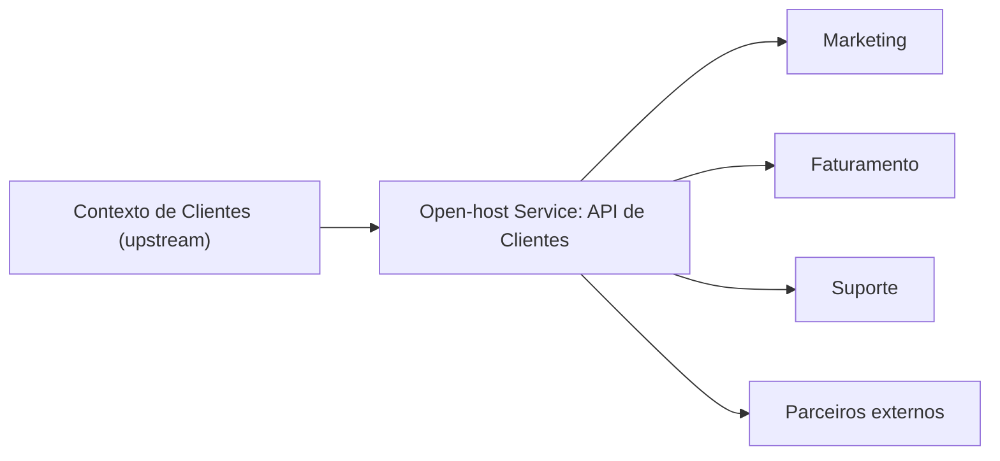

# Open-host Service

## Descrição

O Open-host Service define um protocolo que dá acesso ao seu subsistema como um conjunto de serviços. O protocolo é aberto, de forma que todos os que precisam se integrar possam usá-lo, e é aprimorado e expandido para tratar novos requisitos de integração, exceto aqueles que sejam idiossincráticos de um único time.

Em vez de criar um tradutor ou uma integração sob medida para cada consumidor, o contexto upstream publica uma interface coerente, estável e documentada, desenhada em torno de seu próprio modelo. Os consumidores se adaptam a ela, com ou sem Anticorruption Layer. Quando um consumidor tem uma necessidade pontual, ela é atendida do lado dele, e não alterando o protocolo.

Em geral o protocolo é descrito em uma Published Language, que serve de formato comum de troca.

## Problemas que resolve

- Explosão de integrações ponto a ponto, uma para cada consumidor do contexto.
- Custo crescente de manter tradutores sob medida dentro do upstream.
- Interfaces instáveis, que mudam de acordo com o último cliente que as pediu.
- Dificuldade de evoluir o upstream sem saber como cada consumidor o usa.

## Quando usar

- Um contexto é usado por vários consumidores, internos ou externos.
- É possível manter uma API estável, versionada e documentada.
- O upstream tem capacidade de evoluir o protocolo para novos requisitos comuns.

## Quando evitar

- Há um único consumidor; um relacionamento Customer/Supplier ou uma interface direta é mais barato.
- O contexto está em mudança rápida e o protocolo ainda não pode ser estabilizado.
- O custo de versionar e documentar não compensa para uso interno restrito.

## Trade-offs

| Ganho | Custo / Risco |
| --- | --- |
| Uma única interface atende muitos consumidores | Necessidade de manter e versionar um contrato público |
| Menor acoplamento entre o upstream e cada cliente | Consumidores com necessidades específicas precisam se adaptar |
| Evolução previsível, com compatibilidade | A API pode crescer em demasia tentando atender a todos |
| Facilita a integração de novos clientes | Modelo do upstream pode vazar para os consumidores |

- **Estabilidade:** o protocolo é um contrato; mudanças incompatíveis devem ser versionadas.
- **Formato:** combine com uma Published Language para o formato das mensagens.
- **Defesa do consumidor:** consumidores com modelos próprios podem proteger-se com uma Anticorruption Layer.

## Diagrama

O contexto de Clientes expõe um único protocolo aberto, consumido por vários contextos sem integrações sob medida.

## Exemplo

O contexto de Clientes de uma empresa tem quatro consumidores: Marketing, Faturamento, Suporte e parceiros externos. Em vez de criar uma exportação específica para cada um, o time publica uma API versionada, com recursos como `/customers/{id}` e eventos de mudança, descrita em uma Published Language. Quando Marketing pede um campo útil só para ele, o time de Marketing o calcula no próprio contexto a partir da API, sem alterar o protocolo.

## Padrões relacionados

- [Published Language](/design/ddd/context-mapping/published-language) — formato documentado usado pelo protocolo.
- [Context Map](/design/ddd/context-mapping/context-map) — registra o upstream como Open-host Service.
- [Anticorruption Layer](/architecture/cloud-design-patterns/integration-and-modernization/anti-corruption-layer) — proteção do consumidor que tem modelo próprio.
- [Customer/Supplier Development](/design/ddd/context-mapping/customer-supplier-development) — relação com um consumidor específico.
- [Conformist](/design/ddd/context-mapping/conformist) — consumidores que adotam o modelo do protocolo.
- [API Gateway](/architecture/microservices/external-api/api-gateway) — ponto de entrada que pode expor o serviço aberto a clientes externos.
- [Domain-specific Protocol](/architecture/microservices/communication-styles/domain-specific-protocol) — protocolo específico do domínio, relacionado à ideia de protocolo aberto.

## Referência

- [DDD Reference, Eric Evans (2015)](https://www.domainlanguage.com/ddd/reference/)
- *Domain-Driven Design: Tackling Complexity in the Heart of Software*, Eric Evans (Addison-Wesley, 2003), cap. 14
- [DDD Crew: Context Mapping](https://github.com/ddd-crew/context-mapping)
