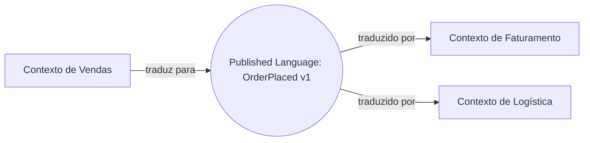

# Published Language

## Descrição

A Published Language é uma linguagem bem documentada, compartilhada e capaz de expressar o domínio necessário, usada como meio de comunicação comum entre contextos. A tradução entre o modelo de cada contexto e essa linguagem é feita por cada lado, em vez de um traduzir diretamente para o modelo do outro.

Evans sugere usar uma linguagem já estabelecida sempre que possível, como padrões da indústria (por exemplo, formatos de intercâmbio de dados de saúde ou financeiros), e só criar uma própria quando necessário. A linguagem é publicada, ou seja, tem esquema, documentação e versionamento acessíveis a quem precisa integrar.

Costuma andar junto ao Open-host Service: o serviço define o protocolo, e a Published Language define o formato das mensagens trafegadas.

## Problemas que resolve

- Tradução direta entre modelos de contextos distintos, que cresce em complexidade a cada novo participante.
- Ambiguidade nos dados trocados entre sistemas por falta de contrato documentado.
- Acoplamento do formato de troca ao modelo interno de um contexto.
- Dificuldade de integrar parceiros e terceiros sem conhecer o interior dos sistemas.

## Quando usar

- Vários contextos, internos ou externos, trocam informações e precisam de um formato único e estável.
- Existe um padrão de mercado que expressa bem o domínio.
- Há necessidade de documentar e versionar o contrato de integração.

## Quando evitar

- Somente dois contextos próximos se integram e um Shared Kernel ou uma tradução direta é suficiente.
- O custo de documentar e manter a linguagem supera o benefício, em integrações descartáveis.
- Padrões de mercado existentes não expressam bem o domínio e a adaptação os distorceria.

## Trade-offs

| Ganho | Custo / Risco |
| --- | --- |
| Contrato claro e independente de cada modelo interno | Esforço de definir, documentar e versionar a linguagem |
| Cada contexto traduz apenas uma vez, para a linguagem comum | Necessidade de manter um tradutor em cada lado |
| Facilita integração com novos participantes | Linguagem comum pode ficar genérica demais |
| Reduz ambiguidades com esquemas e exemplos | Evolução exige compatibilidade e governança |

- **Versionamento:** defina regras de compatibilidade desde o início.
- **Formatos:** XML Schema, JSON Schema, Protocol Buffers ou Avro são formas comuns de especificar a linguagem.
- **Governança:** alguém precisa ser dono do esquema e aprovar mudanças.

## Diagrama



Cada contexto traduz entre seu modelo interno e a linguagem publicada, sem conhecer o modelo dos demais.

## Exemplo

O contexto de Vendas publica o evento `OrderPlaced`, descrito em um JSON Schema versionado. Faturamento e Logística leem esse evento e o traduzem para o próprio modelo.

```json
{
  "type": "OrderPlaced",
  "version": 1,
  "orderId": "ord-1042",
  "customerId": "cus-77",
  "currency": "BRL",
  "items": [
    { "sku": "SKU-9", "quantity": 2, "unitPrice": "49.90" }
  ],
  "placedAt": "2026-03-10T14:32:00Z"
}
```

Os campos são definidos em termos de negócio e não expõem tabelas ou classes internas de Vendas.

## Padrões relacionados

- [Open-host Service](/design/ddd/context-mapping/open-host-service) — o serviço que expõe a linguagem publicada.
- [Context Map](/design/ddd/context-mapping/context-map) — onde a linguagem é registrada como meio de integração.
- [Anticorruption Layer](/architecture/cloud-design-patterns/integration-and-modernization/anti-corruption-layer) — tradução do consumidor entre a linguagem e o modelo interno.
- [Conformist](/design/ddd/context-mapping/conformist) — consumidor que adota a linguagem do upstream como modelo.
- [Ubiquitous Language](/design/ddd/model-in-practice/ubiquitous-language) — linguagem interna de um contexto, distinta da linguagem publicada.
- [Domain-specific Protocol](/architecture/microservices/communication-styles/domain-specific-protocol) — protocolo específico de domínio para comunicação entre serviços.

## Referência

- [DDD Reference, Eric Evans (2015)](https://www.domainlanguage.com/ddd/reference/)
- *Domain-Driven Design: Tackling Complexity in the Heart of Software*, Eric Evans (Addison-Wesley, 2003), cap. 14
- [DDD Crew: Context Mapping](https://github.com/ddd-crew/context-mapping)
