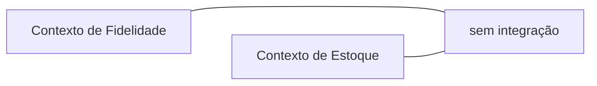

# Separate Ways

## Descrição

No Separate Ways, dois contextos decidem de forma explícita não se integrar. Cada um resolve o seu problema de modo independente, com o próprio modelo, mesmo que isso signifique duplicar alguma funcionalidade ou alguns dados.

A integração tem custo permanente: coordenar mudanças, traduzir modelos e manter contratos. Quando o benefício esperado é pequeno, é mais barato cortar o vínculo. Evans observa que, se duas funcionalidades não têm dependência significativa, não precisam estar no mesmo contexto nem ligadas por uma interface.

Como decisão estratégica, deve aparecer no Context Map para que ninguém tente reconectar os contextos sem avaliar o custo.

## Problemas que resolve

- Integrações cujo custo de manutenção supera o valor que entregam.
- Acoplamento organizacional desnecessário entre times que poderiam trabalhar sozinhos.
- Modelos forçados a se conciliar quando não têm requisitos em comum.

## Quando usar

- O benefício de integrar é pequeno ou duvidoso.
- Os contextos atendem a necessidades de negócio distintas, sem fluxo relevante entre eles.
- É possível duplicar uma pequena funcionalidade ou usar uma solução simples e local.

## Quando evitar

- Há fluxos de negócio importantes que dependem de dados dos dois contextos.
- A duplicação gera inconsistências que os usuários percebem ou que violam regras do negócio.
- Aplicável ao Core Domain, onde a duplicação pode custar diferenciação ou receita.

## Trade-offs

| Ganho | Custo / Risco |
| --- | --- |
| Autonomia total e nenhum custo de integração | Duplicação de funcionalidades e de dados |
| Cada contexto evolui no próprio ritmo | Possível inconsistência entre as duas visões do negócio |
| Modelos simples, sem tradução | Dificuldade de ter uma visão unificada, como em relatórios |
| Menos coordenação entre times | Integração futura será mais cara, se for necessária |

- **Reversibilidade:** é possível voltar atrás e integrar depois, mas com custo maior.
- **Visibilidade:** registre a decisão e o motivo, para que não seja revertida por inércia.

## Diagrama

Os dois contextos coexistem no mesmo ecossistema, mas sem qualquer relação de integração.

## Exemplo

Uma rede de lojas considera integrar o programa de Fidelidade ao módulo de Gestão de Estoque, para que o estoque considere o volume de clientes fiéis. O time conclui que o ganho é marginal e o custo de manter a integração seria alto. Os contextos seguem caminhos separados: Fidelidade mantém seu cadastro de lojas, mesmo que isso duplique alguns dados, e a decisão é registrada no Context Map.

## Padrões relacionados

- [Context Map](/design/ddd/context-mapping/context-map) — onde a decisão deve ser registrada.
- [Bounded Context](/design/ddd/model-in-practice/bounded-context) — a fronteira que permite separar os caminhos.
- [Shared Kernel](/design/ddd/context-mapping/shared-kernel) — extremo oposto, com compartilhamento forte.
- [Partnership](/design/ddd/context-mapping/partnership) — extremo oposto, de cooperação estreita.
- [Conformist](/design/ddd/context-mapping/conformist) — alternativa quando a integração é necessária mas não vale a pena traduzir.
- [Decompose by Subdomain](/architecture/microservices/service-boundaries/decompose-by-subdomain) — subdomínios independentes favorecem separação.

## Referência

- [DDD Reference, Eric Evans (2015)](https://www.domainlanguage.com/ddd/reference/)
- *Domain-Driven Design: Tackling Complexity in the Heart of Software*, Eric Evans (Addison-Wesley, 2003), cap. 14
- [DDD Crew: Context Mapping](https://github.com/ddd-crew/context-mapping)
