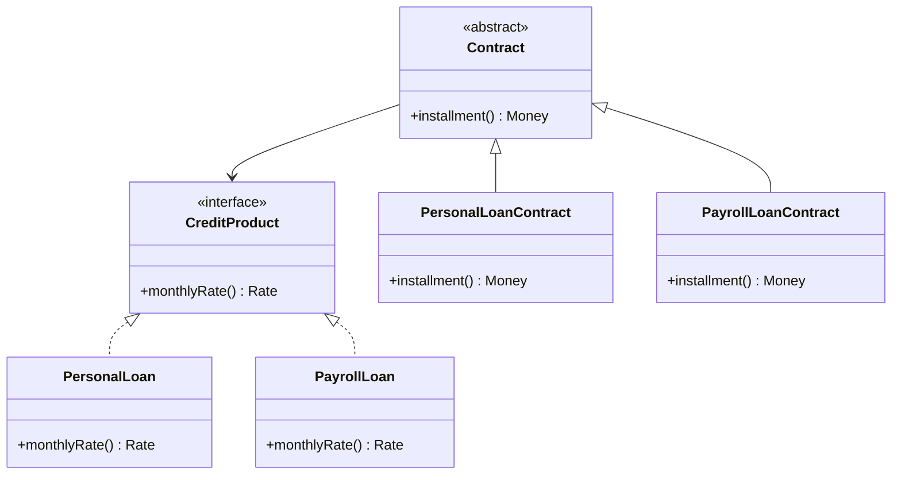

# Abstract Core

## Descrição

O Abstract Core é um módulo separado que contém os conceitos mais fundamentais do modelo, expressos como classes abstratas e interfaces. Ele captura o vocabulário e as interações essenciais entre os subdomínios, sem os detalhes de implementação que variam de um para o outro.

Os módulos especializados dependem do Abstract Core e implementam ou estendem seus tipos, mas não dependem uns dos outros diretamente. Isso permite entender o modelo de alto nível lendo apenas o núcleo abstrato, e reduz o acoplamento entre as partes especializadas.

É um recurso mais forte do que o [Highlighted Core](/design/ddd/distillation/highlighted-core), pois muda a estrutura do código, mas pode ser menos invasivo que um [Segregated Core](/design/ddd/distillation/segregated-core) quando o core é muito grande para ser movido por inteiro. Só vale a pena quando há muita interação entre módulos e um conjunto de conceitos claramente estável.

## Problemas que resolve

- Modelo grande, em que muitos módulos se comunicam entre si e criam uma teia de dependências.
- Dificuldade de entender o todo sem percorrer cada módulo especializado.
- Tipos concretos espalhados, forçando mudanças em cascata quando um módulo evolui.
- Falta de um vocabulário comum que atravesse os subdomínios.

## Quando usar

- Quando há muita interação entre módulos e um núcleo conceitual estável pode ser identificado.
- Quando o core é grande demais para ser segregado por inteiro.
- Quando se quer que módulos especializados possam variar sem afetar uns aos outros.

## Quando evitar

- Quando o modelo ainda está mudando rapidamente e não há conceitos estáveis o suficiente para abstrair.
- Quando poucos módulos interagem; as abstrações seriam cerimônia sem ganho.
- Quando abstrair esconde regras de negócio importantes ou gera indireção excessiva.

## Trade-offs

| Ganho | Custo / Risco |
| --- | --- |
| Visão de alto nível em um único módulo | Abstrações prematuras podem engessar o modelo |
| Módulos especializados desacoplados entre si | Mais indireção e mais tipos a manter |
| Vocabulário comum entre subdomínios | Exige maturidade para identificar o que é realmente estável |
| Facilita testes com implementações alternativas | Mudanças no núcleo abstrato afetam todos os módulos |

- **Estabilidade:** o núcleo abstrato muda pouco; modificá-lo tem impacto amplo e exige cuidado.
- **Dependências:** apontam sempre dos módulos especializados para o núcleo, nunca na outra direção.
- **Compromisso:** é necessário decidir o que entra no núcleo; muito conteúdo o transforma em uma segunda cópia do modelo.

## Diagrama



`Contract` e `CreditProduct` formam o núcleo abstrato; os módulos de crédito pessoal e de consignado o especializam sem se conhecerem.

## Exemplo

Uma fintech oferece crédito pessoal e consignado, com módulos que evoluem em ritmos diferentes. Ambos precisam participar de campanhas de oferta, renegociações e relatórios de exposição da carteira, o que levou a dependências diretas entre os módulos.

A equipe cria o módulo `credit-core`, com apenas `CreditProduct`, `Contract` e `Installment`, em termos abstratos. Os módulos `personal-loan` e `payroll-loan` o implementam, e renegociações e relatórios passam a depender só das abstrações.

```java
// módulo credit-core
public interface CreditProduct { Rate monthlyRate(); }

public abstract class Contract {
    protected final CreditProduct product;
    protected final Money principal;
    protected final int months;
    protected Contract(CreditProduct product, Money principal, int months) {
        this.product = product; this.principal = principal; this.months = months;
    }
    public abstract Money installment();
}

// módulo payroll-loan (depende de credit-core)
public class PayrollLoanContract extends Contract {
    public PayrollLoanContract(PayrollLoan product, Money principal, int months) {
        super(product, principal, months);
    }
    // Parcela fixa (Price), descontada em folha.
    public Money installment() { return PriceTable.installment(principal, product.monthlyRate(), months); }
}
```

## Padrões relacionados

- [Core Domain](/design/ddd/distillation/core-domain) — o Abstract Core é uma forma de organizar e comunicar o core.
- [Highlighted Core](/design/ddd/distillation/highlighted-core) — alternativa mais leve, que não altera a estrutura.
- [Segregated Core](/design/ddd/distillation/segregated-core) — alternativa que move o core inteiro, em vez de extrair apenas abstrações.
- [Module](/design/ddd/building-blocks/module) — o núcleo abstrato vive em um módulo próprio.
- [Knowledge Level](/design/ddd/large-scale-structure/knowledge-level) — outra forma de separar conceitos abstratos e regras configuráveis.
- [Pluggable Component Framework](/design/ddd/large-scale-structure/pluggable-component-framework) — usa interfaces abstratas para permitir componentes intercambiáveis.
- [Separated Interface](/design/poeaa/base/separated-interface) — técnica para colocar interface e implementação em pacotes distintos.
- [Abstract Factory](/coding/gof/creational/abstract-factory) — comumente usada para criar implementações sem conhecer os tipos concretos.

## Referência

- [DDD Reference, Eric Evans (2015)](https://www.domainlanguage.com/ddd/reference/)
- *Domain-Driven Design: Tackling Complexity in the Heart of Software*, Eric Evans (Addison-Wesley, 2003)
