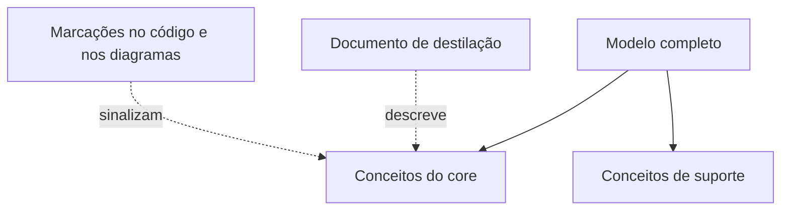

# Highlighted Core

## Descrição

O Highlighted Core torna o [Core Domain](/design/ddd/distillation/core-domain) fácil de encontrar dentro de um modelo grande, sem alterar a estrutura do código. Ele combina dois recursos leves: um documento de destilação e marcações explícitas no próprio modelo.

O documento de destilação é uma descrição muito curta (de três a sete páginas, no máximo) com os conceitos centrais e as interações entre eles, escrito de forma que qualquer membro da equipe possa lê-lo. As marcações, por sua vez, sinalizam no repositório quais módulos ou classes pertencem ao core, por exemplo com anotações, convenções de nomes ou destaque nos diagramas.

A vantagem é a baixa intrusão: o núcleo ganha visibilidade imediata sem a necessidade de refatorar pacotes. Quando o custo de separar fisicamente é alto, esse é o passo inicial, e a separação estrutural pode vir depois com o [Segregated Core](/design/ddd/distillation/segregated-core).

## Problemas que resolve

- Desenvolvedores que não sabem quais partes do código são centrais e quais são de suporte.
- Mudanças feitas no core sem o cuidado extra que ele exige.
- O core diluído entre muitos elementos de aparência igual.
- Dificuldade de explicar o essencial do modelo a quem chega ao projeto.

## Quando usar

- Quando o core foi identificado, mas reestruturar o código agora é caro ou arriscado.
- Quando a equipe é grande ou rotativa e precisa de orientação rápida.
- Como primeiro passo, antes de decidir por uma separação estrutural.

### Quando evitar

- Quando o modelo é pequeno e o core é óbvio para todos.
- Quando o documento de destilação não será mantido, pois ele se descola da realidade rapidamente.
- Quando o acoplamento entre core e o restante é o verdadeiro problema; marcar não resolve a dependência, e o caso pede um [Segregated Core](/design/ddd/distillation/segregated-core).

## Trade-offs

| Ganho | Custo / Risco |
| --- | --- |
| Visibilidade do core com pouco esforço | Não reduz o acoplamento entre core e o resto |
| Sem refatoração estrutural | Marcações e documento podem ficar desatualizados |
| Orienta novos membros e revisões de código | Exige disciplina de manter o destaque consistente |
| Compatível com qualquer estrutura de código | Pode dar falsa sensação de que o problema está resolvido |

- **Manutenção:** o documento deve ser revisado sempre que o core mudar; ele só é útil se refletir o modelo atual.
- **Formato:** o importante é a visibilidade, por isso pode ser um arquivo no repositório, uma seção de wiki ou uma anotação no código.
- **Evolução:** costuma ser a etapa que antecede uma separação estrutural.

## Diagrama

O modelo permanece inteiro, mas o documento de destilação e as marcações apontam quais conceitos pertencem ao core.

## Exemplo

Uma seguradora tem um grande módulo de apólices em que a precificação de risco é o core, mas as classes estão misturadas com cadastro, cobrança e relatórios. Refatorar tudo agora atrasaria o roadmap em meses.

A equipe escreve um documento de duas páginas na raiz do repositório, `CORE.md`, listando os conceitos centrais (`RiskProfile`, `PremiumCalculator`, `UnderwritingRule`) e como interagem. Essas classes recebem uma anotação `@CoreDomain`, o diagrama principal as destaca em cor e as revisões de código nelas exigem um segundo revisor sênior.

## Padrões relacionados

- [Core Domain](/design/ddd/distillation/core-domain) — o conceito que está sendo destacado.
- [Domain Vision Statement](/design/ddd/distillation/domain-vision-statement) — descreve o valor do core, enquanto este padrão aponta onde ele está.
- [Segregated Core](/design/ddd/distillation/segregated-core) — alternativa estrutural, mais forte e mais cara.
- [Abstract Core](/design/ddd/distillation/abstract-core) — outra forma de resumir o core, com um módulo de conceitos abstratos em vez de documento.
- [Module](/design/ddd/building-blocks/module) — módulos são a unidade natural a destacar.
- [Context Map](/design/ddd/context-mapping/context-map) — também funciona como um destaque de alto nível, entre contextos.

## Referência

- [DDD Reference, Eric Evans (2015)](https://www.domainlanguage.com/ddd/reference/)
- *Domain-Driven Design: Tackling Complexity in the Heart of Software*, Eric Evans (Addison-Wesley, 2003)
