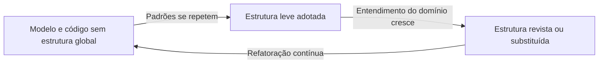

# Evolving Order

## Descrição

Evolving Order é o princípio que guia todas as estruturas de larga escala do DDD: a estrutura global de um sistema não deve ser imposta de cima para baixo no início do projeto, e sim deixada evoluir junto com a aplicação. Uma estrutura imposta cedo demais, sem conhecimento do domínio, acaba restringindo decisões de modelagem e se torna um fardo que as equipes contornam ou abandonam.

Em vez disso, a estrutura é tratada como algo vivo. Ela surge de padrões que se repetem no modelo, é adotada de forma enxuta e é revista conforme o entendimento do domínio amadurece. Uma boa estrutura de larga escala dá orientação e coerência sem engessar: ela deve restringir o mínimo possível e permitir que o modelo continue se aprofundando.

Na prática, isso significa começar sem estrutura (ou com uma muito leve), observar onde a equipe sente falta de uma visão geral e só então introduzir um padrão como System Metaphor, Responsibility Layers, Knowledge Level ou Pluggable Component Framework. O padrão escolhido pode ser trocado ou descartado quando deixar de servir.

## Problemas que resolve

- Estruturas arquiteturais impostas no início do projeto que não combinam com o domínio real e viram camisa de força.
- Sistemas com muitos módulos e conceitos em que ninguém consegue enxergar o conjunto, o que gera decisões inconsistentes entre equipes.
- Estruturas "corporativas" aplicadas a todos os projetos sem considerar o contexto, obrigando contorcer o modelo para encaixá-lo.
- Estruturas que ficam obsoletas, mas continuam sendo seguidas por inércia.

## Quando usar

- Sistemas grandes, com muitos módulos e várias equipes, em que a falta de uma visão de conjunto já causa inconsistência.
- Quando a equipe já tem modelo suficiente para reconhecer padrões que se repetem entre módulos.
- Em projetos que praticam refatoração contínua e aceitam mudar a estrutura quando o entendimento muda.

### Quando evitar

- Sistemas pequenos, em que os módulos e o Ubiquitous Language já dão ordem suficiente e uma estrutura extra é custo sem retorno.
- Quando se tenta usar uma estrutura de larga escala como substituto de bons limites de contexto: o problema então é de Bounded Context, não de estrutura.
- Equipes que não têm autonomia para refatorar e acabam cristalizando a primeira estrutura escolhida.

## Trade-offs

| Ganho | Custo / Risco |
| --- | --- |
| Estrutura adequada ao domínio real, e não suposta | Exige disciplina para rever e refatorar a estrutura com frequência |
| Menos restrição ao design das partes | Durante a transição, o sistema pode ter ordens parcialmente aplicadas |
| Visão de conjunto sem burocracia | Sem critério, a "evolução" vira ausência de estrutura |
| Decisões de estrutura tomadas com mais informação | Exige conhecimento do domínio e experiência para reconhecer padrões úteis |

- **Custo de mudança:** mudar a estrutura toca muitos módulos; por isso ela precisa ser leve e ter poucas regras.
- **Autoridade:** uma estrutura só funciona se as equipes a seguem; quem a define deve conhecer o código e ouvir os desenvolvedores.
- **Minimalismo:** a melhor estrutura é a mais simples que resolve o problema atual.

## Diagrama

O sistema começa sem estrutura global, adota uma versão leve ao perceber padrões recorrentes e a revisa ou substitui conforme o conhecimento do domínio evolui, num ciclo contínuo.

## Exemplo

Uma operadora de logística tem quatro equipes cuidando de roteirização, armazenagem, faturamento e rastreio. No início, cada equipe organiza seus módulos como quer. Após alguns meses, os desenvolvedores percebem que quase todo conceito do sistema fica em um de dois níveis: regras de decisão (política de roteirização, política de cobrança) e operações do dia a dia (movimentar carga, emitir fatura).

A equipe então adota uma estrutura de Responsibility Layers com apenas essas duas camadas e uma regra simples de dependência. Um ano depois, ao incluir parceiros terceirizados, a divisão em duas camadas se mostra insuficiente e é refinada para três, sem reescrever o sistema: apenas módulos que não se encaixavam foram movidos. A estrutura nunca foi desenhada por completo de antemão, só ajustada quando a dor apareceu.

## Padrões relacionados

- [System Metaphor](/design/ddd/large-scale-structure/system-metaphor) — uma das estruturas que podem emergir e ser adotadas quando um conceito do domínio ordena o conjunto.
- [Responsibility Layers](/design/ddd/large-scale-structure/responsibility-layers) — estrutura que costuma emergir da observação de responsabilidades recorrentes.
- [Knowledge Level](/design/ddd/large-scale-structure/knowledge-level) — estrutura adotada quando regras de configuração do modelo precisam variar.
- [Pluggable Component Framework](/design/ddd/large-scale-structure/pluggable-component-framework) — estrutura de alto custo, adotada só quando há maturidade para isso.
- [Refactoring Toward Deeper Insight](/design/ddd/model-in-practice/refactoring-toward-deeper-insight) — o mecanismo pelo qual a estrutura é revista.
- [Module](/design/ddd/building-blocks/module) — unidade básica que as estruturas de larga escala organizam.
- [Bounded Context](/design/ddd/model-in-practice/bounded-context) — limite de contexto que precisa ser resolvido antes de recorrer a estruturas de larga escala.

## Referência

- [DDD Reference, Eric Evans (2015)](https://www.domainlanguage.com/ddd/reference/)
- *Domain-Driven Design: Tackling Complexity in the Heart of Software*, Eric Evans (Addison-Wesley, 2003)
