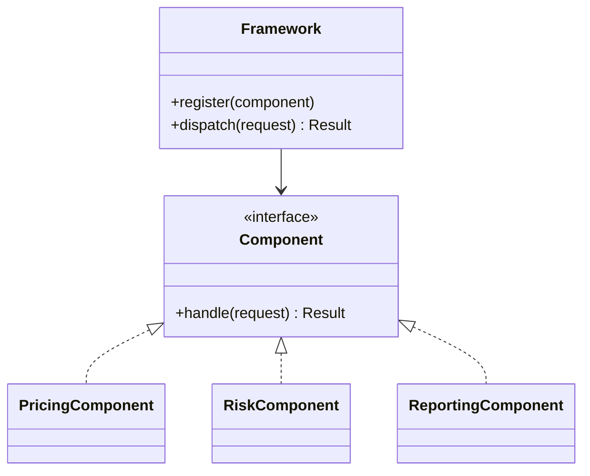

# Pluggable Component Framework

## Descrição

Pluggable Component Framework é uma estrutura de larga escala que surge quando um domínio maduro tem várias aplicações ou grupos de componentes que precisam interoperar. Define-se uma interface de abstração central, mantida e compartilhada, que expressa o núcleo do modelo, e vários componentes independentes (muitas vezes de equipes diferentes) são escritos para se encaixar nessa interface.

O framework fixa os pontos de conexão, as interfaces e os protocolos de interação, enquanto os componentes implementam variações. Nele, o Abstract Core define o vocabulário comum e os componentes dependem apenas dele, sem conhecerem uns aos outros. Assim, é possível substituir, adicionar ou evoluir componentes sem mexer nos demais.

Evans alerta que este é um padrão de alto investimento e alto risco: exige um domínio bem entendido, uma abstração central estável e disciplina entre equipes. Por isso só deve ser adotado depois de se ter vivido a experiência de vários componentes concretos, nunca de início, como um "framework a priori".

## Problemas que resolve

- Várias equipes construindo aplicações sobre o mesmo domínio e duplicando ou divergindo no modelo central.
- Integração difícil entre componentes que nasceram separados e usam abstrações incompatíveis.
- Dificuldade de trocar ou estender partes do sistema sem afetar o restante.
- Necessidade de oferecer pontos de extensão para parceiros ou variantes de um produto.

## Quando usar

- Quando várias aplicações ou componentes compartilham o mesmo núcleo de domínio e já existe experiência com pelo menos duas ou três implementações concretas.
- Quando as equipes precisam de autonomia, mas dependem de um contrato comum estável.
- Quando há um Abstract Core claro, extraído de componentes existentes por refatoração.

### Quando evitar

- Projetos em que há uma única aplicação ou poucos componentes: o custo da abstração supera o benefício.
- Domínios ainda em descoberta, onde a abstração central muda a cada iteração e arrasta todos os componentes.
- Quando o framework nasce de uma especulação, sem componentes reais que justifiquem cada ponto de extensão.
- Quando uma simples Separated Interface ou Plugin resolve o problema de extensibilidade.

## Trade-offs

| Ganho | Custo / Risco |
| --- | --- |
| Componentes independentes e substituíveis | Altíssimo custo de design e de manutenção do framework |
| Autonomia das equipes de componentes | Mudanças na abstração central afetam todos os componentes |
| Interoperabilidade garantida pelo contrato comum | Restringe o modelo dos componentes ao que a interface permite |
| Possibilidade de ecossistema e de variantes | Se mal desenhado, é uma generalização prematura difícil de desfazer |

- **Estabilidade:** a interface central precisa ser estável e versionada com cuidado.
- **Governança:** exige uma equipe responsável pelo framework e processos claros de evolução.
- **Alternativa:** muitas vezes é melhor ficar com módulos acoplados por Shared Kernel ou por um Abstract Core simples.

## Diagrama



O `Framework` conhece apenas a interface `Component`; cada componente concreto implementa o contrato e pode ser desenvolvido e substituído de forma independente.

## Exemplo

Uma corretora de seguros tem vários produtos (auto, residencial, vida), cada um desenvolvido por uma equipe. Após três produtos prontos, a organização extrai o que eles têm em comum e define um contrato `ProductModule` com operações como cotar, emitir e renovar. A plataforma carrega os módulos e os orquestra.

```python
from abc import ABC, abstractmethod

class ProductModule(ABC):
    @abstractmethod
    def quote(self, request) -> "Quote": ...

    @abstractmethod
    def issue(self, quote) -> "Policy": ...

class Platform:
    def __init__(self):
        self._modules: dict[str, ProductModule] = {}

    def register(self, product_code: str, module: ProductModule):
        self._modules[product_code] = module

    def quote(self, product_code: str, request):
        return self._modules[product_code].quote(request)
```

Uma nova equipe pode criar o produto "viagem" implementando `ProductModule` e registrando-o, sem alterar a plataforma nem os outros produtos.

## Padrões relacionados

- [Abstract Core](/design/ddd/distillation/abstract-core) — a interface central do framework é, na prática, um Abstract Core.
- [Evolving Order](/design/ddd/large-scale-structure/evolving-order) — o framework só deve surgir depois de a estrutura ter amadurecido.
- [Knowledge Level](/design/ddd/large-scale-structure/knowledge-level) — outra forma de tornar o sistema configurável, por dados em vez de componentes.
- [Shared Kernel](/design/ddd/context-mapping/shared-kernel) — alternativa mais simples de compartilhamento entre equipes.
- [Open Host Service](/design/ddd/context-mapping/open-host-service) — protocolo aberto para integração, que um framework pode adotar.
- [Cohesive Mechanisms](/design/ddd/distillation/cohesive-mechanisms) — mecanismos que podem ser encapsulados em componentes do framework.
- [Plugin](/design/poeaa/base/plugin) — mecanismo técnico de ligação de implementações em tempo de configuração.
- [Separated Interface](/design/poeaa/base/separated-interface) — separa a interface da implementação, base técnica dos componentes.
- [Strategy](/coding/gof/behavioral/strategy) — variação de comportamento atrás de uma interface, em escala menor.

## Referência

- [DDD Reference, Eric Evans (2015)](https://www.domainlanguage.com/ddd/reference/)
- *Domain-Driven Design: Tackling Complexity in the Heart of Software*, Eric Evans (Addison-Wesley, 2003)
