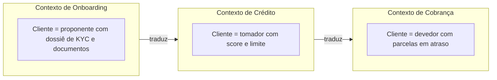

# Bounded Context

## Descrição

Um Bounded Context define explicitamente a fronteira dentro da qual um modelo de domínio específico se aplica. Dentro dessa fronteira, cada termo tem um único significado e o modelo é internamente consistente; fora dela, o mesmo termo pode significar outra coisa, e isso é aceito.

A fronteira é definida em termos práticos: organização dos times, partes da aplicação, base de código e esquema do banco de dados. Em vez de perseguir um modelo único e universal para toda a empresa, o DDD aceita vários modelos, cada um com seu contexto, e trata o relacionamento entre eles de forma explícita por meio do Context Map.

O Bounded Context é o alicerce do design estratégico: é nele que a Ubiquitous Language ganha significado preciso e é a partir dele que se decide onde investir esforço de modelagem.

## Problemas que resolve

- Conceitos ambíguos, como "Cliente" ou "Produto", com significados conflitantes em áreas diferentes do negócio.
- Modelo "unificado" que tenta agradar a todos e acaba inconsistente e confuso.
- Times pisando no código uns dos outros por falta de fronteiras claras.
- Vazamento de conceitos de um modelo para outro, corrompendo ambos.

## Quando usar

- Quando o mesmo termo tem significados diferentes para áreas distintas do negócio.
- Quando mais de um time contribui para o mesmo sistema e o modelo começa a ficar incoerente.
- Ao desenhar a decomposição de um sistema grande, seja em módulos ou em serviços.

## Quando evitar

- Sistemas pequenos, mantidos por um único time, em que um único modelo coeso é suficiente.
- Quando a fronteira é traçada só por critério técnico (camadas, tecnologia) e ignora o significado do domínio.

## Trade-offs

| Ganho | Custo / Risco |
| --- | --- |
| Modelo consistente e vocabulário preciso dentro da fronteira | Duplicação de conceitos entre contextos |
| Times com autonomia para evoluir seu modelo | Necessidade de tradução e integração nas fronteiras |
| Base para decompor em módulos ou serviços | Fronteiras mal traçadas são caras de corrigir depois |

- **Integração:** os relacionamentos entre contextos precisam ser mapeados e gerenciados, em geral com um Context Map.
- **Fronteira organizacional:** o contexto costuma coincidir com a fronteira de um time; a Lei de Conway atua a favor ou contra.
- **Consistência:** a consistência do modelo vale só dentro do contexto; entre contextos ela é negociada.

## Diagrama

O termo "Cliente" tem um modelo próprio em cada contexto, e as setas indicam pontos de tradução entre eles.

## Exemplo

Uma fintech tinha uma única classe `Customer` com dezenas de atributos, alterada pelos times de Onboarding, Crédito e Cobrança. Cada mudança de um time quebrava outro, e o status "bloqueado" significava KYC pendente para um time e inadimplência para outro. A equipe separou três Bounded Contexts: em Onboarding, o cliente é um proponente com dossiê de KYC e documentos; em Crédito, é um tomador com `RiskScore` e limite aprovado; em Cobrança, é um devedor com parcelas em atraso e acordos de pagamento.

Cada contexto passou a ter seu modelo, seu código e seu esquema de banco, com um identificador de cliente compartilhado como única ligação. As integrações passaram por uma camada de tradução, e o vocabulário de cada time ficou preciso dentro do seu contexto.

## Padrões relacionados

- [Ubiquitous Language](/design/ddd/model-in-practice/ubiquitous-language) — a linguagem vale dentro de um Bounded Context.
- [Continuous Integration](/design/ddd/model-in-practice/continuous-integration) — mantém o modelo coeso dentro da fronteira.
- [Context Map](/design/ddd/context-mapping/context-map) — descreve os relacionamentos entre Bounded Contexts.
- [Anticorruption Layer](/architecture/cloud-design-patterns/integration-and-modernization/anti-corruption-layer) — protege o modelo de influências externas.
- [Shared Kernel](/design/ddd/context-mapping/shared-kernel) — subconjunto do modelo compartilhado entre contextos.
- [Decompose by Subdomain](/architecture/microservices/service-boundaries/decompose-by-subdomain) — Bounded Contexts costumam guiar a divisão em microsserviços.
- [Database per Service](/architecture/microservices/service-collaboration/database-per-service) — reforça a fronteira do modelo no armazenamento.

## Referência

- [BoundedContext, bliki de Martin Fowler](https://martinfowler.com/bliki/BoundedContext.html)
- [DDD Reference, Eric Evans (2015)](https://www.domainlanguage.com/ddd/reference/)
- *Domain-Driven Design: Tackling Complexity in the Heart of Software*, Eric Evans (Addison-Wesley, 2003)
