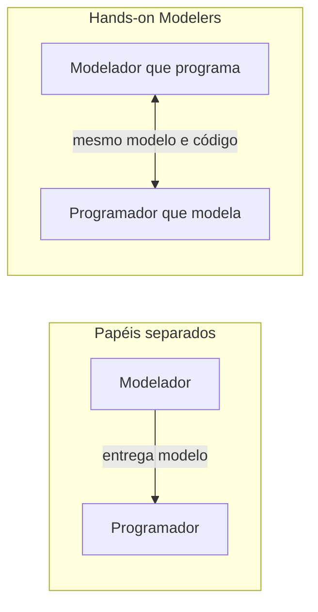

# Hands-on Modelers

## Descrição

Hands-on Modelers é o princípio de que toda pessoa que contribui com o modelo deve também ter contato com o código, e toda pessoa que altera o código deve participar da conversa sobre o modelo. Se o modelador se afasta da implementação, ele perde o senso das restrições práticas, e o modelo vira uma abstração que não funciona na prática.

Do outro lado, se os programadores recebem o modelo pronto e apenas o implementam, o feedback da implementação não volta para o modelo, e eles tendem a ignorar o que ele pretendia. Um modelo só se mantém útil se quem o desenha sente suas limitações ao escrever código.

Isso não significa que todo mundo faz tudo: arquitetos e analistas podem liderar a modelagem, desde que programem de verdade, ao menos em parte do tempo, no mesmo código.

## Problemas que resolve

- Modelos de "torre de marfim" desenhados por quem não implementa e que não funcionam no código.
- Programadores que implementam sem entender a intenção do modelo e criam um design paralelo.
- Feedback lento ou inexistente entre o modelo e a implementação.
- Separação de papéis entre analistas e desenvolvedores que fragmenta o conhecimento.

## Quando usar

- Em projetos DDD em que o modelo é o centro do design.
- Quando se percebe que o modelo diz uma coisa e o código faz outra.
- Para equipes pequenas ou médias capazes de colaborar de perto.

### Quando evitar

- Em organizações em que arquitetos não podem tocar no código por restrições formais; nesse caso, o padrão exige mudança de processo antes.
- Como justificativa para que todos alterem tudo sem coordenação, sem cuidado com a integração do modelo.

## Trade-offs

| Ganho | Custo / Risco |
| --- | --- |
| Modelos que respeitam as restrições reais de implementação | Exige que modeladores mantenham habilidade técnica |
| Feedback rápido entre modelo e código | Desafia estruturas organizacionais com papéis rígidos |
| Conhecimento do domínio distribuído no time | Tempo de modelador gasto também com código |

- **Papéis:** o padrão questiona a divisão estrita entre arquitetos, analistas e programadores.
- **Escala:** funciona melhor em contextos com time pequeno, perto da prática de Continuous Integration.
- **Cultura:** depende de confiança e de respeito entre especialistas e desenvolvedores.

## Diagrama

No arranjo com papéis separados, o fluxo é de mão única; com Hands-on Modelers, modelo e código são trabalhados pelas mesmas pessoas e o feedback é contínuo.

## Exemplo

Uma arquiteta de uma fintech desenhava diagramas de domínio para o contexto de Pagamentos e passava aos desenvolvedores, que implementavam à sua maneira. Os diagramas logo ficaram desatualizados. A empresa mudou a prática: a arquiteta passou a dedicar parte da semana a programar no mesmo repositório, em pareamento com os desenvolvedores.

Ao implementar uma regra de estorno, ela percebeu que o modelo desenhado exigia consultar três agregados em uma transação, algo inviável. Reformulou o modelo ali mesmo, com os colegas, e o novo desenho foi direto para o código. Os desenvolvedores, por sua vez, passaram a participar das conversas com os especialistas de negócio.

## Padrões relacionados

- [Model-Driven Design](/design/ddd/model-in-practice/model-driven-design) — o princípio que exige que modelo e código sejam um só.
- [Ubiquitous Language](/design/ddd/model-in-practice/ubiquitous-language) — a linguagem compartilhada une modeladores e programadores.
- [Continuous Integration](/design/ddd/model-in-practice/continuous-integration) — mantém o modelo coeso quando várias pessoas o alteram.
- [Refactoring Toward Deeper Insight](/design/ddd/model-in-practice/refactoring-toward-deeper-insight) — o refinamento do modelo acontece junto com o código.

## Referência

- [DDD Reference, Eric Evans (2015)](https://www.domainlanguage.com/ddd/reference/)
- *Domain-Driven Design: Tackling Complexity in the Heart of Software*, Eric Evans (Addison-Wesley, 2003)
