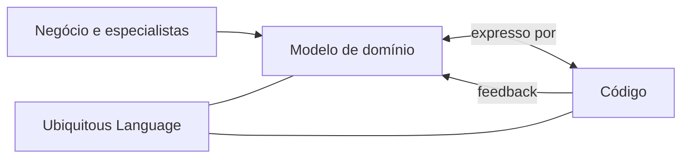

# Model-Driven Design

## Descrição

Model-Driven Design é a ideia de que o modelo de domínio e o design do código devem estar intimamente ligados: o código é uma expressão do modelo, e uma mudança no código é uma mudança no modelo. Em vez de manter um modelo de análise separado do design, o time usa um único modelo que serve à análise e à implementação.

Para isso, a implementação usa construções que espelham os conceitos do modelo, tipicamente com programação orientada a objetos e os blocos de construção táticos do DDD, como Entity, Value Object, Aggregate e Repository. Quando o modelo não pode ser expresso de forma natural no código, o modelo deve ser revisto, e não o código contornado.

O padrão exige que quem modela se envolva com a implementação, o que dá origem ao Hands-on Modelers.

## Problemas que resolve

- Modelo de análise que diverge do código e se torna documentação desatualizada.
- Design que ignora o modelo e resulta em estruturas técnicas sem significado de negócio.
- Perda de conhecimento ao passar do modelo para a implementação por equipes diferentes.
- Dificuldade de saber se uma regra de negócio está de fato implementada.

## Quando usar

- Em domínios complexos, nos quais o modelo é o principal ativo de entendimento.
- Quando se quer que o código seja a documentação viva do domínio.
- Em conjunto com uma Ubiquitous Language compartilhada entre negócio e tecnologia.

### Quando evitar

- Em sistemas dominados por operações de dados simples (CRUD), nos quais um modelo rico não traz retorno.
- Quando a plataforma ou o paradigma escolhido não permite expressar o modelo de forma razoável.

## Trade-offs

| Ganho | Custo / Risco |
| --- | --- |
| Código e modelo sempre alinhados | Pede equipe que domine modelagem e programação |
| Regras de negócio localizadas e legíveis | Pode conflitar com otimizações técnicas pontuais |
| Mudanças de modelo se refletem de forma direta | Exige refatoração constante para manter o alinhamento |

- **Fronteira:** vale dentro de um Bounded Context, não para todo o sistema.
- **Ferramentas:** frameworks que impõem estruturas próprias podem atrapalhar a expressão do modelo.
- **Evolução:** o modelo muda com o aprendizado, e o código acompanha.

## Diagrama

O modelo e o código se influenciam mutuamente, ligados pela linguagem comum; o feedback da implementação volta para o modelo.

## Exemplo

Um time de seguros modelou o conceito de "apólice" com regras de vigência e de cobertura, mas a implementação tinha apenas tabelas e serviços com lógica espalhada. Ao adotar Model-Driven Design, o time criou `Policy`, `Coverage` e `CoveragePeriod` no código, com as regras de vigência dentro dessas classes.

Quando os especialistas mudaram a regra para permitir cobertura retroativa, a alteração foi feita em um único ponto do código e discutida no próprio modelo. Ao tentar expressar a nova regra, os desenvolvedores perceberam uma ambiguidade no modelo e voltaram à conversa com o negócio antes de implementar.

## Padrões relacionados

- [Hands-on Modelers](/design/ddd/model-in-practice/hands-on-modelers) — quem modela participa da implementação.
- [Ubiquitous Language](/design/ddd/model-in-practice/ubiquitous-language) — o código usa os termos do modelo.
- [Layered Architecture](/design/ddd/building-blocks/layered-architecture) — isola a camada de domínio onde o modelo vive.
- [Entity](/design/ddd/building-blocks/entity) — bloco de construção para expressar o modelo.
- [Value Object](/design/poeaa/base/value-object) — bloco de construção para expressar o modelo.
- [Aggregate](/design/ddd/building-blocks/aggregate) — bloco de construção para manter a consistência do modelo.
- [Domain Model](/design/poeaa/domain-logic/domain-model) — padrão de organização da lógica de domínio que o DDD aprofunda.

## Referência

- [DDD Reference, Eric Evans (2015)](https://www.domainlanguage.com/ddd/reference/)
- *Domain-Driven Design: Tackling Complexity in the Heart of Software*, Eric Evans (Addison-Wesley, 2003)
