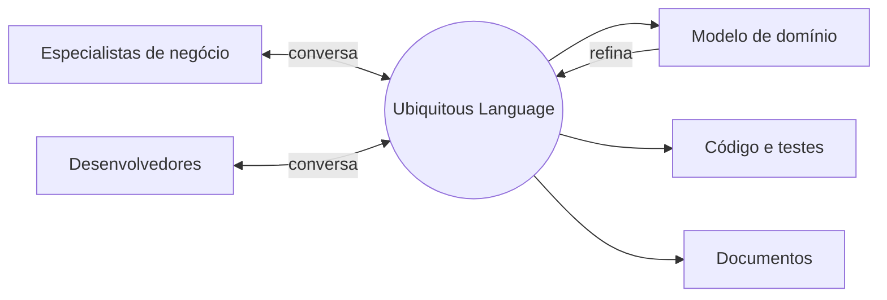

# Ubiquitous Language

## Descrição

A Ubiquitous Language é uma linguagem estruturada em torno do modelo de domínio e usada por todos os membros do time, especialistas de negócio e desenvolvedores, em todas as atividades: conversas, documentos, testes e código. Os termos da linguagem vêm do modelo, e o modelo é refinado a partir do uso da linguagem.

Quando a conversa revela um termo ambíguo ou desajeitado, isso é sinal de um problema no modelo, e o código deve ser alterado junto com a linguagem. Sem uma linguagem comum, os desenvolvedores traduzem o tempo todo entre o jargão do negócio e o jargão técnico, e cada tradução perde informação.

A linguagem é válida dentro de um Bounded Context; em contextos diferentes, os mesmos termos podem ter significados diferentes.

## Problemas que resolve

- Tradução constante entre o vocabulário do negócio e o dos desenvolvedores, com perda de significado.
- Mal-entendidos entre especialistas e desenvolvedores que só aparecem tarde, em produção.
- Código com nomes técnicos ou genéricos que não revelam a intenção de negócio.
- Modelo e implementação que divergem ao longo do tempo.

## Quando usar

- Em qualquer projeto com domínio rico, em que especialistas e desenvolvedores precisam colaborar de perto.
- Quando se percebe que as mesmas coisas recebem nomes diferentes em reuniões, documentos e código.
- Em conjunto com um modelo em evolução, para validar o que foi entendido.

## Quando evitar

- Quando não há acesso a especialistas do domínio, pois a linguagem acaba inventada só pelos desenvolvedores.
- Tentar impor uma única linguagem para toda a empresa, em vez de uma por Bounded Context.

## Trade-offs

| Ganho | Custo / Risco |
| --- | --- |
| Comunicação precisa entre negócio e tecnologia | Exige disciplina contínua de todo o time |
| Código que reflete o negócio e é legível por especialistas | Renomear código e documentos quando a linguagem muda |
| Erros de modelo detectados cedo, na conversa | Pode gerar atrito quando termos do negócio são ambíguos |

- **Escopo:** a linguagem pertence a um contexto; termos iguais em contextos diferentes não são conflito, e sim fronteira.
- **Documentação:** diagramas e documentos ajudam, mas a fonte de verdade é a própria conversa e o código.
- **Evolução:** mudar o modelo implica mudar a linguagem, e vice-versa.

## Diagrama

A linguagem fica no centro, ligando pessoas, modelo, código e documentos; o uso refina o modelo, e o modelo refina a linguagem.

## Exemplo

Em um sistema de logística, os especialistas dizem "consolidar cargas" e "janela de coleta", enquanto o código tinha `mergeShipments()` e `pickupTimeRange`. Durante uma sessão de modelagem, percebeu-se que "consolidar" só se aplica a cargas com o mesmo destino, uma regra que o código não expressava.

O time renomeou os métodos e as classes para `consolidate()` e `PickupWindow`, ajustou os testes para usar as mesmas frases ditas pelos especialistas e passou a rejeitar a consolidação de cargas com destinos diferentes. O ganho foi que a regra, antes implícita, passou a existir tanto no vocabulário quanto no código.

## Padrões relacionados

- [Bounded Context](/design/ddd/model-in-practice/bounded-context) — delimita onde a linguagem vale.
- [Model-Driven Design](/design/ddd/model-in-practice/model-driven-design) — o código usa os termos do modelo.
- [Hands-on Modelers](/design/ddd/model-in-practice/hands-on-modelers) — quem modela também programa e usa a mesma linguagem.
- [Refactoring Toward Deeper Insight](/design/ddd/model-in-practice/refactoring-toward-deeper-insight) — a linguagem revela onde o modelo precisa de refinamento.
- [Published Language](/design/ddd/context-mapping/published-language) — linguagem bem documentada para integração entre contextos.

## Referência

- [UbiquitousLanguage, bliki de Martin Fowler](https://martinfowler.com/bliki/UbiquitousLanguage.html)
- [DDD Reference, Eric Evans (2015)](https://www.domainlanguage.com/ddd/reference/)
- *Domain-Driven Design: Tackling Complexity in the Heart of Software*, Eric Evans (Addison-Wesley, 2003)
