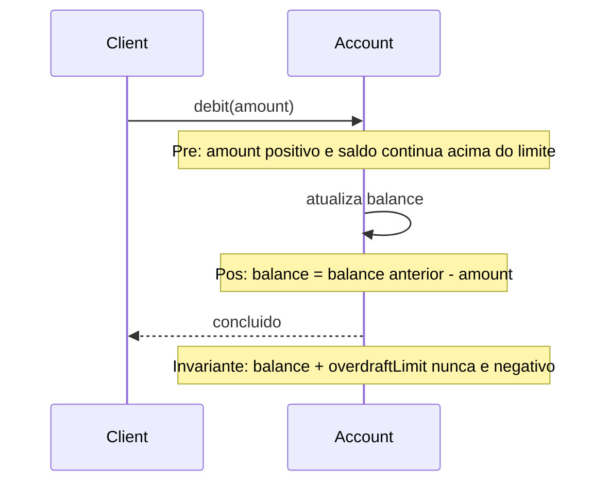

# Assertions

## Descrição

Assertions consiste em declarar explicitamente as pós-condições das operações e os invariantes das classes e dos Aggregates. Quando uma operação altera o estado, não basta o nome sugerir o efeito: o contrato diz o que será verdadeiro depois da chamada, e o que precisa ser verdadeiro antes.

Em linguagens com suporte a contratos, as assertions podem ser escritas no código. Nas demais, usam-se testes automatizados, e a documentação do modelo deve apresentá-las com clareza. O importante é que o cliente não precise deduzir o efeito lendo o corpo do método, e que o implementador saiba o que precisa preservar.

Combinado com Side-Effect-Free Functions, o padrão deixa visíveis os poucos comandos que modificam o estado e o que eles garantem, o que torna seguro compor e estender o modelo.

## Problemas que resolve

- Efeitos colaterais ocultos, que só são descobertos lendo a implementação ou em produção.
- Invariantes do Aggregate que existem apenas na cabeça de quem o escreveu.
- Subclasses e novas implementações que quebram o contrato sem perceber.
- Dificuldade de saber o que testar em uma operação que muda o estado.

## Quando usar

- Em comandos que alteram o estado de Entities e Aggregates.
- Quando há regras de consistência que precisam ser preservadas por qualquer modificação.
- Em hierarquias ou pontos de extensão, em que várias implementações precisam respeitar o mesmo contrato.

## Quando evitar

- Em operações triviais, onde a asserção só repete o nome.
- Quando o custo de verificar a condição em tempo de execução é proibitivo; nesse caso, prefira testes.

## Trade-offs

| Ganho | Custo / Risco |
| --- | --- |
| Contrato explícito e verificável | Esforço para escrever e manter as condições |
| Falhas detectadas perto da origem | Verificações em tempo de execução custam desempenho |
| Facilita testes e extensão segura | Condições desatualizadas enganam mais que ajudam |

- **Consistência:** invariantes tornam as regras do modelo verificáveis.
- **Documentação:** testes que expressam as assertions funcionam como documentação executável.
- **Ferramentas:** o nível de formalidade depende do suporte da linguagem.

## Diagrama



A pré-condição, a pós-condição e o invariante são declarados em torno do comando `debit`. O livro ilustra o padrão com a mistura de tintas.

## Exemplo

Em `Account.debit`, a pós-condição é que o saldo final é o saldo inicial menos o valor, e o invariante é que o saldo nunca fica abaixo do limite do cheque especial. Sem linguagem de contratos, elas viram testes automatizados e checagens no método.

```java
public class Account {
    private Money balance;
    private final Money overdraftLimit;

    public Account(Money balance, Money overdraftLimit) {
        this.balance = balance;
        this.overdraftLimit = overdraftLimit;
    }

    /**
     * Pré-condição: amount não nulo e positivo, e o saldo não passa do limite.
     * Pós-condição: balance() == saldoAnterior - amount. Invariante: balance() + overdraftLimit >= 0.
     */
    public void debit(Money amount) {
        Objects.requireNonNull(amount, "amount");
        if (!amount.isPositive()) {
            throw new IllegalArgumentException("amount must be positive");
        }
        Money before = balance;
        Money after = balance.minus(amount);
        if (after.plus(overdraftLimit).isNegative()) {
            throw new IllegalStateException("saldo insuficiente");
        }
        balance = after;
        assert balance.equals(before.minus(amount));
        assert !balance.plus(overdraftLimit).isNegative();
    }

    public Money balance() { return balance; }
}

@Test
void debitSubtractsFromBalance() {
    Account a = new Account(Money.brl(100_00), Money.brl(50_00));
    a.debit(Money.brl(30_00));
    assertEquals(Money.brl(70_00), a.balance());
}

@Test
void debitCannotGoBelowTheLimit() {
    Account a = new Account(Money.brl(100_00), Money.brl(50_00));
    assertThrows(IllegalStateException.class,
        () -> a.debit(Money.brl(200_00)));
}
```

## Padrões relacionados

- [Side-Effect-Free Functions](/design/ddd/supple-design/side-effect-free-functions) — reduz o número de comandos que precisam de assertions.
- [Intention-Revealing Interfaces](/design/ddd/supple-design/intention-revealing-interfaces) — o nome sugere o efeito; a assertion o confirma.
- [Aggregate](/design/ddd/building-blocks/aggregate) — seus invariantes são o principal alvo de assertions.
- [Entity](/design/ddd/building-blocks/entity) — comandos que mudam estado precisam de pós-condições claras.
- [Closure of Operations](/design/ddd/supple-design/closure-of-operations) — facilita raciocinar sobre o resultado sem novas dependências.

## Referência

- [DDD Reference, Eric Evans (2015)](https://www.domainlanguage.com/ddd/reference/)
- *Domain-Driven Design: Tackling Complexity in the Heart of Software*, Eric Evans (Addison-Wesley, 2003)
