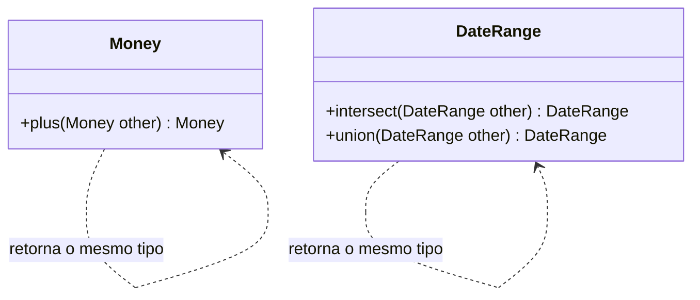

# Closure of Operations

## Descrição

Closure of Operations consiste em definir operações cujo tipo de retorno é o mesmo tipo de seus argumentos. Como na matemática, a soma de dois números é um número: o conjunto é fechado sob a operação. O resultado pode ser usado como entrada da mesma operação, e a composição é natural.

Como o resultado pertence ao mesmo conjunto, o cliente não precisa conhecer outros conceitos para usar a operação, o que reduz dependências. Se o tipo do argumento é o do implementador, a operação é fechada sobre ele; se existe um argumento de outro tipo (por exemplo, um parâmetro de configuração), diz-se fechada de forma parcial, e ainda assim o benefício é grande.

O padrão é especialmente natural em Value Objects, que são imutáveis e podem devolver novas instâncias. Nem todo conceito admite uma operação fechada, e nesse caso não se deve forçá-la.

## Problemas que resolve

- Operações que devolvem tipos auxiliares e obrigam o cliente a conhecer conceitos extras.
- Cadeias de cálculos difíceis de compor.
- Dependências desnecessárias introduzidas por tipos intermediários.
- Interfaces com muitos tipos de retorno diferentes, difíceis de entender.

## Quando usar

- Em Value Objects com operações naturais de combinação (somar, unir, intersectar).
- Quando é possível expressar um cálculo como sequência de passos do mesmo tipo.
- Em regras que se compõem, como conjuntos de condições ou intervalos de datas.

## Quando evitar

- Quando não há uma operação fechada natural: forçar o tipo distorce o modelo.
- Quando a operação precisa de informação extra que o conjunto não carrega.

## Trade-offs

| Ganho | Custo / Risco |
| --- | --- |
| Interface pequena e fácil de entender | Nem todo conceito admite fechamento |
| Composição de operações em cadeia | Pode criar muitos objetos intermediários |
| Menos dependências para o cliente | Fechamento forçado pode distorcer o modelo |

- **Imutabilidade:** em geral, combina com objetos imutáveis.
- **Composição:** o resultado pode alimentar a mesma operação sem adaptações.
- **Modelo:** a presença de uma operação fechada é sinal de um conceito bem formado.

## Diagrama



Em ambas as classes, a operação recebe e devolve o mesmo tipo, de modo que os resultados podem ser encadeados.

## Exemplo

`Money.plus` recebe e devolve `Money`, então o valor de uma parcela é uma cadeia de somas (principal, juros e seguro). O mesmo vale para um intervalo de datas, que oferece `intersect`, recebe e devolve `DateRange`: para saber em que janela a carência se sobrepõe ao período de cobrança, basta intersectar os dois.

```typescript
class Money {
  private constructor(readonly cents: number, readonly currency: string) {}

  static brl(cents: number): Money {
    return new Money(cents, "BRL");
  }

  // Operação fechada: Money -> Money
  plus(other: Money): Money {
    return new Money(this.cents + other.cents, this.currency);
  }
}

const installment = principalPart.plus(interest).plus(insurance);

// Segundo exemplo: o período de carência
class DateRange {
  constructor(readonly start: Date, readonly end: Date) {}

  intersect(other: DateRange): DateRange | null {
    const start = this.start > other.start ? this.start : other.start;
    const end = this.end < other.end ? this.end : other.end;
    return start <= end ? new DateRange(start, end) : null;
  }
}

const overlap = gracePeriod.intersect(billingWindow);
```

## Padrões relacionados

- [Value Object](/design/poeaa/base/value-object) — ambiente mais natural para operações fechadas.
- [Side-Effect-Free Functions](/design/ddd/supple-design/side-effect-free-functions) — operações fechadas costumam ser funções puras.
- [Standalone Classes](/design/ddd/supple-design/standalone-classes) — o fechamento ajuda a limitar dependências.
- [Composite](/coding/gof/structural/composite) (GoF) — estrutura em que o todo e a parte compartilham o mesmo tipo.
- [Declarative Design](/design/ddd/supple-design/declarative-design) — operações fechadas sustentam combinações declarativas.

## Referência

- [DDD Reference, Eric Evans (2015)](https://www.domainlanguage.com/ddd/reference/)
- *Domain-Driven Design: Tackling Complexity in the Heart of Software*, Eric Evans (Addison-Wesley, 2003)
