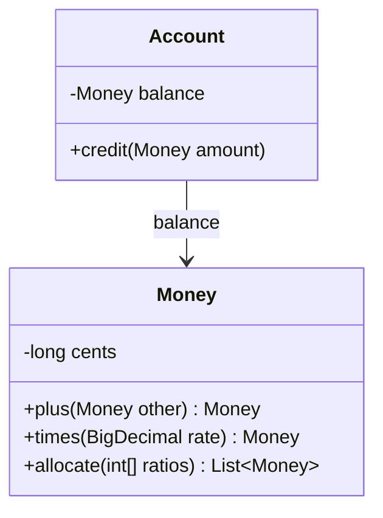

# Side-Effect-Free Functions

## Descrição

Side-Effect-Free Functions propõe separar as operações em duas categorias: comandos, que modificam o estado, e consultas, que apenas devolvem um resultado. Uma função é livre de efeitos colaterais quando calcula e retorna um valor sem alterar nada observável. Os comandos devem ser simples e não devolver dados de domínio.

A lógica complexa é colocada em funções puras, de preferência em Value Objects, que são imutáveis. Assim, uma operação que combina valores devolve um novo objeto em vez de modificar o existente. Quando o cálculo está em uma Entity, pode-se extrair parte dele para um Value Object e deixar a Entity apenas aplicando o resultado.

O efeito é uma redução forte da carga mental: o desenvolvedor pode chamar e compor funções sem medo de alterar o estado de outro objeto, e os testes ficam simples.

## Problemas que resolve

- Operações que misturam cálculo e mudança de estado, difíceis de prever e de testar.
- Efeitos colaterais em cascata, em que chamar um método altera objetos que o chamador não imaginava.
- Dificuldade de reaproveitar um cálculo sem disparar sua mudança de estado.
- Bugs causados por ordem de chamada e por estado compartilhado mutável.

## Quando usar

- Em cálculos complexos do domínio (preços, juros, prazos, taxas).
- Ao modelar conceitos como Value Objects, que devem ser imutáveis.
- Quando uma consulta é chamada em muitos lugares e precisa ser segura de compor.

## Quando evitar

- Em objetos grandes cuja cópia a cada operação é cara e comprovadamente um gargalo.
- Quando o domínio é por natureza uma sequência de mudanças de estado (por exemplo, um processo longo): ali o comando é legítimo e deve ser explícito, não escondido.

## Trade-offs

| Ganho | Custo / Risco |
| --- | --- |
| Testes simples, sem preparação de estado | Cria novos objetos a cada operação |
| Composição segura e raciocínio local | Exige disciplina para separar comandos de consultas |
| Cache e paralelismo facilitados | Pode ser pouco natural em bibliotecas mutáveis |

- **Consistência:** menos pontos onde o estado pode ser corrompido.
- **Desempenho:** a imutabilidade pode custar alocações; meça antes de abrir mão dela.
- **Comandos:** mantenha-os pequenos e com efeito claramente nomeado.

## Diagrama



`Account.credit` é um comando que muda o estado, enquanto `Money.times` e `Money.allocate` são funções puras que calculam novos valores sem alterar nenhum objeto. O livro ilustra o padrão com a mistura de tintas.

## Exemplo

Em uma conta digital, o cálculo do rendimento e o rateio de um valor são regras delicadas, por causa dos arredondamentos. Elas ficam em `Money`, um Value Object imutável; o comando em `Account` apenas aplica o resultado. A taxa é um valor ilustrativo.

```java
public final class Money {
    private final long cents;
    private final Currency currency;

    private Money(long cents, Currency currency) {
        this.cents = cents; this.currency = currency;
    }

    public static Money brl(long cents) {
        return new Money(cents, Currency.getInstance("BRL"));
    }

    public Money plus(Money other) {
        return new Money(cents + other.cents, currency);
    }

    // Função pura: devolve novo valor, nada é modificado
    public Money times(BigDecimal rate) {
        long result = BigDecimal.valueOf(cents).multiply(rate)
            .setScale(0, RoundingMode.HALF_EVEN).longValueExact();
        return new Money(result, currency);
    }

    // Função pura: rateia sem perder centavos (o resto vai para as primeiras parcelas)
    public List<Money> allocate(int... ratios) {
        long totalRatio = Arrays.stream(ratios).sum();
        long[] shares = new long[ratios.length];
        long remainder = cents;
        for (int i = 0; i < ratios.length; i++) {
            shares[i] = cents * ratios[i] / totalRatio;
            remainder -= shares[i];
        }
        for (int i = 0; i < remainder; i++) shares[i]++;
        return Arrays.stream(shares)
            .mapToObj(s -> new Money(s, currency)).toList();
    }
}

public class Account {
    private Money balance;

    // Comando: simples, só aplica o resultado
    public void credit(Money amount) {
        balance = balance.plus(amount);
    }

    public Money balance() { return balance; }
}

// Calcula (consulta) e depois aplica (comando)
Money yield = account.balance().times(new BigDecimal("0.0105"));
account.credit(yield);
```

## Padrões relacionados

- [Value Object](/design/poeaa/base/value-object) — lugar natural para funções puras, por serem imutáveis.
- [Entity](/design/ddd/building-blocks/entity) — mantém os comandos, delegando o cálculo a valores.
- [Closure of Operations](/design/ddd/supple-design/closure-of-operations) — operações que devolvem o mesmo tipo combinam bem com funções puras.
- [Assertions](/design/ddd/supple-design/assertions) — documentam os efeitos dos comandos que sobram.
- [Intention-Revealing Interfaces](/design/ddd/supple-design/intention-revealing-interfaces) — o nome deve deixar claro se é comando ou consulta.
- [Money](/design/poeaa/base/money) (PoEAA) — valor imutável com operações puras.

## Referência

- [DDD Reference, Eric Evans (2015)](https://www.domainlanguage.com/ddd/reference/)
- *Domain-Driven Design: Tackling Complexity in the Heart of Software*, Eric Evans (Addison-Wesley, 2003)
- [Command Query Separation (bliki do Fowler)](https://martinfowler.com/bliki/CommandQuerySeparation.html)
