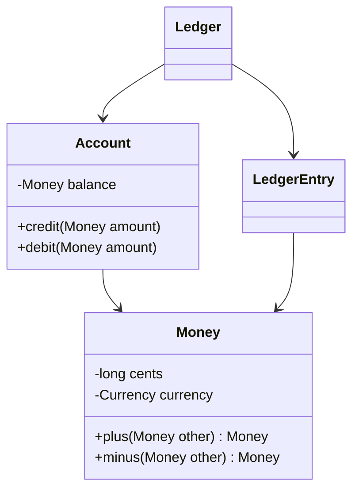

# Standalone Classes

## Descrição

Standalone Classes propõe reduzir ao mínimo as dependências de cada classe, até que ela possa ser entendida e testada sozinha, sem referenciar outras classes além de tipos primitivos e de bibliotecas básicas da linguagem. Toda dependência a mais exige que o leitor entenda também o outro conceito.

O objetivo não é eliminar todo acoplamento, e sim deixar o acoplamento essencial explícito e as demais ligações removidas. Cada associação e cada parâmetro é examinado: se o conceito pode ser entendido sem a outra classe, a dependência é removida. Value Objects costumam ser candidatos ideais.

Quando se consegue um Standalone Class, o ganho é grande: o conceito pode ser entendido, testado e alterado isoladamente, e a carga mental do modelo diminui. As classes que não conseguem isso são as que concentram a complexidade essencial do domínio.

## Problemas que resolve

- Classes que só podem ser entendidas junto com várias outras, aumentando a carga mental.
- Testes que exigem montar um grafo grande de objetos.
- Mudanças que se propagam por dependências desnecessárias.
- Modelos em que todo conceito depende de todos os outros.

## Quando usar

- Em conceitos do domínio que podem ser expressos apenas com valores e tipos básicos.
- Ao modelar Value Objects e cálculos puros.
- Em revisões de modelo, para identificar dependências que não são essenciais.

## Quando evitar

- Quando o conceito é, por natureza, uma relação com outros: forçar o isolamento esconde a associação real.
- Quando o isolamento exige duplicar lógica de outras classes, aumentando o custo total.

## Trade-offs

| Ganho | Custo / Risco |
| --- | --- |
| Entendimento e teste isolados | Pode exigir repensar o modelo para remover dependências |
| Menor propagação de mudanças | Alguns conceitos não conseguem ser independentes |
| Reuso fácil | Risco de duplicar lógica para evitar uma dependência |

- **Carga mental:** cada dependência removida é um conceito a menos para manter na cabeça.
- **Acoplamento essencial:** mantenha as dependências que expressam o domínio.
- **Prioridade:** aplique primeiro nas classes mais usadas e mais complexas.

## Diagrama



`Money` depende apenas de tipos primitivos e da moeda, e pode ser entendida sozinha, enquanto `Ledger` concentra as dependências do contexto. O livro ilustra o padrão com a mistura de tintas.

## Exemplo

A classe `Money` conhece apenas números e moeda. Não referencia `Account`, `Ledger` nem qualquer serviço, por isso é testada sem preparação alguma.

```java
public final class Money {
    private final long cents;
    private final Currency currency;

    private Money(long cents, Currency currency) {
        this.cents = cents; this.currency = currency;
    }

    public static Money brl(long cents) {
        return new Money(cents, Currency.getInstance("BRL"));
    }

    public Money plus(Money other) {
        if (!currency.equals(other.currency)) {
            throw new IllegalArgumentException("moedas diferentes não se somam");
        }
        return new Money(cents + other.cents, currency);
    }

    public Money minus(Money other) {
        return plus(new Money(-other.cents, other.currency));
    }

    @Override public boolean equals(Object o) {
        return o instanceof Money m && cents == m.cents && currency.equals(m.currency);
    }

    @Override public int hashCode() { return Objects.hash(cents, currency); }
}

// Teste isolado, sem outros objetos de domínio
Money total = Money.brl(10_00).plus(Money.brl(5_50));
assertEquals(Money.brl(15_50), total);
```

## Padrões relacionados

- [Value Object](/design/poeaa/base/value-object) — candidato natural a classe independente.
- [Module](/design/ddd/building-blocks/module) — baixo acoplamento entre módulos e alta coesão dentro deles.
- [Side-Effect-Free Functions](/design/ddd/supple-design/side-effect-free-functions) — funções puras em classes independentes são muito fáceis de entender.
- [Closure of Operations](/design/ddd/supple-design/closure-of-operations) — outra forma de reduzir dependências em operações.
- [Cohesive Mechanisms](/design/ddd/distillation/cohesive-mechanisms) — isola mecanismos complexos para que o modelo permaneça focado.

## Referência

- [DDD Reference, Eric Evans (2015)](https://www.domainlanguage.com/ddd/reference/)
- *Domain-Driven Design: Tackling Complexity in the Heart of Software*, Eric Evans (Addison-Wesley, 2003)
