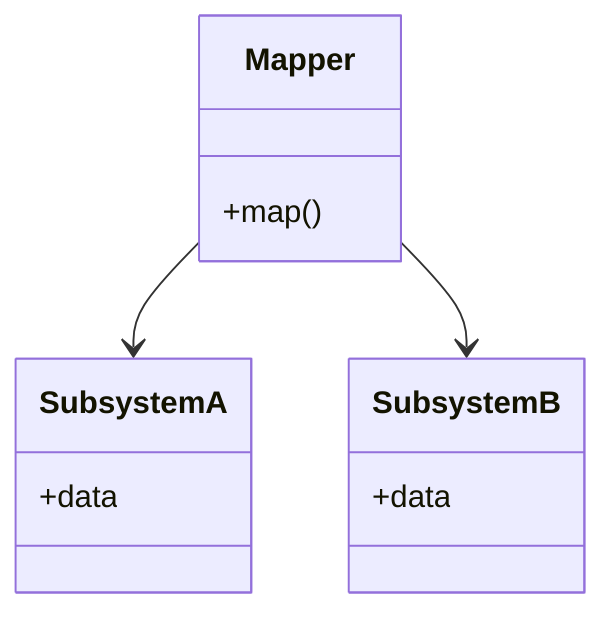

# Mapper

## Descrição

O Mapper é um objeto que estabelece a comunicação entre dois objetos ou subsistemas independentes. Nenhum dos lados conhece o outro: quem sabe como conectá-los é o Mapper, que fica entre eles, lê dados de um lado e os entrega ao outro.

O padrão vale quando os dois subsistemas precisam se comunicar, mas não podem (ou não devem) ser alterados para conhecer um ao outro. Também é útil quando é possível alterá-los, mas se deseja evitar dependências entre eles e até entre eles e o elemento isolador.

No PoEAA, o Mapper é a forma geral. O [Data Mapper](/design/poeaa/data-source-architectural/data-mapper), que move dados entre objetos de domínio e o banco, é a sua especialização mais conhecida.

## Problemas que resolve

- Dois subsistemas precisam trocar dados, mas nenhum deve depender do outro.
- Um dos lados não pode ser modificado (biblioteca, sistema legado, código de terceiros).
- Dependências diretas entre módulos tornam a evolução de ambos mais difícil.

## Quando usar

- Quando dois subsistemas devem colaborar sem se conhecer.
- Quando não é possível modificar um ou ambos os subsistemas.
- Quando é possível modificá-los, mas se quer evitar dependências entre eles.
- Quando a lógica de tradução entre as duas representações merece ficar em um único lugar.

## Quando evitar

- Quando os dois lados já compartilham um vocabulário e a dependência direta é aceitável.
- Quando o Mapper seria apenas cópia campo a campo, sem tradução relevante, e só acrescentaria código.
- Quando a dependência de um lado sobre o outro é desejada e estável.

## Trade-offs

| Ganho | Custo / Risco |
| --- | --- |
| Os subsistemas ficam independentes entre si | Mais uma classe (ou camada) a manter |
| Mudanças em um lado se concentram no Mapper | O Mapper pode acoplar-se a ambos os modelos |
| Permite integrar código que não pode ser alterado | Código de mapeamento é repetitivo e sujeito a erros |
| A tradução fica em um ponto único | Pode haver custo de desempenho em mapeamentos grandes |

- **Acoplamento:** os subsistemas não se conhecem, mas o Mapper conhece ambos.
- **Testabilidade:** o mapeamento pode ser testado isoladamente com dados de entrada e saída.

## Diagrama



O `Mapper` conhece o `SubsystemA` e o `SubsystemB`, mas eles não têm referência um para o outro nem para o Mapper.

## Exemplo

Um módulo de cobrança e um módulo de envio de e-mails não devem se conhecer. Um mapper lê faturas do primeiro e produz mensagens para o segundo.

```typescript
interface Invoice { customerEmail: string; total: number; dueDate: Date }
interface EmailMessage { to: string; subject: string; body: string }

class InvoiceToEmailMapper {
  map(invoice: Invoice): EmailMessage {
    return {
      to: invoice.customerEmail,
      subject: "Sua fatura",
      body: `Valor: ${invoice.total.toFixed(2)} — vencimento: ${invoice.dueDate.toISOString().slice(0, 10)}`,
    };
  }
}

// O módulo de cobrança não conhece e-mail; o de e-mail não conhece faturas.
const message = new InvoiceToEmailMapper().map({
  customerEmail: "a@b.com", total: 120, dueDate: new Date(),
});
```

O mesmo princípio aparece em bibliotecas como MapStruct e AutoMapper, e no mapeamento objeto-relacional.

## Padrões relacionados

- [Data Mapper](/design/poeaa/data-source-architectural/data-mapper) — especialização do Mapper entre objetos de domínio e banco de dados.
- [Gateway](/design/poeaa/base/gateway) — isola a aplicação de um recurso externo; o Mapper isola dois subsistemas entre si.
- [Data Transfer Object](/design/poeaa/distribution/data-transfer-object) — frequentemente são usados mappers para converter entre entidades e DTOs.
- [Adapter](/coding/gof/structural/adapter) — adapta uma interface a outra; o Mapper traduz dados entre dois modelos sem que nenhum o conheça.
- [Mediator](/coding/gof/behavioral/mediator) — centraliza a comunicação entre objetos, mas os colegas conhecem o mediador.

## Referência

- [Página do padrão no catálogo do Fowler](https://martinfowler.com/eaaCatalog/mapper.html)
- *Patterns of Enterprise Application Architecture*, Martin Fowler (Addison-Wesley, 2002)
