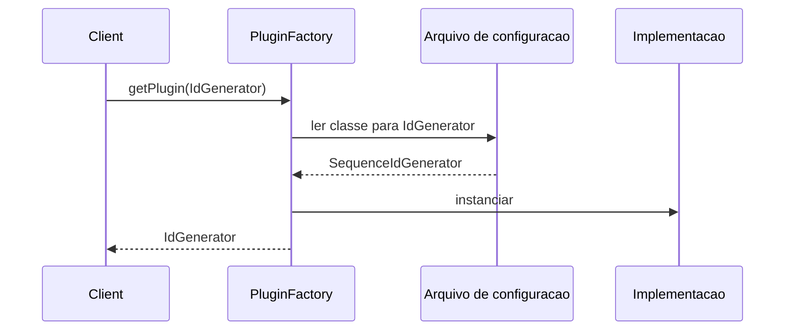

# Plugin

## Descrição

O Plugin liga classes durante a configuração, e não durante a compilação. A escolha da implementação de uma interface sai do código da aplicação e vai para uma configuração centralizada, lida em tempo de execução.

O problema típico aparece quando o código roda em ambientes diferentes e usa um [Separated Interface](/design/poeaa/base/separated-interface) com implementações distintas para cada um: por exemplo, um gerador de chaves em memória para testes unitários e uma sequência do banco em produção. Normalmente a escolha é feita em métodos de fábrica que verificam variáveis de ambiente. À medida que as fábricas se multiplicam, mudar a configuração de um ambiente exige editar várias delas, recompilar e reimplantar.

Com o Plugin, um único arquivo de configuração associa cada interface à implementação do ambiente, e uma fábrica genérica instancia a classe indicada (por reflexão ou carregamento dinâmico). Trocar a implementação passa a ser uma mudança de configuração, sem recompilar. Os contêineres de injeção de dependência modernos são, em essência, implementações sofisticadas desse padrão.

## Problemas que resolve

- Condicionais de ambiente (`if (env == "test")`) espalhadas por várias fábricas.
- Trocar a configuração de implantação exige alterar código, recompilar e reimplantar.
- Dificuldade de usar implementações diferentes em testes, desenvolvimento e produção.
- Dificuldade de estender o sistema com novas implementações sem tocar no código existente.

## Quando usar

- Quando há um Separated Interface com várias implementações para diferentes ambientes (teste, homologação, produção).
- Quando as escolhas de implementação estão dispersas em várias fábricas ou condicionais.
- Quando se quer mudar a configuração sem recompilar ou reimplantar o código.
- Quando terceiros devem poder adicionar implementações (extensões, drivers, conectores).

## Quando evitar

- Quando há uma única implementação e nenhum motivo para variar por ambiente.
- Quando a configuração dinâmica tornaria o comportamento difícil de rastrear e depurar, com erros só em tempo de execução.
- Quando já existe um contêiner de injeção de dependência no projeto: use-o em vez de construir um mecanismo próprio.

## Trade-offs

| Ganho | Custo / Risco |
| --- | --- |
| Mudar implementação sem recompilar | Erros de configuração só aparecem em tempo de execução |
| Configuração centralizada em um só lugar | Mais difícil seguir o fluxo do código (indireção por reflexão) |
| Facilita trocar por stubs em testes e ambientes | Exige uma interface bem definida (Separated Interface) |
| Permite extensões de terceiros | Segurança: carregar classes por configuração exige cuidado com a origem |

- **Testabilidade:** o ambiente de teste aponta para implementações de teste (por exemplo, [Service Stub](/design/poeaa/base/service-stub)) apenas pela configuração.
- **Complexidade:** moderada, pois depende de reflexão, descoberta de classes ou de um contêiner.

## Diagrama



O `Client` pede à `PluginFactory` uma implementação da interface. A fábrica consulta a configuração, instancia a classe indicada e devolve o resultado, sem que o cliente saiba qual é.

## Exemplo

Um gerador de identificadores tem implementação em memória para testes e outra baseada em sequência do banco para produção. A escolha vem de um arquivo de propriedades.

```java
// plugins.properties (teste)
// IdGenerator=com.acme.InMemoryIdGenerator
// plugins.properties (produção)
// IdGenerator=com.acme.DatabaseIdGenerator

public class PluginFactory {
    private static final java.util.Properties config = load("plugins.properties");

    @SuppressWarnings("unchecked")
    public static <T> T getPlugin(Class<T> iface) {
        String className = config.getProperty(iface.getSimpleName());
        try {
            return (T) Class.forName(className).getDeclaredConstructor().newInstance();
        } catch (ReflectiveOperationException e) {
            throw new IllegalStateException("Plugin inválido para " + iface, e);
        }
    }

    private static java.util.Properties load(String file) { /* ... */ return new java.util.Properties(); }
}

IdGenerator ids = PluginFactory.getPlugin(IdGenerator.class);
```

Em frameworks, equivalem ao Spring (perfis e configuração de beans), ao `ServiceLoader` do Java e ao sistema de provedores do .NET.

## Padrões relacionados

- [Separated Interface](/design/poeaa/base/separated-interface) — fornece a interface cujas implementações o Plugin escolhe.
- [Service Stub](/design/poeaa/base/service-stub) — implementação típica selecionada em ambientes de teste.
- [Gateway](/design/poeaa/base/gateway) — gateways costumam ser configurados como plugins por ambiente.
- [Registry](/design/poeaa/base/registry) — alternativa para localizar serviços, mas por consulta a um objeto conhecido, e não por configuração externa.
- [Factory Method](/coding/gof/creational/factory-method) — o Plugin substitui fábricas com condicionais por uma fábrica genérica dirigida por configuração.
- [Abstract Factory](/coding/gof/creational/abstract-factory) — também escolhe uma família de implementações, mas fixada no código.
- [Strategy](/coding/gof/behavioral/strategy) — o Plugin é uma forma de selecionar a estratégia por configuração.
- [Externalized Configuration](/architecture/cloud-design-patterns/deployment-and-topology/external-configuration-store) — a mesma ideia de tirar a configuração do código, aplicada a serviços.

## Referência

- [Página do padrão no catálogo do Fowler](https://martinfowler.com/eaaCatalog/plugin.html)
- *Patterns of Enterprise Application Architecture*, Martin Fowler (Addison-Wesley, 2002)
