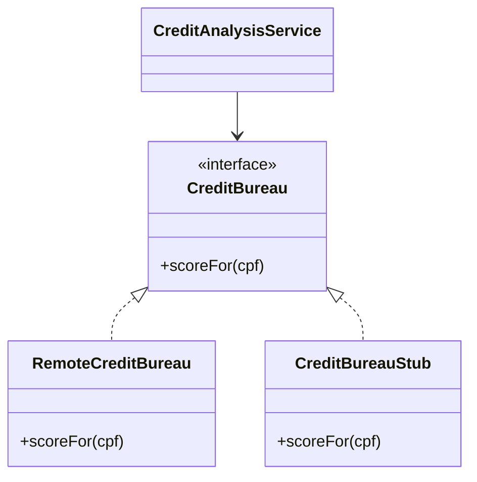

# Service Stub

## Descrição

O Service Stub remove a dependência de serviços problemáticos durante os testes. Aplicações corporativas costumam depender de serviços fora do controle da equipe, como consulta de crédito, cálculo de impostos ou motores de preço. Esses serviços podem estar atrasados, instáveis, lentos ou simplesmente indisponíveis no ambiente de desenvolvimento.

A solução é substituir o serviço real, durante os testes, por uma implementação local e em memória que devolve respostas previsíveis. O stub é rápido, determinístico e não depende da disponibilidade do sistema externo. Em geral ele é plugado no lugar de um [Gateway](/design/poeaa/base/gateway) por meio de um [Separated Interface](/design/poeaa/base/separated-interface) e escolhido por configuração, com o [Plugin](/design/poeaa/base/plugin).

O padrão foi proposto por David Rice no PoEAA e é a base do que hoje se chama de fakes e stubs em testes automatizados.

## Problemas que resolve

- Testes dependentes de serviços remotos lentos ou instáveis.
- Desenvolvimento bloqueado porque o serviço externo ainda não foi entregue.
- Testes que não conseguem rodar sem rede ou credenciais.
- Gambiarras no código de produção para contornar um serviço ausente.

## Quando usar

- Quando a aplicação depende de serviços de terceiros ou remotos fora do controle da equipe.
- Quando se quer testes rápidos e repetíveis no fluxo de desenvolvimento e na integração contínua.
- Quando é preciso simular cenários difíceis de provocar no serviço real (erros, lentidão, dados específicos).

## Quando evitar

- Quando o serviço real é barato, rápido e estável, e testá-lo diretamente é viável.
- Como única forma de teste: o stub não garante que o contrato real continua válido (use também testes de contrato ou de integração).
- Quando o stub ficaria tão complexo que passaria a reimplementar o serviço.

## Trade-offs

| Ganho | Custo / Risco |
| --- | --- |
| Testes rápidos, previsíveis e independentes de rede | O stub pode divergir do comportamento do serviço real |
| Desenvolvimento destravado mesmo sem o serviço pronto | Mais código de apoio a manter |
| Permite simular falhas e casos de borda | Falsa sensação de segurança se o contrato não for verificado |
| Código de produção sem desvios para testes | Exige uma interface bem definida para trocar a implementação |

- **Acoplamento:** exige que o cliente dependa de uma interface, não de uma classe concreta.
- **Testabilidade:** é o principal ganho do padrão.
- **Complexidade:** baixa, desde que o stub seja apenas uma tabela de respostas em memória.

## Diagrama



O `CreditAnalysisService` depende da interface `CreditBureau`. Em produção usa o `RemoteCreditBureau`; nos testes, o `CreditBureauStub`, que responde em memória.

## Exemplo

A análise de crédito consulta o score do proponente no bureau de crédito, um serviço remoto. Nos testes, um stub devolve scores fixos (valores ilustrativos).

```java
interface CreditBureau {
    int scoreFor(String cpf);
}

class CreditBureauStub implements CreditBureau {
    private final java.util.Map<String, Integer> scores = java.util.Map.of(
        "111.111.111-11", 820,
        "222.222.222-22", 380);

    public int scoreFor(String cpf) {
        return scores.getOrDefault(cpf, 0);
    }
}

class CreditAnalysisService {
    private final CreditBureau bureau;
    CreditAnalysisService(CreditBureau bureau) { this.bureau = bureau; }

    boolean approves(String cpf, int minimumScore) {
        return bureau.scoreFor(cpf) >= minimumScore;
    }
}

// Teste
var analysis = new CreditAnalysisService(new CreditBureauStub());
// analysis.approves("111.111.111-11", 600) -> true
// analysis.approves("222.222.222-22", 600) -> false
```

Ferramentas como WireMock, MockServer e bibliotecas de mock produzem stubs sem escrevê-los à mão.

## Padrões relacionados

- [Gateway](/design/poeaa/base/gateway) — o Gateway encapsula o serviço externo; o Service Stub é a implementação de teste desse Gateway.
- [Separated Interface](/design/poeaa/base/separated-interface) — fornece a interface que permite trocar o serviço real pelo stub.
- [Plugin](/design/poeaa/base/plugin) — escolhe, por configuração, entre o serviço real e o stub conforme o ambiente.
- [Null Object](/coding/gof/behavioral/null-object) — também é uma implementação alternativa de uma interface, mas voltada a representar ausência, e não a simular um serviço em testes.
- [Proxy](/coding/gof/structural/proxy) — o stub ocupa o lugar do serviço real, mas sem delegar a ele.
- [Consumer-Driven Contract Test](/architecture/microservices/testing/consumer-driven-contract-test) — complementa o stub, verificando que ele continua fiel ao contrato real.

## Referência

- [Página do padrão no catálogo do Fowler](https://martinfowler.com/eaaCatalog/serviceStub.html)
- *Patterns of Enterprise Application Architecture*, Martin Fowler (Addison-Wesley, 2002)
