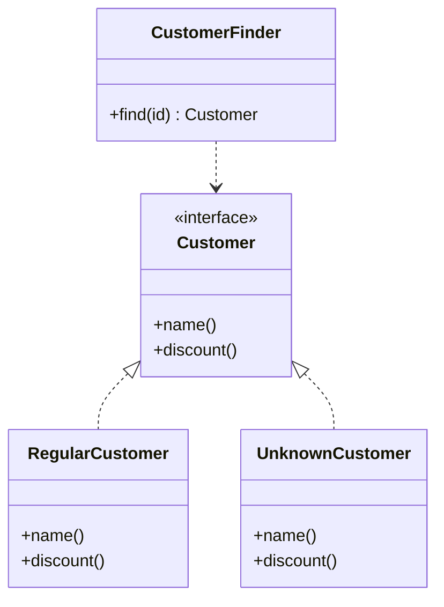

# Special Case

## Descrição

O Special Case é uma subclasse que fornece comportamento especial para casos particulares. Em vez de retornar `null` ou um valor sentinela estranho, o código devolve um objeto de caso especial que implementa a mesma interface esperada pelo chamador, de modo que ele pode invocar os métodos normalmente.

O objeto de caso especial encapsula o comportamento padrão da situação (por exemplo, um cliente desconhecido, um valor infinito, um ocupante não identificado). Com isso, as checagens de nulo que seriam repetidas em muitos lugares deixam de ser necessárias, e o tratamento do caso fica em um único ponto.

O Special Case é a generalização do [Null Object](/coding/gof/behavioral/null-object) do GoF. O Null Object é um caso particular em que o objeto especial não faz nada (ausência de comportamento). O Special Case cobre também situações em que há comportamento específico e útil, como um `UnknownCustomer` que devolve nome "ocupante" e cobra tarifa padrão, ou um `MissingPerson` que devolve valores padrão.

## Problemas que resolve

- Checagens repetidas de `null` espalhadas por todo o código cliente.
- Esquecer uma checagem de nulo e provocar `NullPointerException` ou similares.
- Comportamento diferente para casos particulares que vira `if` em vários lugares.
- Códigos de erro ou valores mágicos retornados no lugar de objetos.

## Quando usar

- Quando uma variável pode ser nula e o "jeito certo" de tratar essa situação é o mesmo em muitos pontos de chamada.
- Quando um caso particular tem comportamento próprio que deve viver junto do tipo (cliente desconhecido, conta inexistente, valor infinito).
- Quando se quer que o cliente trate o caso especial e o normal de forma uniforme (polimorfismo).
- Para finders que não encontram o registro, devolvendo um objeto especial em vez de `null`.

### Quando evitar

- Quando o chamador precisa realmente distinguir a ausência e agir de forma diferente em cada ponto; nesse caso, um `Optional`/`Maybe` explícito pode ser mais honesto.
- Quando o caso especial esconderia um erro que deveria falhar rápido (uma ausência inesperada que merece exceção).
- Quando só existe um ponto de checagem e a criação de uma subclasse seria exagero.

## Trade-offs

| Ganho | Custo / Risco |
| --- | --- |
| Elimina checagens de nulo repetidas | Pode mascarar erros, já que a ausência deixa de ser visível |
| Tratamento polimórfico e uniforme dos casos | Mais classes para criar e manter |
| Comportamento do caso especial concentrado em um só lugar | Exige que a interface do tipo suporte o comportamento padrão |
| Código cliente mais simples e legível | Decidir o comportamento padrão certo nem sempre é óbvio |

- **Testabilidade:** o caso especial é fácil de instanciar em testes e dispensa mocks de nulo.
- **Variações:** o Special Case pode ser um singleton imutável, como no Null Object, ou ter estado, quando o caso especial carrega dados.

## Diagrama



`UnknownCustomer` e `RegularCustomer` implementam `Customer`. O `CustomerFinder` devolve o `UnknownCustomer` quando não encontra o cliente, e o código cliente não precisa checar nulo.

## Exemplo

Uma companhia de energia pode ter imóveis sem cliente identificado. Em vez de `null`, o finder devolve um `UnknownCustomer` com comportamento padrão.

```typescript
interface Customer {
  name(): string;
  billingPlan(): string;
}

class RegularCustomer implements Customer {
  constructor(private readonly customerName: string, private readonly plan: string) {}
  name() { return this.customerName; }
  billingPlan() { return this.plan; }
}

class UnknownCustomer implements Customer {
  name() { return "ocupante"; }
  billingPlan() { return "tarifa-padrao"; }
}

class CustomerFinder {
  constructor(private readonly store: Map<string, Customer>) {}
  find(id: string): Customer {
    return this.store.get(id) ?? new UnknownCustomer();
  }
}

// Sem if (customer === null) em lugar nenhum
const label = `${finder.find("x-1").name()} / ${finder.find("x-1").billingPlan()}`;
```

Exemplos conhecidos: `Collections.emptyList()` no Java, `AnonymousUser` em frameworks web e `Float.POSITIVE_INFINITY` como valor especial de um tipo numérico.

## Padrões relacionados

- [Null Object](/coding/gof/behavioral/null-object) — caso particular do Special Case, em que o objeto especial não faz nada; o Special Case generaliza a ideia para qualquer comportamento específico.
- [Value Object](/design/poeaa/base/value-object) — valores especiais (zero, infinito, desconhecido) podem ser Special Cases de um Value Object.
- [Money](/design/poeaa/base/money) — um dinheiro "zero" ou "indefinido" pode ser um Special Case de Money.
- [Domain Model](/design/poeaa/domain-logic/domain-model) — entidades como clientes e contas costumam ter variantes de caso especial.
- [Repository](/design/poeaa/object-relational-metadata-mapping/repository) — finders que não encontram resultados podem devolver um Special Case no lugar de nulo.
- [State](/coding/gof/behavioral/state) — também usa polimorfismo para variar o comportamento, mas em função do estado interno do objeto.
- [Strategy](/coding/gof/behavioral/strategy) — o caso especial é, na prática, uma estratégia-padrão para a situação.

## Referência

- [Página do padrão no catálogo do Fowler](https://martinfowler.com/eaaCatalog/specialCase.html)
- *Patterns of Enterprise Application Architecture*, Martin Fowler (Addison-Wesley, 2002)
