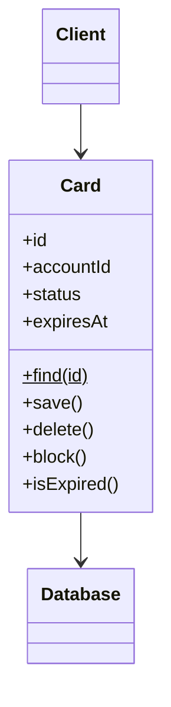

# Active Record

## Descrição

O Active Record é um objeto que envolve uma linha de uma tabela ou view, encapsula o acesso ao banco e adiciona lógica de domínio sobre esses dados. Os campos do objeto correspondem diretamente às colunas, e o próprio objeto sabe se carregar, salvar e excluir.

Em essência, é um Row Data Gateway com lógica de negócio. Métodos de busca costumam ser estáticos ou ficar numa classe auxiliar, e o objeto reúne dados e comportamento, o que dá uma impressão de modelo de objetos sem uma camada de mapeamento separada.

Funciona bem enquanto o modelo de domínio é parecido com o esquema do banco; quando os dois divergem, o acoplamento passa a ser um problema.

## Problemas que resolve

- Excesso de código de infraestrutura para persistir objetos de domínio simples.
- Necessidade de uma camada de acesso a dados leve, sem mapeamento separado.
- Duplicação entre classes de dados e classes de lógica quando o modelo é quase igual às tabelas.

## Quando usar

- Quando a lógica de domínio é moderada: criação, leitura, atualização, exclusão e validações simples.
- Quando o modelo de objetos pode seguir de perto o esquema do banco.
- Para entregar rapidamente aplicações CRUD, como em Rails e Laravel.

## Quando evitar

- Quando a lógica de negócio é complexa e exige heranças, coleções e relacionamentos que divergem do esquema.
- Quando se quer testar o domínio sem banco de dados.
- Quando o esquema muda com frequência e não deve afetar o modelo de domínio.

## Trade-offs

| Ganho | Custo / Risco |
| --- | --- |
| Muito simples e rápido de começar | Objeto de domínio acoplado ao esquema e ao banco |
| Dados e comportamento juntos, fácil de entender | Dificulta testes unitários sem banco |
| Pouco código de mapeamento | Refatorar esquema e modelo de forma independente é difícil |
| Bom para CRUD | Mistura responsabilidades (persistência e regras) |

- **Acoplamento:** alto entre domínio e esquema; mudanças em um afetam o outro.
- **Testabilidade:** limitada, a menos que se use banco em memória ou dublês.
- **Complexidade:** baixa no início, mas pode crescer conforme o domínio se torna rico.

## Diagrama



O `Client` usa diretamente `Card`, que mantém os dados de uma linha, contém a lógica de domínio (`block` e `isExpired`) e acessa o `Database` por meio de `save`, `delete` e `find`.

## Exemplo

Um cartão tem regras simples, como bloquear e saber se está vencido. A classe `Card` representa a linha e sabe se salvar, como nos modelos do Rails ActiveRecord, do Django ORM ou do Eloquent.

```python
from datetime import date

class Card:
    def __init__(self, conn, id, account_id, status, expires_at):
        self.conn, self.id, self.account_id = conn, id, account_id
        self.status, self.expires_at = status, expires_at

    @classmethod
    def find(cls, conn, id):
        r = conn.execute(
            "SELECT id, account_id, status, expires_at FROM cards WHERE id = ?",
            (id,)).fetchone()
        return cls(conn, r[0], r[1], r[2], date.fromisoformat(r[3]))

    def is_expired(self, today=None):  # lógica de domínio
        return self.expires_at < (today or date.today())

    def block(self):  # lógica de domínio
        if self.status == "CANCELLED":
            raise ValueError("cartão cancelado não pode ser bloqueado")
        self.status = "BLOCKED"

    def save(self):
        self.conn.execute(
            "UPDATE cards SET status = ? WHERE id = ?", (self.status, self.id))

card = Card.find(conn, 7)
card.block()
card.save()
```

## Padrões relacionados

- [Row Data Gateway](/design/poeaa/data-source-architectural/row-data-gateway) — mesma estrutura, mas sem lógica de domínio.
- [Table Data Gateway](/design/poeaa/data-source-architectural/table-data-gateway) — acesso por tabela, em vez de um objeto por linha.
- [Data Mapper](/design/poeaa/data-source-architectural/data-mapper) — separa domínio e persistência quando o modelo é rico.
- [Domain Model](/design/poeaa/domain-logic/domain-model) — com modelo simples, o Active Record é uma forma de implementá-lo.
- [Transaction Script](/design/poeaa/domain-logic/transaction-script) — alternativa mais procedural para lógicas simples.
- [Identity Field](/design/poeaa/object-relational-structural/identity-field) — a chave primária guardada no objeto.

## Referência

- [Página do padrão no catálogo do Fowler](https://martinfowler.com/eaaCatalog/activeRecord.html)
- *Patterns of Enterprise Application Architecture*, Martin Fowler (Addison-Wesley, 2002)
- [Active record pattern na Wikipedia](https://en.wikipedia.org/wiki/Active_record_pattern)
