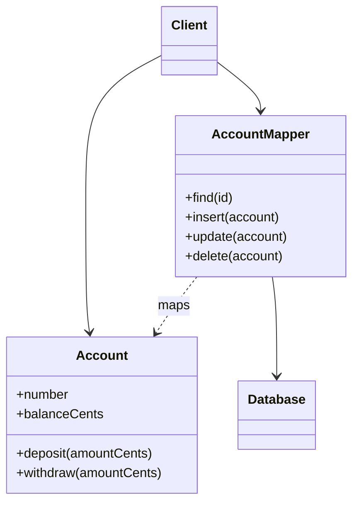

# Data Mapper

## Descrição

O Data Mapper é uma camada de acesso a dados que transfere dados entre objetos em memória e o banco, mantendo ambos independentes entre si e do próprio mapper. Os objetos de domínio não sabem que o banco existe: não contêm SQL nem conhecem o esquema.

Modelos de objetos têm coleções, herança e associações que raramente casam com tabelas relacionais. O mapper cuida da tradução: carrega linhas e monta objetos, e percorre objetos para gravar de volta, resolvendo diferenças de estrutura. Para o domínio, o mapper fica oculto atrás de uma interface.

É a base de ORMs como Hibernate, Entity Framework e SQLAlchemy, e costuma vir acompanhado de Unit of Work, Identity Map e Lazy Load.

## Problemas que resolve

- Domínio acoplado ao esquema do banco e a SQL.
- Impedância objeto-relacional: herança, coleções e associações sem equivalente direto em tabelas.
- Dificuldade de evoluir modelo de objetos e esquema de forma independente.
- Testes de domínio que precisam do banco.

## Quando usar

- Com um Domain Model rico, cuja estrutura diverge do esquema.
- Quando modelo e banco evoluem em ritmos diferentes.
- Quando se quer testar regras de negócio sem banco.
- Quando o esquema é herdado e não pode ser alterado.

## Quando evitar

- Em aplicações CRUD simples, em que Active Record resolve com muito menos código.
- Quando a equipe não tem experiência nem ferramenta de ORM e o custo de construir um mapper não compensa.
- Quando a lógica é procedural e baseada em tabelas.

## Trade-offs

| Ganho | Custo / Risco |
| --- | --- |
| Domínio independente do banco | Mais camadas e mais código de mapeamento |
| Modelo e esquema evoluem separadamente | Curva de aprendizado e configuração |
| Facilita testes unitários do domínio | Pode ocultar consultas ineficientes (N+1) |
| Suporta heranças e associações complexas | Construir o próprio mapper é trabalhoso; usa-se um ORM |

- **Acoplamento:** baixo entre domínio e persistência; o acoplamento fica concentrado no mapper.
- **Consistência:** costuma ser combinado com Unit of Work e Identity Map para gerenciar mudanças e identidade.
- **Complexidade:** alta; compensa em domínios complexos.

## Diagrama



O `Account` não conhece o banco nem o `AccountMapper`. O mapper lê e grava no `Database` e converte linhas de `contas_correntes` em objetos `Account`, e vice-versa.

## Exemplo

Um banco digital tem a entidade `Account`, com regras de saldo, e uma tabela legada `contas_correntes` com nomes e colunas diferentes. O `AccountMapper` faz a tradução e o domínio permanece puro.

```java
class Account {                        // domínio puro
    private final String number;
    private long balanceCents;
    Account(String number, long balanceCents) { this.number = number; this.balanceCents = balanceCents; }
    void deposit(long amountCents) { balanceCents += amountCents; }
    void withdraw(long amountCents) {
        if (amountCents > balanceCents) throw new IllegalStateException("saldo insuficiente");
        balanceCents -= amountCents;
    }
}

class AccountMapper {
    private final JdbcTemplate jdbc;
    AccountMapper(JdbcTemplate jdbc) { this.jdbc = jdbc; }

    Account find(long id) {
        return jdbc.queryForObject(
            "SELECT num_conta, saldo_centavos FROM contas_correntes WHERE id = ?",
            (rs, n) -> new Account(rs.getString("num_conta"),
                                   rs.getLong("saldo_centavos")),
            id);
    }

    void insert(Account a) { /* INSERT a partir dos campos de Account */ }
}
```

No Hibernate e no Entity Framework, o mapeamento é configurado por metadados em vez de escrito à mão.

## Padrões relacionados

- [Active Record](/design/poeaa/data-source-architectural/active-record) — alternativa mais simples em que o objeto sabe se persistir.
- [Row Data Gateway](/design/poeaa/data-source-architectural/row-data-gateway) — gateway por linha, sem lógica de domínio.
- [Table Data Gateway](/design/poeaa/data-source-architectural/table-data-gateway) — gateway por tabela, usado por lógicas tabulares.
- [Domain Model](/design/poeaa/domain-logic/domain-model) — o modelo que o Data Mapper mantém independente do banco.
- [Unit of Work](/design/poeaa/object-relational-behavioral/unit-of-work) — controla quais objetos mudaram e coordena a gravação.
- [Identity Map](/design/poeaa/object-relational-behavioral/identity-map) — garante um único objeto por linha carregada.
- [Lazy Load](/design/poeaa/object-relational-behavioral/lazy-load) — adia o carregamento de associações.
- [Repository](/design/poeaa/object-relational-metadata-mapping/repository) — oferece ao domínio uma visão de coleção sobre o mapper.
- [Mapper](/design/poeaa/base/mapper) — padrão base do qual este é uma especialização.
- [Metadata Mapping](/design/poeaa/object-relational-metadata-mapping/metadata-mapping) — mapeamento descrito por metadados em ORMs.

## Referência

- [Página do padrão no catálogo do Fowler](https://martinfowler.com/eaaCatalog/dataMapper.html)
- *Patterns of Enterprise Application Architecture*, Martin Fowler (Addison-Wesley, 2002)
- [Data mapper pattern na Wikipedia](https://en.wikipedia.org/wiki/Data_mapper_pattern)
