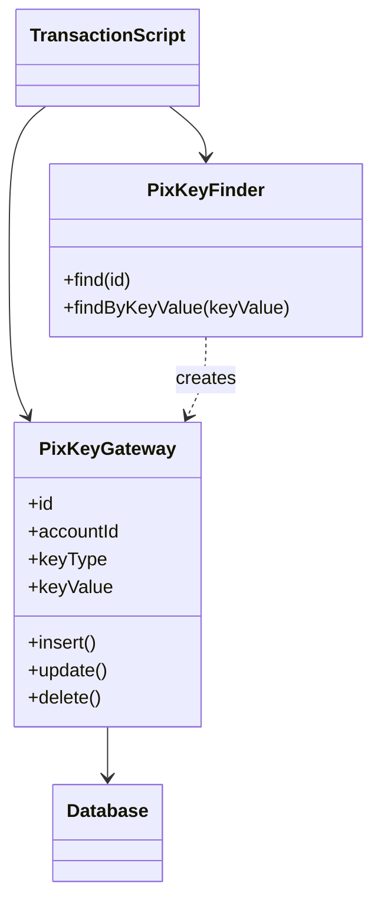

# Row Data Gateway

## Descrição

O Row Data Gateway é um objeto que atua como gateway para um único registro de uma fonte de dados, com uma instância por linha. Sua interface espelha a estrutura do registro: há um campo para cada coluna, de modo que o código cliente o usa como um objeto comum.

Todo o acesso ao banco fica escondido dentro do gateway, que sabe se inserir, atualizar e excluir. Normalmente ele é acompanhado de uma classe de busca (finder) que carrega os gateways a partir de consultas. Ao contrário do Active Record, o gateway não contém lógica de domínio: apenas dados e acesso ao banco.

Isso mantém o código de persistência fora dos objetos de domínio em memória, simplificando a lógica de negócio e isolando variações de SQL entre bancos.

## Problemas que resolve

- Lógica de negócio misturada a SQL e a detalhes de acesso a dados.
- Testes lentos que dependem do banco para exercitar regras de negócio.
- Necessidade de suportar variações de SQL entre diferentes bancos.
- Código procedural que precisa manipular registros como objetos.

## Quando usar

- Com Transaction Script, quando a lógica prefere manipular registros como objetos.
- Quando o formato do registro é estável e quase igual à tabela.
- Quando o código gerado automaticamente a partir do esquema pode produzir os gateways.

## Quando evitar

- Quando há um Domain Model: o gateway vira uma camada redundante entre o modelo e o banco.
- Quando se tem muitas tabelas e o esforço de manter um gateway e um finder por tabela não compensa.
- Quando a lógica de domínio começa a migrar para o gateway, caracterizando um Active Record disfarçado.

## Trade-offs

| Ganho | Custo / Risco |
| --- | --- |
| Acesso ao banco isolado em um objeto por linha | Uma classe por tabela, com muito código repetitivo |
| Lógica de negócio sem SQL | Pode ser redundante diante de um Domain Model |
| Facilita testes com dublês dos gateways | Exige um finder separado para consultas |
| Permite variar SQL entre bancos | Tentação de pôr lógica de domínio nele |

- **Acoplamento:** o cliente depende da interface do registro, não do SQL.
- **Testabilidade:** boa, pois é fácil substituir o gateway por um objeto em memória.
- **Complexidade:** moderada, por causa da quantidade de classes; geração de código ajuda.

## Diagrama



O `TransactionScript` usa o `PixKeyFinder` para obter instâncias de `PixKeyGateway`, cada uma representando uma chave Pix cadastrada, e as persiste chamando seus métodos `insert`, `update` e `delete`.

## Exemplo

Um script de cadastro de chaves Pix manipula um registro por vez. Cada linha da tabela `pix_keys` vira um `PixKeyGateway`, e o `PixKeyFinder` carrega os gateways a partir de consultas.

```typescript
class PixKeyGateway {
  constructor(
    private db: Db,
    public id: number | null,
    public accountId: number,
    public keyType: "CPF" | "EMAIL" | "PHONE" | "RANDOM",
    public keyValue: string,
  ) {}

  async insert(): Promise<void> {
    this.id = await this.db.insert(
      "INSERT INTO pix_keys (account_id, key_type, key_value) VALUES (?, ?, ?)",
      [this.accountId, this.keyType, this.keyValue]);
  }

  async update(): Promise<void> {
    await this.db.exec(
      "UPDATE pix_keys SET account_id = ?, key_type = ?, key_value = ? WHERE id = ?",
      [this.accountId, this.keyType, this.keyValue, this.id]);
  }

  async delete(): Promise<void> {
    await this.db.exec("DELETE FROM pix_keys WHERE id = ?", [this.id]);
  }
}

class PixKeyFinder {
  constructor(private db: Db) {}

  async find(id: number): Promise<PixKeyGateway> {
    const r = await this.db.one("SELECT * FROM pix_keys WHERE id = ?", [id]);
    return new PixKeyGateway(this.db, r.id, r.account_id, r.key_type, r.key_value);
  }

  async findByKeyValue(keyValue: string): Promise<PixKeyGateway> {
    const r = await this.db.one("SELECT * FROM pix_keys WHERE key_value = ?", [keyValue]);
    return new PixKeyGateway(this.db, r.id, r.account_id, r.key_type, r.key_value);
  }
}
```

## Padrões relacionados

- [Table Data Gateway](/design/poeaa/data-source-architectural/table-data-gateway) — um objeto por tabela em vez de um por linha.
- [Active Record](/design/poeaa/data-source-architectural/active-record) — igual em estrutura, mas incorpora a lógica de domínio.
- [Data Mapper](/design/poeaa/data-source-architectural/data-mapper) — separa totalmente objetos de domínio e persistência.
- [Transaction Script](/design/poeaa/domain-logic/transaction-script) — uso mais comum do Row Data Gateway.
- [Gateway](/design/poeaa/base/gateway) — padrão base do qual este é uma especialização.
- [Identity Map](/design/poeaa/object-relational-behavioral/identity-map) — evita carregar a mesma linha em gateways duplicados.

## Referência

- [Página do padrão no catálogo do Fowler](https://martinfowler.com/eaaCatalog/rowDataGateway.html)
- *Patterns of Enterprise Application Architecture*, Martin Fowler (Addison-Wesley, 2002)
- [Row data gateway na Wikipedia](https://en.wikipedia.org/wiki/Row_data_gateway)
