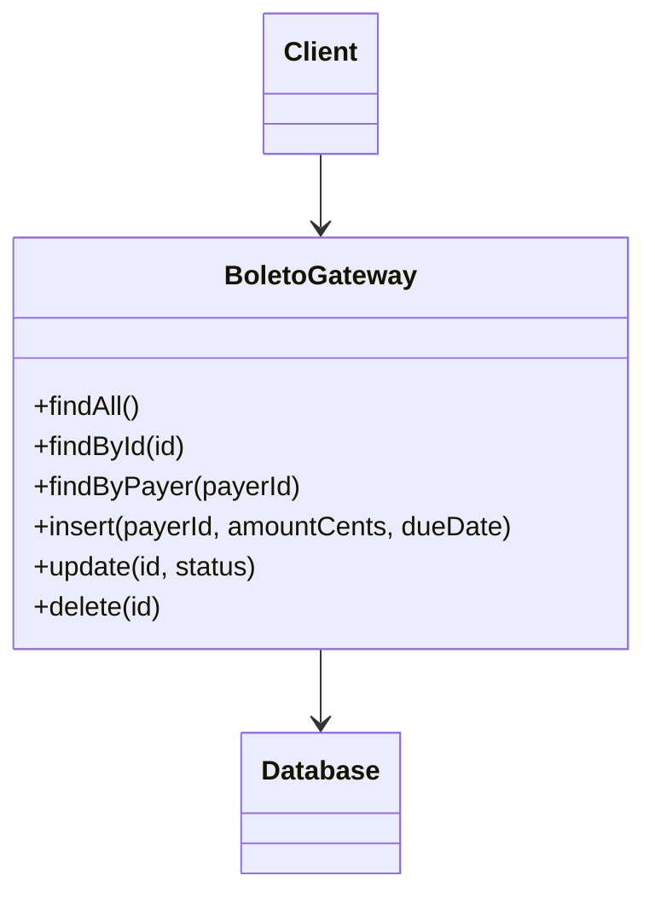

# Table Data Gateway

## Descrição

O Table Data Gateway é um objeto que atua como gateway para uma tabela (ou view) do banco de dados. Uma única instância cuida de todas as linhas da tabela e concentra todo o SQL de consulta, inserção, atualização e exclusão.

O restante da aplicação não escreve SQL: chama métodos como `findById`, `findByPayer` ou `insert`. Normalmente o gateway não tem estado e devolve estruturas de dados simples, como Record Sets ou DTOs, em vez de objetos de domínio com comportamento.

Com isso, o SQL fica em um só lugar, facilitando o trabalho de quem não domina SQL e permitindo que DBAs encontrem e ajustem as consultas quando o esquema muda.

## Problemas que resolve

- SQL espalhado pela lógica de negócio e pela camada de apresentação.
- Mudanças de esquema que exigem alterações em muitos pontos do código.
- Dificuldade de DBAs localizarem e otimizarem as consultas usadas pela aplicação.
- Necessidade de uma camada de acesso simples para lógicas de domínio orientadas a tabela.

## Quando usar

- Com Transaction Script, em que a lógica de negócio opera sobre dados tabulares.
- Com Table Module, que costuma receber Record Sets produzidos pelo gateway.
- Para encapsular o acesso a stored procedures, tratando-as como um gateway.
- Quando se quer isolar o SQL sem o custo de um mapeamento objeto-relacional completo.

## Quando evitar

- Quando há um Domain Model rico com regras complexas; um Data Mapper ou ORM se adapta melhor.
- Quando se espera mapear heranças, associações e coleções de objetos de forma transparente.
- Quando o gateway tende a acumular dezenas de consultas e virar um "god object" da tabela.

## Trade-offs

| Ganho | Custo / Risco |
| --- | --- |
| Todo o SQL fica centralizado e fácil de ajustar | Pouca ajuda para mapear objetos de domínio ricos |
| Interface simples, próxima da estrutura da tabela | Resultados tabulares expõem o esquema para quem os consome |
| Casa bem com Transaction Script e Table Module | Gateways podem crescer com muitas consultas específicas |
| Simples de substituir por um dublê em testes | Não gerencia identidade nem concorrência sozinho |

- **Acoplamento:** o código de negócio depende da interface do gateway, não do SQL; ainda assim, vê a forma das tabelas.
- **Testabilidade:** o gateway pode ser trocado por um Service Stub ou por um banco em memória.
- **Complexidade:** baixa, com uma classe por tabela.

## Diagrama



O `Client` (por exemplo, um Transaction Script de cobrança) chama apenas métodos do `BoletoGateway`, que contém o SQL e conversa com o `Database`. Uma instância atende todas as linhas da tabela.

## Exemplo

Os scripts de cobrança de uma fintech precisam consultar e gravar boletos. Um `BoletoGateway` isola o SQL da tabela `boletos` e devolve linhas simples.

```python
class BoletoGateway:
    def __init__(self, conn):
        self.conn = conn

    def find_by_id(self, boleto_id):
        cur = self.conn.execute(
            "SELECT id, payer_id, amount_cents, due_date, status "
            "FROM boletos WHERE id = ?", (boleto_id,))
        return cur.fetchone()

    def find_overdue(self, today):
        cur = self.conn.execute(
            "SELECT id, payer_id, amount_cents, due_date, status "
            "FROM boletos WHERE status = 'OPEN' AND due_date < ?", (today,))
        return cur.fetchall()

    def insert(self, payer_id, amount_cents, due_date):
        cur = self.conn.execute(
            "INSERT INTO boletos (payer_id, amount_cents, due_date, status) "
            "VALUES (?, ?, ?, 'OPEN')", (payer_id, amount_cents, due_date))
        return cur.lastrowid

    def update_status(self, boleto_id, status):
        self.conn.execute(
            "UPDATE boletos SET status = ? WHERE id = ?", (status, boleto_id))

# Transaction Script
def flag_overdue_boletos(gateway, today):
    for boleto in gateway.find_overdue(today):
        gateway.update_status(boleto["id"], "OVERDUE")
```

No .NET, o `TableAdapter` do ADO.NET e a classe DAO do mundo Java seguem ideia semelhante.

## Padrões relacionados

- [Row Data Gateway](/design/poeaa/data-source-architectural/row-data-gateway) — um objeto por linha em vez de um por tabela.
- [Active Record](/design/poeaa/data-source-architectural/active-record) — o objeto de domínio acumula também o acesso ao banco.
- [Data Mapper](/design/poeaa/data-source-architectural/data-mapper) — alternativa quando o modelo de domínio é rico e independente do esquema.
- [Transaction Script](/design/poeaa/domain-logic/transaction-script) — combinação típica de lógica de domínio com este gateway.
- [Table Module](/design/poeaa/domain-logic/table-module) — consome os Record Sets que o gateway produz.
- [Record Set](/design/poeaa/base/record-set) — formato comum dos resultados.
- [Gateway](/design/poeaa/base/gateway) — padrão base do qual este é uma especialização.
- [Facade](/coding/gof/structural/facade) — também esconde detalhes de um subsistema atrás de uma interface simples.

## Referência

- [Página do padrão no catálogo do Fowler](https://martinfowler.com/eaaCatalog/tableDataGateway.html)
- *Patterns of Enterprise Application Architecture*, Martin Fowler (Addison-Wesley, 2002)
- [Table data gateway na Wikipedia](https://en.wikipedia.org/wiki/Table_data_gateway)
