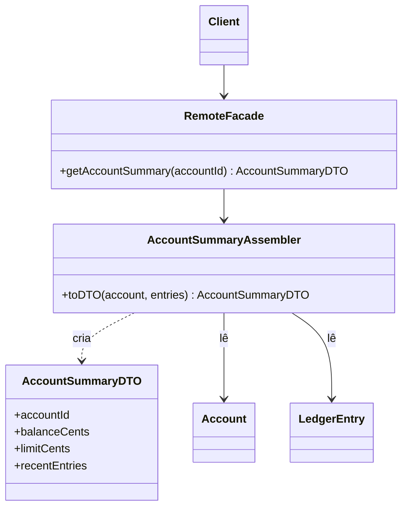

# Data Transfer Object

## Descrição

O Data Transfer Object (DTO) é um objeto que carrega dados entre processos para reduzir o número de chamadas. Como cada chamada remota é cara, o objetivo é fazer menos chamadas, cada uma levando mais dados. Passar muitos parâmetros é desajeitado, e algumas linguagens retornam apenas um valor, então o DTO agrupa tudo o que uma chamada precisa enviar ou receber.

Um DTO é um objeto simples, só com campos e acessores, sem comportamento de domínio, e precisa ser serializável para cruzar a fronteira. Normalmente um Assembler (ou Mapper) converte entre o DTO e os objetos de domínio, de modo que o domínio não conhece o formato de transporte.

Um benefício secundário é encapsular a serialização: o formato de transmissão (JSON, XML, binário) fica em um único lugar, e o restante do código não depende dele. Historicamente o padrão foi chamado de "value object" em Java, o que conflita com o padrão [Value Object](/design/poeaa/base/value-object); por isso o nome "Transfer Object" se firmou.

## Problemas que resolve

- Muitas chamadas remotas pequenas para obter ou enviar um conjunto de dados relacionados.
- Assinaturas com longas listas de parâmetros ou necessidade de retornar vários valores.
- Objetos de domínio acoplados ao formato de serialização e ao contrato remoto.
- Exposição acidental de campos internos, relacionamentos preguiçosos e regras do domínio para clientes externos.

## Quando usar

- Em interfaces remotas, geralmente por trás de um [Remote Facade](/design/poeaa/distribution/remote-facade), onde cada chamada tem custo alto.
- Quando se quer agrupar o que seriam várias chamadas em uma só.
- Quando o contrato de dados com o cliente deve evoluir independentemente do modelo de domínio.

## Quando evitar

- Em chamadas locais dentro do mesmo processo: Fowler alerta no artigo LocalDTO que o custo de mapeamento é alto e o benefício é nenhum; prefira uma [Service Layer](/design/poeaa/domain-logic/service-layer) trabalhando com objetos de domínio.
- Quando o DTO tende a espelhar o domínio campo a campo, apenas duplicando classes sem ganho de isolamento.
- Quando o DTO ganha comportamento e regras de negócio, o que o transforma em um modelo anêmico paralelo.

## Trade-offs

| Ganho | Custo / Risco |
| --- | --- |
| Menos chamadas remotas, mais dados por chamada | Mais classes e código de mapeamento para manter |
| Contrato remoto desacoplado do domínio | Duplicação de campos entre DTO e entidade |
| Serialização concentrada em um ponto | Risco de transferir dados demais ou de dados desatualizados |
| Controle do que sai do sistema | Mapeamento custa tempo e pode esconder erros de conversão |

- **Desempenho:** compensa só quando a rede é o gargalo; localmente, é custo puro.
- **Acoplamento:** o domínio fica livre de anotações e detalhes de serialização.
- **Testabilidade:** DTOs são triviais, mas o Assembler merece testes próprios.
- **Evolução:** versionar o DTO permite mudar o domínio sem quebrar clientes.

## Diagrama



O `Client` recebe um `AccountSummaryDTO` da `RemoteFacade`. O `AccountSummaryAssembler` é o único que conhece tanto o DTO quanto os objetos de domínio `Account` e `LedgerEntry`.

## Exemplo

Uma API do banco digital devolve, em uma única resposta, o resumo da conta com saldo, limite e últimos lançamentos. O DTO é um registro imutável e o assembler converte as entidades.

```java
public record EntryDTO(String description, long amountCents, LocalDate postedAt) {}

public record AccountSummaryDTO(
    String accountId, long balanceCents, long limitCents, List<EntryDTO> recentEntries) {}

public class AccountSummaryAssembler {
    public AccountSummaryDTO toDTO(Account account, List<LedgerEntry> entries) {
        List<EntryDTO> recent = entries.stream()
            .map(e -> new EntryDTO(
                e.getDescription(), e.getAmount().cents(), e.getPostedAt()))
            .toList();
        return new AccountSummaryDTO(
            account.getId(),
            account.getBalance().cents(),
            account.getCreditLimit().cents(),
            recent);
    }
}
```

Em frameworks, o papel do assembler é feito por bibliotecas como MapStruct (Java), AutoMapper (.NET) e serializers do Django REST Framework.

## Padrões relacionados

- [Remote Facade](/design/poeaa/distribution/remote-facade) — o consumidor típico do DTO: a fachada recebe e devolve DTOs.
- [Service Layer](/design/poeaa/domain-logic/service-layer) — a alternativa local, que dispensa DTOs e trabalha com o domínio.
- [Mapper](/design/poeaa/base/mapper) — o Assembler é um mapper entre DTO e domínio.
- [Value Object](/design/poeaa/base/value-object) — nome historicamente confundido; o Value Object tem comportamento e igualdade por valor.
- [Data Mapper](/design/poeaa/data-source-architectural/data-mapper) — faz algo parecido entre domínio e banco de dados; o assembler faz entre domínio e fronteira remota.
- [Remote Procedure Invocation](/architecture/microservices/communication-styles/remote-procedure-invocation) — o estilo de comunicação em que o custo de cada chamada justifica o DTO.

## Referência

- [Página do padrão no catálogo do Fowler](https://martinfowler.com/eaaCatalog/dataTransferObject.html)
- [LocalDTO, no bliki do Fowler](https://martinfowler.com/bliki/LocalDTO.html)
- *Patterns of Enterprise Application Architecture*, Martin Fowler (Addison-Wesley, 2002)
- [Data transfer object na Wikipedia](https://en.wikipedia.org/wiki/Data_transfer_object)
