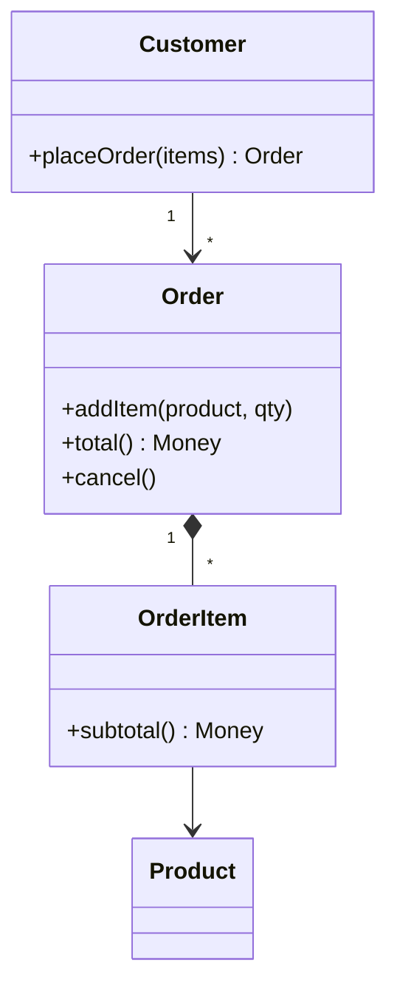

# Domain Model

## Descrição

O Domain Model é um modelo de objetos do domínio de negócio que incorpora tanto o comportamento quanto os dados. Cada objeto representa um conceito significativo do negócio, desde algo grande, como uma empresa, até algo pequeno, como uma linha de um pedido.

Os objetos formam uma rede interligada, e as regras de negócio vivem junto dos dados que governam. Cálculos, validações e decisões ficam dentro das entidades e dos objetos de valor, com apoio de herança, polimorfismo e outras técnicas de orientação a objetos para lidar com muitas variações de regra.

O modelo deve ser independente de interface de usuário e de persistência; a ligação com o banco costuma ser feita por um mapeador de dados.

## Problemas que resolve

- Lógica de negócio complexa, com muitas regras e exceções que viram condicionais espalhadas em scripts procedurais.
- Duplicação de regras entre casos de uso diferentes.
- Dificuldade de expressar a linguagem do negócio no código.
- Necessidade de evoluir regras sem reescrever a aplicação inteira.

## Quando usar

- Domínios com regras complexas e em constante mudança.
- Quando há variações de comportamento que se beneficiam de polimorfismo e de padrões como Strategy.
- Quando a equipe domina modelagem orientada a objetos e pretende investir em uma linguagem ubíqua do domínio.

## Quando evitar

- Aplicações essencialmente CRUD, onde a lógica é mínima.
- Equipes sem familiaridade com orientação a objetos e mapeamento objeto-relacional.
- Quando o custo de mapear objetos para tabelas supera o ganho de expressividade.

## Trade-offs

| Ganho | Custo / Risco |
| --- | --- |
| Regras expressas de forma rica e reutilizável | Curva de aprendizado alta |
| Fácil de testar sem banco de dados | Exige mapeamento objeto-relacional (Data Mapper, Unit of Work) |
| Extensível via polimorfismo e composição | Risco de modelo anêmico, com lógica fora das entidades |
| Linguagem do negócio refletida no código | Pode carregar muitos objetos e consultas se mal desenhado |

- **Desacoplamento:** o modelo não conhece a persistência nem a interface.
- **Desempenho:** carregar grafos de objetos exige atenção a Lazy Load e a consultas eficientes.
- **Fronteira:** costuma ser exposto por um Service Layer para evitar vazar detalhes aos clientes.

## Diagrama



`Customer`, `Order`, `OrderItem` e `Product` formam uma rede de objetos em que cada classe contém dados e as regras associadas, como `total()` e `cancel()`.

## Exemplo

Um pedido calcula o próprio total e impede cancelamento após o envio, regras que moram na entidade.

```java
public class Order {
    private final List<OrderItem> items = new ArrayList<>();
    private Status status = Status.OPEN;

    public void addItem(Product product, int qty) {
        if (status != Status.OPEN) throw new IllegalStateException("Pedido fechado");
        items.add(new OrderItem(product, qty));
    }

    public Money total() {
        return items.stream()
            .map(OrderItem::subtotal)
            .reduce(Money.ZERO, Money::add);
    }

    public void cancel() {
        if (status == Status.SHIPPED) throw new IllegalStateException("Já enviado");
        status = Status.CANCELLED;
    }
}
```

## Padrões relacionados

- [Transaction Script](/design/poeaa/domain-logic/transaction-script) — alternativa mais simples para lógica pouco complexa.
- [Table Module](/design/poeaa/domain-logic/table-module) — organiza a lógica por tabela, intermediário entre os dois.
- [Service Layer](/design/poeaa/domain-logic/service-layer) — fronteira usual do Domain Model, coordenando casos de uso e transações.
- [Data Mapper](/design/poeaa/data-source-architectural/data-mapper) — mantém o modelo independente do banco.
- [Unit of Work](/design/poeaa/object-relational-behavioral/unit-of-work) — rastreia mudanças nos objetos do modelo.
- [Strategy](/coding/gof/behavioral/strategy) — encapsula variações de regras dentro do modelo.
- [Null Object](/coding/gof/behavioral/null-object) — evita verificações de nulo nas regras.

## Referência

- [Página do padrão no catálogo do Fowler](https://martinfowler.com/eaaCatalog/domainModel.html)
- *Patterns of Enterprise Application Architecture*, Martin Fowler (Addison-Wesley, 2002)
- [Domain model na Wikipedia](https://en.wikipedia.org/wiki/Domain_model)
