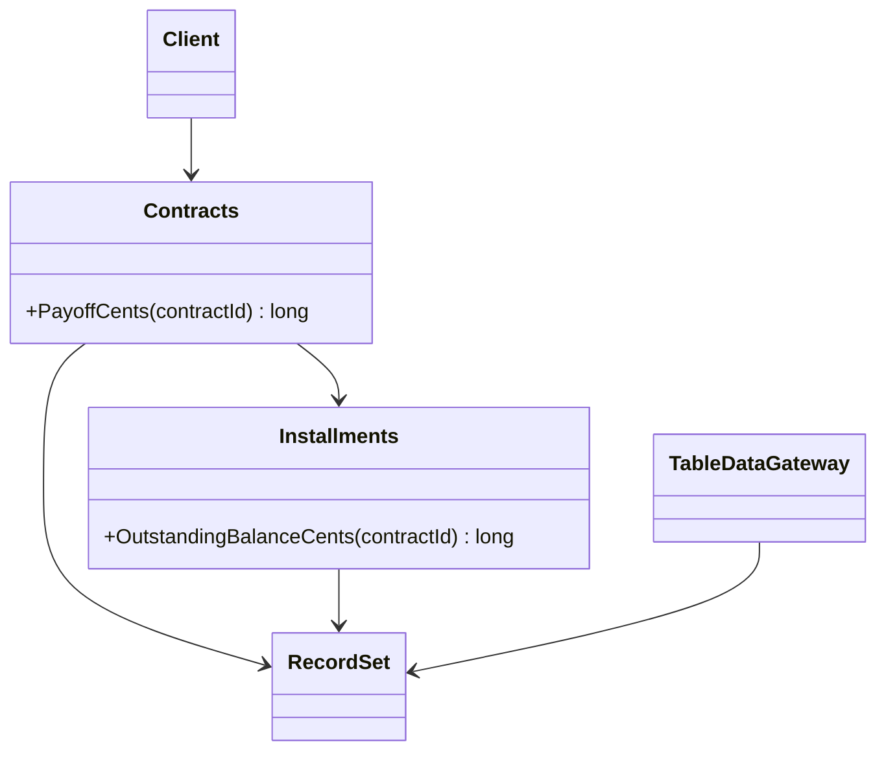

# Table Module

## Descrição

O Table Module é uma única instância que trata a lógica de negócio de todas as linhas de uma tabela ou view do banco de dados. Há uma classe por tabela, e seus métodos recebem ou operam sobre um conjunto de dados tabular.

Diferente do Domain Model, que cria um objeto por registro (um objeto para cada parcela), o Table Module tem um único objeto `Installments` que processa todas as parcelas. Para identificar uma linha, o cliente passa uma chave ou o método recebe o registro como argumento.

O padrão funciona muito bem com Record Set, estruturas tabulares em memória fornecidas por plataformas como .NET (DataSet), que o integram a ferramentas de interface e de acesso a dados.

## Problemas que resolve

- Evitar o custo e a complexidade do mapeamento objeto-relacional de um Domain Model.
- Organizar a lógica em um lugar previsível, em vez de espalhá-la em scripts.
- Aproveitar plataformas e ferramentas orientadas a dados tabulares.

## Quando usar

- Quando a plataforma oferece suporte forte a Record Set e a controles de interface ligados a dados.
- Lógica de complexidade moderada, organizada em torno de tabelas.
- Quando se quer mais estrutura que o Transaction Script, sem o custo de um Domain Model.

## Quando evitar

- Quando as regras exigem polimorfismo, herança e relacionamentos ricos entre entidades.
- Quando a lógica cresce e se espalha entre muitos módulos de tabelas que precisam se chamar.
- Quando o suporte a Record Set da plataforma é fraco.

## Trade-offs

| Ganho | Custo / Risco |
| --- | --- |
| Estrutura mais clara que scripts soltos | Sem polimorfismo nem identidade por objeto |
| Dispensa mapeamento objeto-relacional | Acoplado ao formato tabular dos dados |
| Integra bem com ferramentas orientadas a dados | Lógica complexa fica difícil de expressar |
| Poucas consultas e operações em lote eficientes | Difícil migrar para Domain Model depois |

- **Desempenho:** processar muitas linhas de uma vez costuma ser eficiente.
- **Testabilidade:** exige montar Record Sets em memória, mas dispensa banco.
- **Evolução:** relações entre tabelas se tornam chamadas entre módulos.

## Diagrama



Cada tabela tem um módulo (`Contracts`, `Installments`) que opera sobre um `RecordSet` carregado por um gateway de tabela.

## Exemplo

Um módulo `Installments` calcula o saldo devedor de um contrato a partir do conjunto de parcelas carregado, e o módulo `Contracts` usa esse saldo para calcular o valor de quitação antecipada (o desconto é ilustrativo).

```csharp
public class Installments
{
    private readonly DataTable table;
    public Installments(DataTable table) { this.table = table; }

    // Soma as parcelas ainda não pagas do contrato, em centavos.
    public long OutstandingBalanceCents(int contractId) =>
        table.AsEnumerable()
             .Where(r => r.Field<int>("ContractId") == contractId
                      && r.IsNull("PaidAt"))
             .Sum(r => r.Field<long>("AmountCents"));
}

public class Contracts
{
    private readonly DataTable table;
    private readonly Installments installments;
    public Contracts(DataTable table, Installments installments) { this.table = table; this.installments = installments; }

    public long PayoffCents(int contractId)
    {
        var row = table.AsEnumerable().Single(r => r.Field<int>("Id") == contractId);
        var balance = installments.OutstandingBalanceCents(contractId);
        var discount = row.Field<decimal>("EarlyPayoffDiscount");   // taxa, por exemplo 0.05m
        return (long)Math.Round(balance * (1m - discount));
    }
}
```

## Padrões relacionados

- [Transaction Script](/design/poeaa/domain-logic/transaction-script) — organiza por requisição em vez de por tabela.
- [Domain Model](/design/poeaa/domain-logic/domain-model) — um objeto por registro, em vez de um por tabela.
- [Record Set](/design/poeaa/base/record-set) — estrutura tabular em memória na qual o Table Module opera.
- [Table Data Gateway](/design/poeaa/data-source-architectural/table-data-gateway) — carrega os dados da tabela para o módulo.
- [Service Layer](/design/poeaa/domain-logic/service-layer) — pode servir de fronteira sobre os módulos.

## Referência

- [Página do padrão no catálogo do Fowler](https://martinfowler.com/eaaCatalog/tableModule.html)
- *Patterns of Enterprise Application Architecture*, Martin Fowler (Addison-Wesley, 2002)
