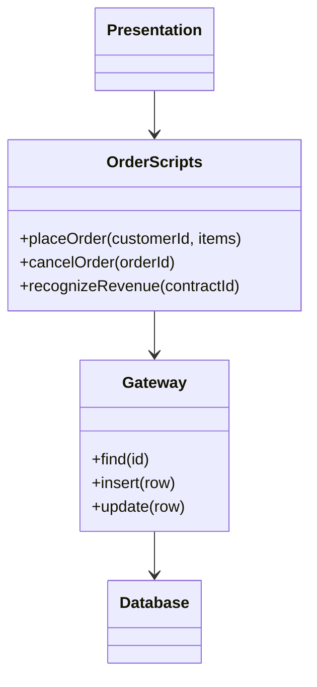

# Transaction Script

## Descrição

O Transaction Script organiza a lógica de negócio como procedimentos, com um procedimento para cada requisição vinda da camada de apresentação. Cada script recebe a entrada, valida, calcula, acessa o banco de dados (diretamente ou por um gateway fino) e devolve o resultado.

Uma aplicação corporativa pode ser vista como uma série de transações: algumas apenas exibem dados, outras os alteram. Cada transação ganha seu próprio script, que roda do começo ao fim de forma linear. Passos comuns podem ser extraídos para subprocedimentos, e vários scripts relacionados costumam ser agrupados em uma mesma classe.

É a forma mais direta de estruturar lógica de domínio e funciona bem enquanto as regras são simples. Quando a lógica cresce, a duplicação entre scripts tende a aumentar.

## Problemas que resolve

- Necessidade de implementar rapidamente casos de uso simples sem montar uma infraestrutura de objetos e mapeamento.
- Equipes sem experiência com modelagem de objetos que precisam de um estilo fácil de entender.
- Operações que se resumem a ler, calcular e gravar, onde cada requisição tem fluxo bem definido.

## Quando usar

- Lógica de negócio simples, com poucas regras e poucas interações entre elas.
- Aplicações que precisam de controle fino sobre as consultas SQL e sobre o desempenho.
- Sistemas pequenos, protótipos ou módulos de relatório e importação.

### Quando evitar

- Quando as regras são complexas e se repetem entre vários casos de uso: a duplicação entre scripts se acumula.
- Quando o domínio tem muitas variações de comportamento que se beneficiam de polimorfismo.
- Quando a aplicação deve crescer por muito tempo e a lógica espalhada em procedimentos ficará difícil de manter.

## Trade-offs

| Ganho | Custo / Risco |
| --- | --- |
| Simples de entender e de implementar | Lógica duplicada entre scripts à medida que o sistema cresce |
| Sem camada de mapeamento objeto-relacional; fácil controlar o SQL | Difícil de refatorar para um modelo mais rico depois |
| Limites de transação claros: um script, uma transação | Regras de negócio acopladas à estrutura das tabelas |
| Bom desempenho previsível | Testes dependem do banco ou de gateways simulados |

- **Complexidade:** cresce de forma não linear; o que começa simples vira um emaranhado de procedimentos.
- **Testabilidade:** boa para scripts pequenos, mas depende da separação entre lógica e acesso a dados.
- **Evolução:** a migração para Domain Model costuma ser custosa.

## Diagrama



A camada de apresentação chama um script por requisição. Os scripts, agrupados em `OrderScripts`, usam um gateway fino para acessar o `Database`.

## Exemplo

Um sistema de pedidos precisa calcular o total com desconto e gravar o pedido. Um único procedimento faz todo o trabalho.

```python
class OrderScripts:
    def __init__(self, db):
        self.db = db

    def place_order(self, customer_id: int, items: list[dict]) -> int:
        with self.db.transaction():
            total = sum(i["price"] * i["qty"] for i in items)
            customer = self.db.fetch_one(
                "SELECT vip FROM customers WHERE id = %s", customer_id
            )
            if customer["vip"]:
                total *= 0.9
            order_id = self.db.insert(
                "INSERT INTO orders (customer_id, total) VALUES (%s, %s)",
                customer_id, total,
            )
            for i in items:
                self.db.insert(
                    "INSERT INTO order_items (order_id, sku, qty) VALUES (%s, %s, %s)",
                    order_id, i["sku"], i["qty"],
                )
            return order_id
```

## Padrões relacionados

- [Domain Model](/design/poeaa/domain-logic/domain-model) — alternativa para lógica complexa, com objetos que combinam dados e comportamento.
- [Table Module](/design/poeaa/domain-logic/table-module) — organiza a lógica por tabela, em vez de por requisição.
- [Service Layer](/design/poeaa/domain-logic/service-layer) — pode ser implementado com scripts de transação como fronteira da aplicação.
- [Table Data Gateway](/design/poeaa/data-source-architectural/table-data-gateway) — gateway fino frequentemente usado pelos scripts para acessar o banco.
- [Command](/coding/gof/behavioral/command) — scripts podem ser organizados como objetos de comando, um por transação.

## Referência

- [Página do padrão no catálogo do Fowler](https://martinfowler.com/eaaCatalog/transactionScript.html)
- *Patterns of Enterprise Application Architecture*, Martin Fowler (Addison-Wesley, 2002)
