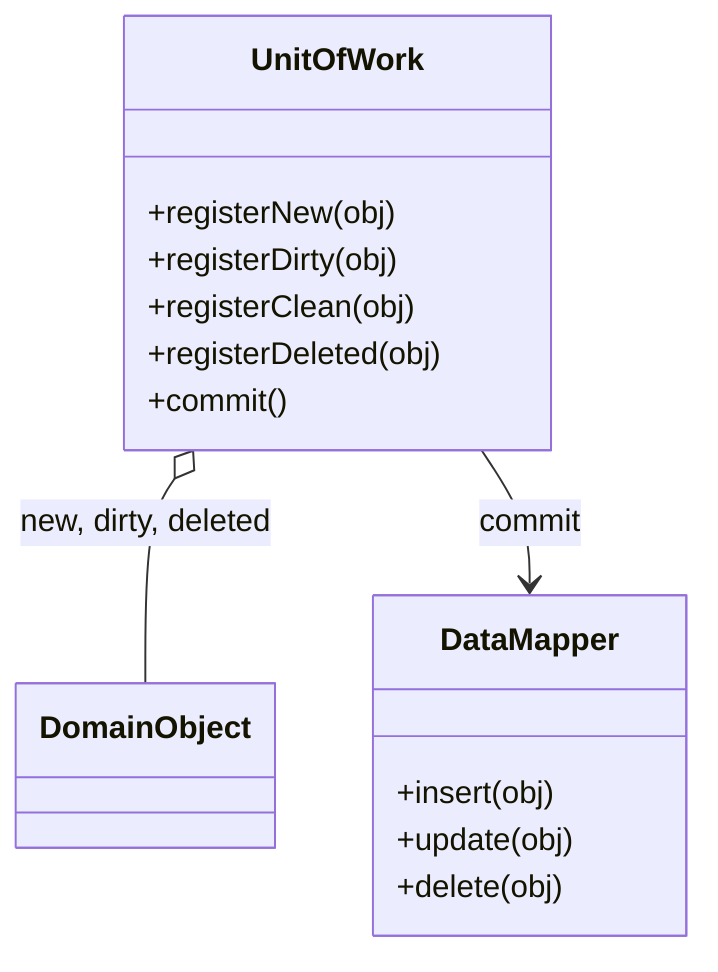

# Unit of Work

## Descrição

O Unit of Work mantém uma lista dos objetos afetados por uma transação de negócio e coordena a escrita das mudanças no banco de dados, além da resolução de problemas de concorrência. Em vez de cada alteração disparar um `INSERT`, `UPDATE` ou `DELETE` imediato, o objeto de trabalho registra o que foi criado, modificado ou removido.

Quando a transação de negócio termina, o `commit` do Unit of Work descobre o que mudou, abre uma única transação de banco, ordena as operações (respeitando chaves estrangeiras) e as executa em lote. O registro pode ser feito pelo chamador (caller registration), pelo próprio objeto (object registration) ou por comparação com um snapshot dos dados lidos (unit of work controller).

Assim, o código de domínio não precisa saber quando nem como persistir: ele apenas manipula objetos, e o Unit of Work cuida de gravar tudo de forma atômica e consistente.

## Problemas que resolve

- Gravações espalhadas pelo código, cada uma em sua própria transação, deixando o banco em estado parcial se algo falhar.
- Muitas chamadas pequenas ao banco para o mesmo objeto alterado várias vezes durante uma operação.
- Dificuldade de saber quais objetos foram alterados e precisam ser gravados.
- Ordem incorreta de gravações que viola restrições de integridade referencial.

## Quando usar

- Quando uma operação de negócio altera vários objetos que devem ser persistidos juntos.
- Quando se usa um Data Mapper ou um domain model e se quer isolar a lógica de persistência.
- Quando se quer reduzir o número de idas ao banco agrupando escritas.

### Quando evitar

- Em aplicações simples com Transaction Script ou Active Record, em que cada operação grava um único registro.
- Quando o framework já fornece o padrão e a camada própria só duplicaria o trabalho.
- Em fluxos que exigem gravação imediata e visível a outros processos antes do fim da operação.

## Trade-offs

| Ganho | Custo / Risco |
| --- | --- |
| Gravação atômica e consistente das mudanças | Mais complexidade para rastrear estado dos objetos |
| Menos chamadas ao banco, com escritas em lote | Mudanças ficam pendentes na memória até o commit |
| Persistência centralizada, fora da lógica de domínio | Unit of Work de vida longa pode crescer e consumir memória |
| Ordenação de operações respeitando integridade referencial | Erros só aparecem no commit, longe do ponto da alteração |

- **Concorrência:** é o ponto natural para aplicar Optimistic Offline Lock na hora de gravar.
- **Testabilidade:** a lógica de domínio pode ser testada sem banco; o Unit of Work pode ser substituído por um dublê.
- **Escopo:** normalmente vive por requisição ou por transação de negócio.

## Diagrama



O `UnitOfWork` guarda as listas de objetos novos, alterados e removidos. No `commit()`, ele delega a gravação de cada um ao `DataMapper` correspondente, dentro de uma única transação.

## Exemplo

Uma transferência bancária altera duas contas e cria um lançamento. O Unit of Work grava tudo em uma só transação ao final.

```python
class UnitOfWork:
    def __init__(self, mappers, connection):
        self.mappers, self.conn = mappers, connection
        self.new, self.dirty, self.deleted = [], [], []

    def register_new(self, obj): self.new.append(obj)
    def register_dirty(self, obj):
        if obj not in self.dirty and obj not in self.new:
            self.dirty.append(obj)
    def register_deleted(self, obj): self.deleted.append(obj)

    def commit(self):
        with self.conn.transaction():
            for o in self.new:     self.mappers[type(o)].insert(o)
            for o in self.dirty:   self.mappers[type(o)].update(o)
            for o in self.deleted: self.mappers[type(o)].delete(o)

uow = UnitOfWork(mappers, conn)
src.withdraw(100); uow.register_dirty(src)
dst.deposit(100);  uow.register_dirty(dst)
uow.register_new(Entry(src, dst, 100))
uow.commit()
```

O Hibernate `Session` e o Entity Framework `DbContext` (`SaveChanges`) são implementações prontas do padrão.

## Padrões relacionados

- [Identity Map](/design/poeaa/object-relational-behavioral/identity-map) — normalmente andam juntos: o Unit of Work usa o mapa para saber quais objetos já foram carregados.
- [Lazy Load](/design/poeaa/object-relational-behavioral/lazy-load) — carregamento sob demanda opera dentro do escopo do Unit of Work.
- [Data Mapper](/design/poeaa/data-source-architectural/data-mapper) — executa as gravações que o Unit of Work coordena.
- [Repository](/design/poeaa/object-relational-metadata-mapping/repository) — costuma ser a porta de entrada que registra objetos no Unit of Work.
- [Optimistic Offline Lock](/design/poeaa/offline-concurrency/optimistic-offline-lock) — verificado no commit para detectar conflitos.

## Referência

- [Página do padrão no catálogo do Fowler](https://martinfowler.com/eaaCatalog/unitOfWork.html)
- *Patterns of Enterprise Application Architecture*, Martin Fowler (Addison-Wesley, 2002)
- [Unit of work na Wikipedia](https://en.wikipedia.org/wiki/Unit_of_work)
