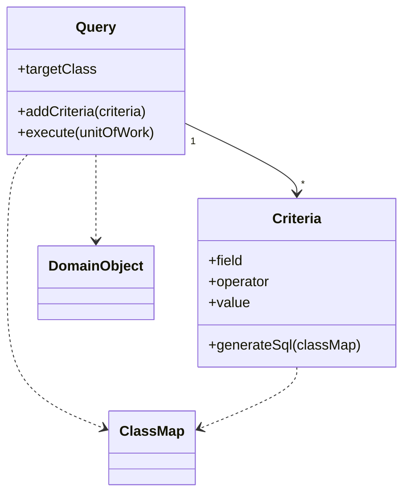

# Query Object

## Descrição

O Query Object é um objeto que representa uma consulta ao banco de dados. Em vez de escrever SQL, o desenvolvedor monta a consulta em termos de classes e campos do domínio, combinando critérios, ordenação e junções como objetos.

Na prática, é uma aplicação do padrão Interpreter: um conjunto de objetos capaz de se transformar em uma instrução SQL. Os metadados do mapeamento traduzem classes e campos em tabelas e colunas, de modo que quem escreve a consulta não precisa conhecer o esquema, e mudanças nele ficam confinadas a um só lugar.

## Problemas que resolve

- SQL é complexo e nem todo desenvolvedor o domina.
- Consultas escritas em SQL exigem conhecimento do esquema e o espalham pelo código.
- Métodos de busca especializados escondem o SQL, mas dificultam consultas ad hoc e duplicam SQL quando o esquema muda.

## Quando usar

- Quando a aplicação precisa de consultas flexíveis e dinâmicas, montadas em tempo de execução.
- Quando se quer isolar o código do esquema físico do banco.
- Quando há muitos filtros combináveis (telas de busca e relatórios).

## Quando evitar

- Quando as consultas são poucas e fixas; métodos de busca simples bastam.
- Quando a consulta é complexa e otimizada por mão, e a abstração atrapalharia o ajuste de desempenho.
- Quando construir o Query Object do zero custa mais que usar um já existente em um ORM.

## Trade-offs

| Ganho | Custo / Risco |
| --- | --- |
| Consultas expressas no vocabulário do domínio | Abstração vaza em consultas complexas |
| Mudanças de esquema ficam isoladas | Construir um bom Query Object é trabalhoso |
| Consultas dinâmicas e combináveis | SQL gerado pode ser ineficiente |
| Reaproveitamento de critérios | Mais difícil de depurar que SQL direto |

- **Acoplamento:** o código cliente depende do modelo de objetos, não do esquema.
- **Testabilidade:** critérios podem ser verificados sem banco, inspecionando o objeto de consulta.
- **Complexidade:** cresce rápido se a linguagem de consulta tenta cobrir todo o SQL.

## Diagrama



O `Query` agrega vários `Criteria`. Ao executar, usa o `ClassMap` do mapeamento para traduzir campos em colunas, gerar o SQL e devolver objetos de domínio.

## Exemplo

Uma tela de busca de pedidos filtra por cliente e por valor mínimo, com filtros opcionais. A Criteria API do JPA monta a consulta com tipos, sem escrever SQL.

```java
CriteriaBuilder cb = em.getCriteriaBuilder();
CriteriaQuery<Order> q = cb.createQuery(Order.class);
Root<Order> o = q.from(Order.class);

List<Predicate> filters = new ArrayList<>();
if (customerId != null) {
    filters.add(cb.equal(o.get("customer").get("id"), customerId));
}
if (minTotal != null) {
    filters.add(cb.greaterThanOrEqualTo(o.get("total"), minTotal));
}

q.select(o)
 .where(filters.toArray(new Predicate[0]))
 .orderBy(cb.desc(o.get("createdAt")));

List<Order> result = em.createQuery(q).getResultList();
```

LINQ no Entity Framework e o Specification em Spring Data seguem a mesma ideia.

## Padrões relacionados

- [Interpreter](/coding/gof/behavioral/interpreter) — o Query Object é um Interpreter cuja saída é SQL.
- [Metadata Mapping](/design/poeaa/object-relational-metadata-mapping/metadata-mapping) — fornece o mapeamento de classes e campos para tabelas e colunas.
- [Repository](/design/poeaa/object-relational-metadata-mapping/repository) — aceita Query Objects como forma de descrever consultas declarativas.
- [Data Mapper](/design/poeaa/data-source-architectural/data-mapper) — executa a consulta e materializa os objetos.
- [Unit of Work](/design/poeaa/object-relational-behavioral/unit-of-work) — objetos carregados pela consulta são registrados nele.

## Referência

- [Página do padrão no catálogo do Fowler](https://martinfowler.com/eaaCatalog/queryObject.html)
- *Patterns of Enterprise Application Architecture*, Martin Fowler (Addison-Wesley, 2002)
