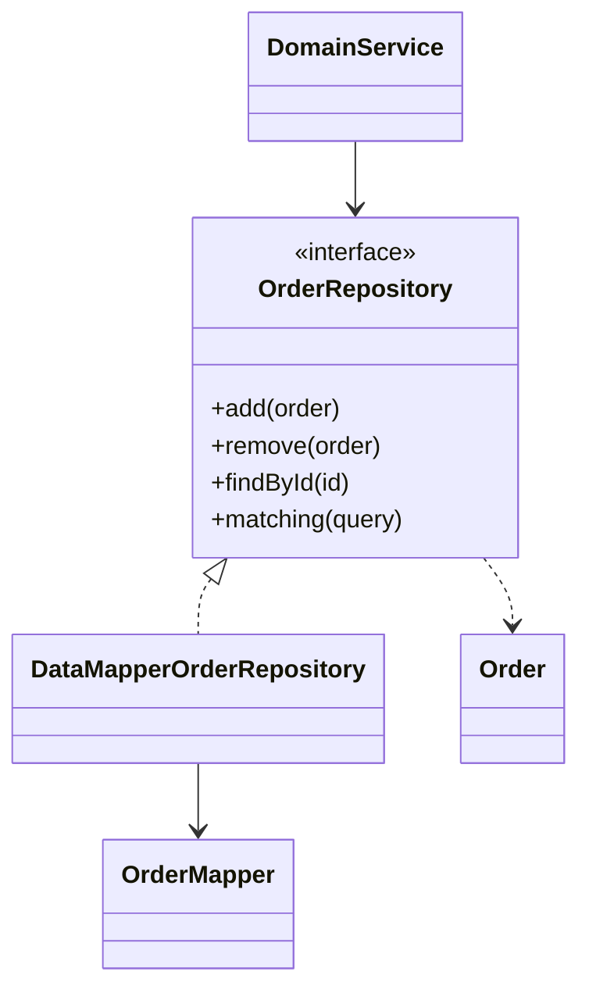

# Repository

## Descrição

O Repository fica entre o domínio e a camada de mapeamento de dados e apresenta os objetos persistidos por meio de uma interface semelhante à de uma coleção em memória. O cliente adiciona, remove e busca objetos como faria em uma lista, sem saber como ou onde eles são armazenados.

Internamente, o Repository delega o trabalho a um [Data Mapper](/design/poeaa/data-source-architectural/data-mapper) e a Query Objects. Isso concentra a lógica de consulta em um só lugar e faz a dependência apontar do domínio para a camada de dados, não o contrário.

No DDD (Domain-Driven Design), Evans define o Repository como o mecanismo que dá a ilusão de uma coleção em memória de todos os objetos de um certo tipo. Há um Repository por [Aggregate](/design/ddd/building-blocks/aggregate) root: os objetos internos do agregado são acessados pela raiz, e o cliente não deve consultá-los diretamente. A interface é expressa na linguagem do domínio, e a criação de novos objetos fica com a [Factory](/design/ddd/building-blocks/factory), enquanto o Repository cuida de armazenar e recuperar objetos existentes.

## Problemas que resolve

- Código de domínio contaminado por detalhes de consulta e persistência.
- Lógica de consulta duplicada em vários pontos da aplicação.
- Dificuldade de testar o domínio sem banco de dados.
- Domínio acoplado à tecnologia de acesso a dados.

## Quando usar

- Quando o modelo de domínio é complexo e há muitas classes e consultas.
- Quando se quer um limite claro entre o domínio e a infraestrutura de persistência.
- Quando é desejável trocar o armazenamento por uma versão em memória nos testes.

## Quando evitar

- Em sistemas simples ou CRUD, onde a camada extra não compensa.
- Quando o ORM já oferece a abstração e o Repository só repetiria seus métodos.
- Quando o Repository vira um depósito genérico de métodos de consulta, difícil de manter.

## Trade-offs

| Ganho | Custo / Risco |
| --- | --- |
| Domínio independente da persistência | Mais uma camada para manter |
| Lógica de consulta centralizada | Pode duplicar a abstração do ORM |
| Fácil substituição por dublê em testes | Risco de crescer com métodos de consulta específicos demais |
| Interface orientada a objetos e à coleção | Abstração pode esconder custos (N+1, carga excessiva) |

- **Acoplamento:** o domínio depende apenas da interface do Repository.
- **Testabilidade:** uma implementação em memória permite testes rápidos do domínio.
- **Consistência:** a gravação em si costuma ser coordenada por um [Unit of Work](/design/poeaa/object-relational-behavioral/unit-of-work).

## Diagrama



O `DomainService` usa apenas a interface `OrderRepository`. A implementação delega ao `OrderMapper` e devolve objetos `Order`.

## Exemplo

Um serviço de pedidos precisa buscar e salvar pedidos sem conhecer o banco. O Spring Data gera a implementação a partir da interface.

```java
public interface OrderRepository extends JpaRepository<Order, Long> {
    List<Order> findByCustomerIdAndStatus(Long customerId, Status status);
}

@Service
public class OrderService {
    private final OrderRepository orders;

    public OrderService(OrderRepository orders) {
        this.orders = orders;
    }

    public void cancel(Long id) {
        Order order = orders.findById(id).orElseThrow();
        order.cancel();
        orders.save(order);
    }
}
```

Nos testes, basta uma implementação em memória da interface.

## Padrões relacionados

- [Data Mapper](/design/poeaa/data-source-architectural/data-mapper) — o Repository fica sobre ele e usa-o para persistir os objetos.
- [Query Object](/design/poeaa/object-relational-metadata-mapping/query-object) — usado para expressar consultas declarativas enviadas ao Repository.
- [Metadata Mapping](/design/poeaa/object-relational-metadata-mapping/metadata-mapping) — fornece o mapeamento usado pela implementação.
- [Unit of Work](/design/poeaa/object-relational-behavioral/unit-of-work) — registra as alterações feitas nos objetos obtidos pelo Repository.
- [Identity Map](/design/poeaa/object-relational-behavioral/identity-map) — garante que o Repository devolva a mesma instância para a mesma identidade.
- [Aggregate](/design/ddd/building-blocks/aggregate) — o Repository trabalha por raiz de agregado.
- [Factory](/design/ddd/building-blocks/factory) — cria os objetos novos, enquanto o Repository recupera os existentes.
- [Domain Model](/design/poeaa/domain-logic/domain-model) — o modelo de domínio acessa a persistência por meio do Repository.

## Referência

- [DDD Reference, Eric Evans (2015)](https://www.domainlanguage.com/ddd/reference/)
- [Página do padrão no catálogo do Fowler](https://martinfowler.com/eaaCatalog/repository.html)
- *Patterns of Enterprise Application Architecture*, Martin Fowler (Addison-Wesley, 2002)
