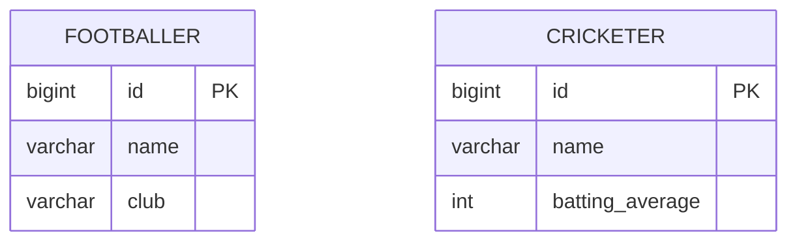

# Concrete Table Inheritance

## Descrição

O Concrete Table Inheritance representa uma hierarquia com uma tabela por classe concreta. Cada tabela contém todos os campos da classe, inclusive os herdados, e a superclasse abstrata não tem tabela.

Carregar um objeto lê uma única tabela, sem joins. Em contrapartida, os campos herdados se repetem em cada tabela, e consultas polimórficas (sobre a superclasse) exigem ler várias tabelas, em geral com `UNION`.

As chaves precisam ser únicas ao longo de todas as tabelas, caso contrário referências para a superclasse ficam ambíguas.

## Problemas que resolve

- Evitar joins ao carregar objetos de uma hierarquia.
- Manter cada tabela independente e autocontida.

## Quando usar

- Quando consultas quase sempre acessam um único tipo concreto.
- Quando os dados de cada subtipo são tratados de forma independente.
- Quando se quer `NOT NULL` por tipo sem joins.

## Quando evitar

- Quando há muitas consultas polimórficas ou referências à superclasse.
- Quando os campos da superclasse mudam com frequência (a mudança vale para todas as tabelas).

## Trade-offs

| Ganho | Custo / Risco |
| --- | --- |
| Sem joins para um tipo concreto | Colunas herdadas duplicadas em cada tabela |
| Cada tabela é autocontida | Consultas polimórficas exigem `UNION` |
| Sem colunas nulas por herança | Não há chave estrangeira para a superclasse |

- **Consistência:** exige chaves únicas entre as tabelas, por sequence compartilhada ou UUID.
- **Evolução:** mudar um campo da superclasse altera todas as tabelas concretas.

## Diagrama



Cada tabela repete `id` e `name`, herdados de `Player`, e acrescenta os campos próprios; não existe tabela `PLAYER`.

## Exemplo

Um mapeamento JPA com tabela por classe concreta.

```java
@Entity
@Inheritance(strategy = InheritanceType.TABLE_PER_CLASS)
public abstract class Player {
    @Id
    @GeneratedValue(strategy = GenerationType.SEQUENCE)
    private Long id;
    private String name;
}

@Entity
public class Footballer extends Player {
    private String club;
}
```

A `SEQUENCE` compartilhada garante chaves únicas entre as tabelas. No EF Core, é o Table-per-Concrete-type (TPC).

## Padrões relacionados

- [Single Table Inheritance](/design/poeaa/object-relational-structural/single-table-inheritance) — alternativa com uma tabela para toda a hierarquia.
- [Class Table Inheritance](/design/poeaa/object-relational-structural/class-table-inheritance) — alternativa com uma tabela por classe, com joins.
- [Inheritance Mappers](/design/poeaa/object-relational-structural/inheritance-mappers) — organiza os mapeadores da hierarquia.
- [Identity Field](/design/poeaa/object-relational-structural/identity-field) — precisa de unicidade entre as tabelas.

## Referência

- [Página do padrão no catálogo do Fowler](https://martinfowler.com/eaaCatalog/concreteTableInheritance.html)
- *Patterns of Enterprise Application Architecture*, Martin Fowler (Addison-Wesley, 2002)
