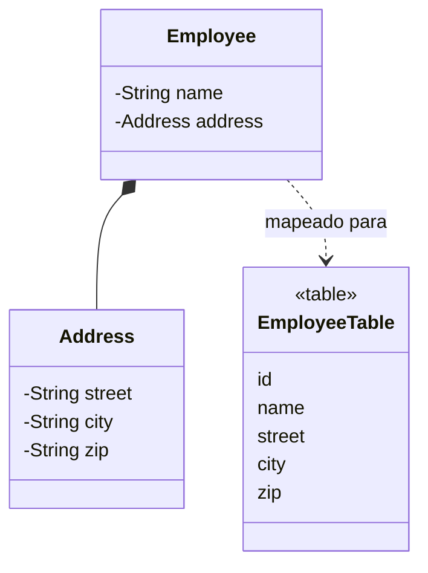

# Embedded Value

## Descrição

O Embedded Value mapeia um objeto para vários campos da tabela de outro objeto. Muitos objetos pequenos, como dinheiro, intervalo de datas ou endereço, não têm sentido como tabelas próprias: são apenas valores do objeto que os contém.

Em vez de criar uma tabela e uma chave estrangeira, as propriedades do objeto menor viram colunas da tabela do dono. Ao carregar, o mapeador monta o objeto de valor a partir dessas colunas; ao salvar, copia os valores de volta.

Costuma ser usado com Value Object, Money e outros tipos sem identidade.

## Problemas que resolve

- Evitar uma tabela e um join para objetos de valor pequenos.
- Manter o modelo de domínio expressivo (tipos ricos) sem complicar o esquema.

## Quando usar

- Para Value Objects com poucos campos, como `Money`, `Address` ou `DateRange`.
- Quando o objeto de valor pertence a um único dono.

### Quando evitar

- Quando o objeto tem identidade própria ou é compartilhado entre donos.
- Quando é preciso consultar ou indexar o objeto de forma independente do dono.

## Trade-offs

| Ganho | Custo / Risco |
| --- | --- |
| Sem joins; leitura em uma única consulta | Colunas extras na tabela do dono |
| Modelo de domínio com tipos ricos | Consultar o valor isoladamente é difícil |
| Esquema simples | Reutilizar o mesmo tipo em vários donos duplica colunas |

- **Desempenho:** uma única linha traz tudo.
- **Consistência:** o valor é gravado junto com o dono, de forma atômica.

## Diagrama



`Address` não tem tabela: seus campos viram colunas de `EmployeeTable`.

## Exemplo

Um `Employee` tem um `Address` embutido; as colunas ficam na tabela do funcionário.

```java
@Embeddable
public class Address {
    private String street;
    private String city;
    private String zip;
}

@Entity
public class Employee {
    @Id @GeneratedValue
    private Long id;
    private String name;

    @Embedded
    private Address address;
}
```

No EF Core, o equivalente é `OwnsOne`.

## Padrões relacionados

- [Value Object](/design/poeaa/base/value-object) — o tipo de objeto que costuma ser embutido.
- [Money](/design/poeaa/base/money) — exemplo clássico de objeto de valor embutido.
- [Serialized LOB](/design/poeaa/object-relational-structural/serialized-lob) — alternativa quando o grupo é maior ou menos estruturado.
- [Dependent Mapping](/design/poeaa/object-relational-structural/dependent-mapping) — para dependentes que precisam de tabela própria.
- [Identity Field](/design/poeaa/object-relational-structural/identity-field) — não é necessário para o objeto embutido.

## Referência

- [Página do padrão no catálogo do Fowler](https://martinfowler.com/eaaCatalog/embeddedValue.html)
- *Patterns of Enterprise Application Architecture*, Martin Fowler (Addison-Wesley, 2002)
