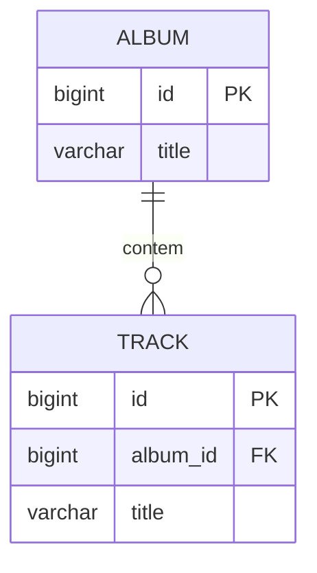

# Foreign Key Mapping

## Descrição

O Foreign Key Mapping mapeia uma associação entre objetos para uma chave estrangeira entre tabelas. Em memória, objetos se referenciam por ponteiros; no banco, linhas se relacionam por chaves. O padrão converte uma coisa na outra usando o Identity Field do objeto referenciado.

Ao carregar um objeto, o mapeador lê a chave estrangeira e busca (ou obtém do Identity Map) o objeto referenciado. Ao salvar, grava no campo de chave estrangeira o identificador do objeto referenciado. Para coleções (um-para-muitos), a chave estrangeira fica na tabela do lado "muitos", e o objeto "um" guarda a coleção.

A carga do objeto referenciado costuma ser adiada com Lazy Load, para evitar carregar grafos inteiros.

## Problemas que resolve

- Persistir referências entre objetos de domínio em um esquema relacional.
- Carregar e navegar associações um-para-um e um-para-muitos.
- Manter a integridade referencial entre tabelas.

## Quando usar

- Em associações de um-para-um, muitos-para-um e um-para-muitos entre entidades.
- Quando as entidades têm identidade própria e ciclo de vida independente.

## Quando evitar

- Em associações muitos-para-muitos: use Association Table Mapping.
- Quando o filho é dependente exclusivo do pai: considere Dependent Mapping.

## Trade-offs

| Ganho | Custo / Risco |
| --- | --- |
| Mapeamento direto e natural no modelo relacional | Associações bidirecionais exigem sincronização dos dois lados |
| Integridade referencial garantida pelo banco | Carregar o grafo pode gerar muitas consultas (problema N+1) |
| Simples de entender e de consultar | Atualizar coleções pode exigir comparar estado antigo e novo |

- **Consistência:** restrições de chave estrangeira impedem referências órfãs.
- **Desempenho:** use Lazy Load ou joins para controlar o número de consultas.

## Diagrama



Cada `TRACK` guarda `album_id`, a chave estrangeira que aponta para o `ALBUM` ao qual pertence.

## Exemplo

Um `Order` pertence a um `Customer`. A coluna `customer_id` guarda a referência.

```java
@Entity
public class Order {
    @Id @GeneratedValue
    private Long id;

    @ManyToOne(fetch = FetchType.LAZY)
    @JoinColumn(name = "customer_id")
    private Customer customer;
}
```

```sql
CREATE TABLE orders (
  id BIGINT PRIMARY KEY,
  customer_id BIGINT NOT NULL REFERENCES customer(id)
);
```

## Padrões relacionados

- [Identity Field](/design/poeaa/object-relational-structural/identity-field) — fornece a chave que a chave estrangeira referencia.
- [Association Table Mapping](/design/poeaa/object-relational-structural/association-table-mapping) — usado quando a associação é muitos-para-muitos.
- [Dependent Mapping](/design/poeaa/object-relational-structural/dependent-mapping) — alternativa quando o filho depende totalmente do pai.
- [Lazy Load](/design/poeaa/object-relational-behavioral/lazy-load) — adia a carga do objeto referenciado.
- [Identity Map](/design/poeaa/object-relational-behavioral/identity-map) — garante um único objeto por linha ao resolver a referência.

## Referência

- [Página do padrão no catálogo do Fowler](https://martinfowler.com/eaaCatalog/foreignKeyMapping.html)
- *Patterns of Enterprise Application Architecture*, Martin Fowler (Addison-Wesley, 2002)
