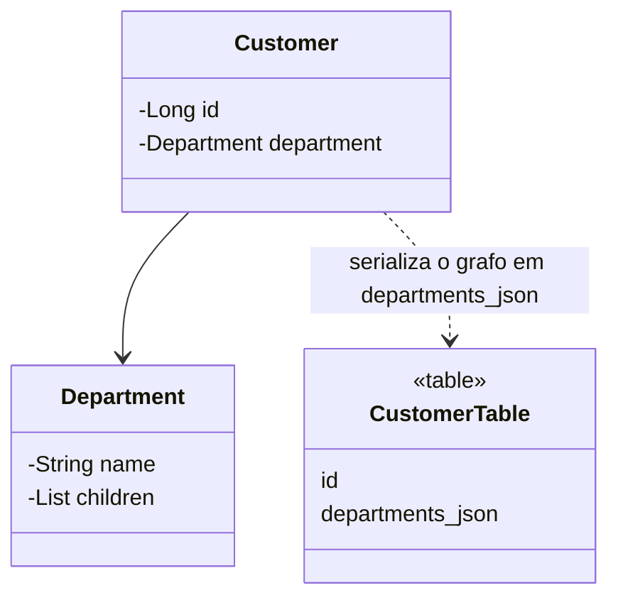

# Serialized LOB

## Descrição

O Serialized LOB salva um grafo de objetos serializando-o e gravando o resultado em um campo grande (LOB) de uma única coluna. O LOB pode ser binário (BLOB) ou de texto (CLOB), em formatos como JSON, XML ou binário.

Em vez de mapear cada objeto do grafo para tabelas e chaves estrangeiras, o mapeador transforma o grafo inteiro em um documento e o grava como um valor opaco. Ao ler, desserializa tudo de uma vez.

É simples e rápido para grafos pequenos que são sempre lidos e escritos juntos, mas esconde a estrutura do banco: o SQL não consegue consultar o interior do LOB (a menos que o banco ofereça tipos como JSON/JSONB).

## Problemas que resolve

- Persistir hierarquias ou grafos complexos sem criar muitas tabelas.
- Armazenar dados de estrutura variável ou configurações aninhadas.

## Quando usar

- Quando o grafo é lido e gravado sempre como unidade.
- Quando não é preciso consultar ou filtrar pelo conteúdo interno.
- Para dados de estrutura flexível, como preferências ou metadados.

### Quando evitar

- Quando outros sistemas ou relatórios SQL precisam acessar os dados internos.
- Quando o formato tende a mudar e quebrar a leitura de dados antigos.
- Quando partes do grafo precisam de integridade referencial.

## Trade-offs

| Ganho | Custo / Risco |
| --- | --- |
| Mapeamento muito simples | Sem consulta SQL sobre o conteúdo |
| Uma leitura e uma gravação por grafo | Evolução do formato pode quebrar dados antigos |
| Sem joins | Sem integridade referencial nem relatórios fáceis |

- **Desempenho:** bom para leitura em bloco; ruim se só parte do grafo é necessária.
- **Consistência:** o grafo é gravado atomicamente, mas o banco não valida a estrutura.
- **Atualização parcial:** qualquer mudança regrava o LOB inteiro.

## Diagrama



O grafo de `Department` é serializado em uma única coluna `departments_json` de `CustomerTable`.

## Exemplo

Um cliente tem uma hierarquia de departamentos, sempre lida inteira. Ela é guardada como JSON.

```sql
CREATE TABLE customer (
  id BIGINT PRIMARY KEY,
  name VARCHAR(100),
  departments JSONB
);
```

```java
@Entity
public class Customer {
    @Id @GeneratedValue
    private Long id;

    @JdbcTypeCode(SqlTypes.JSON)
    private DepartmentTree departments;
}
```

## Padrões relacionados

- [Embedded Value](/design/poeaa/object-relational-structural/embedded-value) — alternativa para grupos pequenos e estruturados que ainda precisam ser colunas.
- [Dependent Mapping](/design/poeaa/object-relational-structural/dependent-mapping) — alternativa quando os filhos precisam ser tabelas.
- [Foreign Key Mapping](/design/poeaa/object-relational-structural/foreign-key-mapping) — o mapeamento relacional tradicional que o LOB evita.
- [Data Transfer Object](/design/poeaa/distribution/data-transfer-object) — também serializa um grafo de objetos, mas para transporte.

## Referência

- [Página do padrão no catálogo do Fowler](https://martinfowler.com/eaaCatalog/serializedLOB.html)
- *Patterns of Enterprise Application Architecture*, Martin Fowler (Addison-Wesley, 2002)
