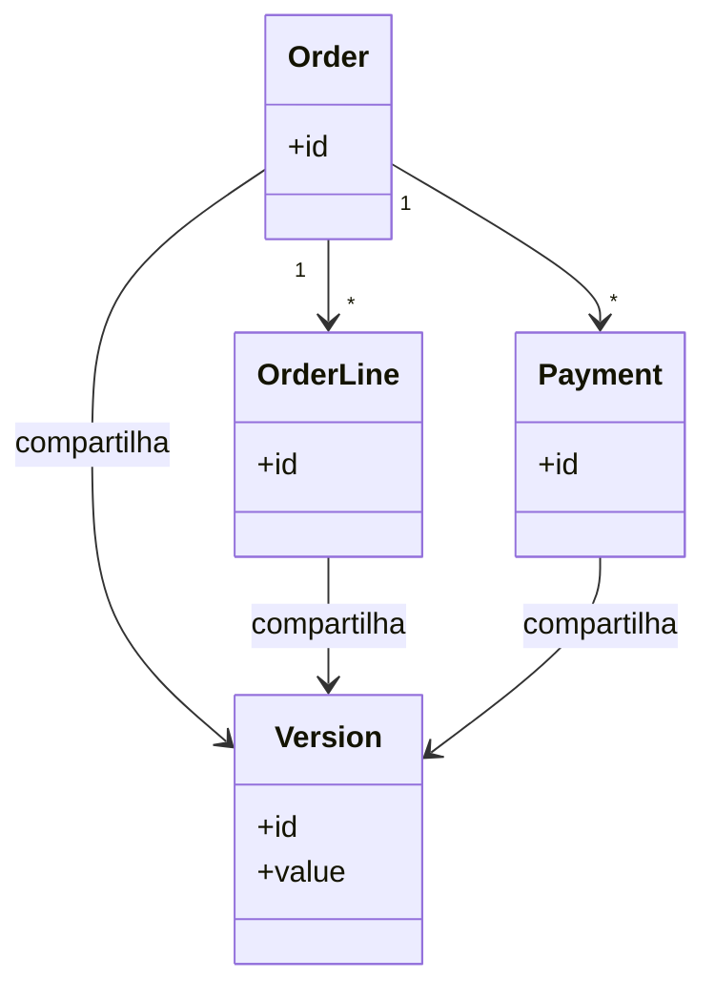

# Coarse-Grained Lock

## Descrição

O Coarse-Grained Lock bloqueia um conjunto de objetos relacionados com um único bloqueio. Em vez de adquirir um bloqueio para cada objeto de um agregado (por exemplo, o pedido e todos os seus itens), a aplicação protege o grupo inteiro por meio de um ponto único, normalmente a raiz do agregado.

Para o bloqueio otimista, isso costuma ser feito com um objeto de versão compartilhado: todos os membros do grupo referenciam o mesmo número de versão, e alterar qualquer um incrementa essa versão. Para o bloqueio pessimista, o bloqueio da raiz implica o bloqueio de todo o grupo. Uma variação é o Root Lock, em que cada objeto filho navega até a raiz para obter o bloqueio.

O padrão alinha a granularidade do bloqueio com a fronteira de consistência do modelo, reduzindo o número de bloqueios e eliminando a chance de bloquear só parte de um agregado.

## Problemas que resolve

- Adquirir e gerenciar muitos bloqueios individuais é custoso e propenso a erros.
- Bloquear apenas parte de um agregado deixa o grupo em estado inconsistente (ex.: um item alterado por outro enquanto o pedido é recalculado).
- Esquecer de bloquear algum membro do grupo quebra a invariante do agregado.

## Quando usar

- Quando objetos são sempre editados juntos, como um agregado ou um conjunto de entidades com invariantes comuns.
- Quando o custo de gerenciar bloqueios por objeto é alto.
- Em conjunto com Optimistic ou Pessimistic Offline Lock para alinhar o bloqueio ao agregado.

## Quando evitar

- Quando objetos do grupo são editados com frequência de forma independente; o bloqueio grosso gera contenção desnecessária.
- Quando o grupo é muito grande, e bloqueá-lo inteiro impede trabalho paralelo legítimo.
- Quando não há fronteira clara de agregado no modelo.

## Trade-offs

| Ganho | Custo / Risco |
| --- | --- |
| Um único bloqueio protege todo o grupo | Reduz concorrência: edições independentes passam a conflitar |
| Preserva invariantes do agregado | Fronteira mal definida gera contenção ou lacunas de proteção |
| Menos bloqueios para adquirir e liberar | Exige que todos os membros apontem para a raiz ou versão compartilhada |
| Código de aplicação mais simples | Atualizações em filhos precisam incrementar a versão da raiz |

- **Consistência:** a granularidade do bloqueio coincide com a fronteira transacional do agregado.
- **Desempenho:** menos bloqueios por operação, porém maior chance de conflito.
- **Modelagem:** reforça a disciplina de definir agregados claros.

## Diagrama



`Order`, `OrderLine` e `Payment` referenciam o mesmo objeto `Version`. Qualquer alteração em um deles incrementa essa versão, e o conflito é detectado para o grupo todo.

## Exemplo

Em um pedido com itens, alterar um item enquanto outra pessoa altera o total deve conflitar. Todos usam a versão da raiz `Order`.

```sql
-- Itens e pedido compartilham a versao do pedido
UPDATE order_line SET qty = 5 WHERE id = 3;

UPDATE orders
   SET version = version + 1
 WHERE id = 10 AND version = 4;  -- 0 linhas => conflito no agregado
```

```java
@Entity
class Order {
    @Version long version;

    @OneToMany(cascade = CascadeType.ALL)
    List<OrderLine> lines;
}

// Em JPA, a versao da raiz pode ser incrementada ao alterar filhos:
// entityManager.lock(order, LockModeType.OPTIMISTIC_FORCE_INCREMENT);
```

## Padrões relacionados

- [Optimistic Offline Lock](/design/poeaa/offline-concurrency/optimistic-offline-lock) — o Coarse-Grained Lock costuma ser implementado como uma versão compartilhada pelo grupo.
- [Pessimistic Offline Lock](/design/poeaa/offline-concurrency/pessimistic-offline-lock) — o bloqueio da raiz implica o bloqueio de todo o grupo.
- [Implicit Lock](/design/poeaa/offline-concurrency/implicit-lock) — automatiza a obtenção do bloqueio do grupo.
- [Unit of Work](/design/poeaa/object-relational-behavioral/unit-of-work) — responsável por gravar o grupo de objetos alterados e incrementar a versão compartilhada.
- [Layer Supertype](/design/poeaa/base/layer-supertype) — hospeda a lógica comum de acesso à raiz ou à versão compartilhada.

## Referência

- [Página do padrão no catálogo do Fowler](https://martinfowler.com/eaaCatalog/coarseGrainedLock.html)
- *Patterns of Enterprise Application Architecture*, Martin Fowler (Addison-Wesley, 2002)
